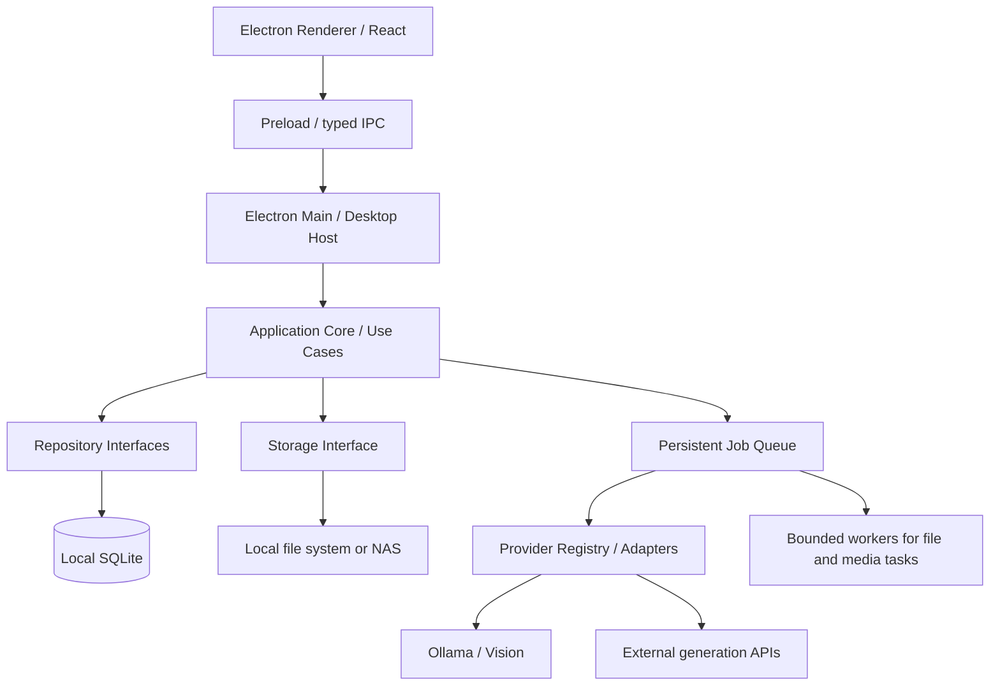

# AssetForge

**Local-first Digital Asset Management & AI Creation Studio**

> Working title · Technical target architecture and development baseline · Phases 1 to 4a implemented (§17)

AssetForge is a desktop application for organizing, creating and processing digital assets. It combines cross-project digital asset management with prompt management, AI-assisted image analysis, image generation and, prospectively, 3D generation.

The focus is on the asset as a domain object, not on a single file or a specific AI model. All related references, drafts, generated images, models, textures, prompts and work steps should be traceable in one place. External generators and analysis models are connected through interchangeable providers.

## 1. Goals and Architecture Principles

- **Local first:** Basic asset, project and prompt management works without the cloud, external AI services or a running database server.
- **Server ready:** Services and persistence are separated so that a central server with multiple clients can be added later.
- **Provider independence:** Image generation, image editing, analysis and 3D generation are not tied to a single vendor.
- **Cross-project assets:** An asset can be used in any number of projects without duplicating files.
- **Open file structure:** Files remain accessible in the file system and can be used with Blender, image editors and other tools.
- **Traceability:** Generations, changes, sources, versions and work states are documented.
- **Resource efficiency:** Large files are streamed, previews are loaded on demand and compute-intensive tasks run in the background with limits.
- **Docker-based server development:** All server components required for a development mode run locally via Docker Compose. The Electron UI runs natively on the host.

The first version is designed for single-user operation. Multi-user operation, central authentication and full synchronization are extensions, not prerequisites for the first runnable version.

## 2. Application Modules

| Module | Purpose |
| --- | --- |
| Workspace | Opening, creating, configuring and backing up a data set |
| Projects | Projects, project assignments, priorities and progress |
| Assets | Central management of typed assets and their relations |
| Library | File import, references, gallery, preview and search |
| Workflows | Configurable production steps and work history |
| Prompts | Reusable, versioned prompts and templates |
| Studio | Image generation, image editing and result management |
| AI Analysis | Automatic image description, classification and batch tagging |
| Providers | Configuration of interchangeable AI and generation services |
| Jobs | Background tasks, queues, progress and error handling |
| Settings | Storage, resource limits, providers, integrations and backups |

The renderer presents the implemented modules in one shell; section 3.3 describes it.

## 3. Projects and Assets

### 3.1 Projects

A project is an organizational unit, for example a game, a film production or a collection.

A project has, among other things, a name, a description, a status, a preview image and a list of assigned assets. The assignment is an n:m relation. Assets remain independent and also exist without any project assignment.

Example:

```text
Gilded Hour
├── Characters
│   ├── Gabriella
│   └── Linda Carver
├── Landscapes
│   └── San Aurelio Valley
└── Buildings
    ├── Gas station
    └── Motel
```

The structure shown is a logical view, not a physical project directory structure. Another project can reference the same gas station or the same vehicle.

Project-specific data such as priority, intended use, approval status or notes is stored on the project assignment. Global asset data is not overwritten by it. Removing an assignment deletes neither the asset nor its files.

### 3.2 Assets and Asset Types

An asset represents a domain object with a stable ID, independent of the files assigned to it.

Example asset types:

| Type | Possible contents |
| --- | --- |
| Character | People, character designs, views, rigs |
| Creature | Animals, creatures, anatomy and motion references |
| Landscape | Terrain, natural environments, vegetation |
| Building | Architecture, interiors, facades |
| Vehicle | Vehicles, vehicle parts, concepts |
| Prop | Objects, furniture, tools |
| Material | Materials, surfaces, shaders and texture sets |
| Other | Freely classifiable contents |

Asset types should be configurable. A type defines optional type-specific metadata fields, a default workflow, allowed or suggested file roles and its presentation in the UI. The type definition contains no hard-wired provider logic.

An asset has at least an ID, name, type, description, status, and creation and modification timestamps. Optionally it has a cover image, tags, custom metadata, relations to other assets and a workflow.

Relations between assets can be, for example, `uses`, `variant_of`, `part_of` or `derived_from`. A character can thus refer to a separate clothing or material asset.

Implemented so far (asset sources): an asset carries a list of sources, each a web address and nothing else (no title, author, licence or date). A source is an `http` or `https` URL with a host, without user name or password, of at most 2000 characters (checked as typed and again after normalisation); the stored and compared form is the parser's `href`, so the same address typed in another spelling is a duplicate. An asset holds at most 50 sources, each unique per asset in normalised form. The app never fetches a source: no download, page title, favicon or reachability check. Opening goes through the stored ID only: `assets:openSource` `{ assetId, sourceId }` reads the stored URL, checks the protocol again and hands it to the system browser; the renderer never passes a URL to be opened. `assets:addSource` `{ assetId, url }` answers `validation_failed` for an unusable URL and `invalid_operation` for a duplicate or a full list, `assets:removeSource` `{ assetId, sourceId }` answers `not_found` for an unknown source, and both return the asset detail, whose `sources` (`{ id, url, createdAt }`, ordered by creation) are part of `assets:get`; `assets:list` does not carry them. Adding or removing a source sets the asset's modification time. The asset screen shows them in the header (a `Sources` block with open, copy and remove). Details are in `docs/superpowers/specs/2026-11-26-asset-sources-design.md`.

### 3.3 Application Shell and Screens

The renderer is dark only. Its colours, radii and fonts are design tokens in the `@theme` block of `index.css` (`bg`, `surface`, `raised`, `line`, `text`, `muted`, `accent`, `danger`, ...); no component uses colour literals or light/dark variants, and a test scans the renderer sources for them. The window background equals the `bg` token (no white flash at start) and the window cannot be made smaller than 1024 x 680.

**Shell.** `AppShell` is the frame of an open workspace: a header with the workspace name, its path and the "Workspaces" button; a navigation (Assets, Projects, Inbox, Trash, Jobs, Settings); and the page slot. While an import runs, the navigation, the "Workspaces" button and every Settings button of the banner and the analysis dialogs are disabled with the tooltip "Import in progress". When the storage is unreachable, a warning banner with a Retry button appears above the page; Retry remounts the page, so it loads from scratch. When the analysis queue is paused (phase 4b, §15.2), a second warning banner has one line per paused provider (§15.2): its name, the fixed message of the pause reason, a Resume button (tooltip "Continue the queued jobs", calls `jobs:resume` for that provider; a failed resume shows its error in that line), a "Move jobs" button (§15.2) and, for `provider_unauthorized` and `provider_not_configured`, a Settings button. A lane without a stored name shows `Removed provider`, the jobs without a provider `No provider`. The banner sits in the shell, so behind an open modal dialog it is inert (faintly visible through the backdrop of a form-size dialog, almost fully covered by the file detail dialog); the Jobs screen shows no pause of its own. `Ctrl+F` focuses the search field of the current page. The list state of the screens (filters, scroll offset, opened or selected item, asset tab) lives in `WorkspaceShell` and survives navigation within a workspace; it is dropped with the workspace.

**Detail column.** The Assets, Projects and Inbox screens show a right-hand detail column next to the list. On the gallery it is the "Selection" column of the selected asset (type, status, tags, cover image with its file tags, file count, projects, "Open asset", "Analyse"); on the project list it shows the selected project and, while a tag filter is set, the matching member assets; in the inbox it holds the batch actions for the selected files. The asset screen and the project screen use the full width.

**Tag attribution.** Asset tags and file tags are never shown in one undifferentiated row. File tags are preceded by one image icon per row, and rows are labelled "Asset tags" or "Image tags" wherever both appear. A chip carries its origin (`manual` or `ai`). An AI tag chip is drawn in its own colour (the token `--color-ai`, a violet clearly apart from the cyan accent, at least 4.5:1 on `bg` and `surface`; class constant `AI_CHIP`), has the tooltip "AI tag" and a remove button named "Remove AI tag <name>". Filter chips and the matched-tag chips of the gallery and project list carry no origin and keep their look. Tag filter chips show the normalised tag name.

**Rename tag.** Every editable tag chip (the asset tags of the asset screen, the image tags of the file detail dialog, the shared tags of the inbox selection and the "Add tags" dialog of the asset Files tab), manual or AI, has a pencil button before its remove button (tooltip "Rename", accessible name "Rename <name>"); Delete and Backspace on the pencil remove nothing. Read-only chips and filter chips have none. The pencil opens the "Rename tag" dialog: a Name field holding the display name, selected; below it the usage line of the tag, "<displayName> · <n> files · <n> assets"; and, when the typed name belongs to another tag, the merge line "Merges with <displayName> · <n> files · <n> assets", with which the confirm button reads `Merge` instead of `Rename`. The typed name is looked up through `tags:usage` debounced and superseded like the search; the confirm button is disabled while that answer is outstanding and for an empty, invalid or unchanged name. There is no second confirmation. A refusal shows its message in the dialog; after `invalid_operation` the dialog looks the name up again, after `not_found` it can only be closed. After a rename the lists showing tags reload, a tag filter on the old name switches to the new one, and record copies no reload reaches (the file selections of the inbox, the asset Files tab and the trash, and the file shown in the detail dialog) are rewritten with the merge rule of §6.

**Search and filters.** The search field applies its text after 250 ms without typing; clearing it (Esc) applies at once. A newer request supersedes an older one: only the answer to the latest query is shown. The previous results stay visible until the first page of the new result arrives, so typing causes no "Loading..." flash.

**Selection model of file lists** (asset Files tab, inbox and trash). A click selects only the file, Ctrl+click toggles it, Shift+click selects the loaded files from the anchor to the clicked one, Space toggles the focused file, Ctrl+A selects the whole result (missing pages are loaded first), Esc clears. A selection holds at most 1000 files, the limit of the batch channels. Pending and failed files can be selected but are left out of tagging and assigning, and the button texts count only the eligible files.

**Batch channels.** Six channels act on 1 to 1000 distinct file ids:

| Channel | Semantics |
| --- | --- |
| `files:assignMany` | Per item. Each file is relocated on its own (a journaled move, no shared transaction) in request order; a failing file does not stop the others. The response lists, per file, the placed record or an error with the usual code and message. The whole batch holds the exclusive workspace queue. |
| `files:addTagMany` | All or nothing. One transaction: an unknown file fails the call with `not_found`, a file that is not complete with `validation_failed`, a file in the trash with `invalid_operation`, and nothing is written. A file that already has the tag manually is left alone; a file that carries it as an AI tag gets it as a manual one instead (§6); every affected asset is reindexed once. |
| `files:removeTagMany` | All or nothing like `files:addTagMany`. Removes the tag whatever its origin, manual or AI; a file without the tag is left alone. |
| `files:trashMany` | Per item like `files:assignMany`. Moves each complete file to the trash (§9.4) and removes each failed file outright (its item then carries neither file nor error); a pending file, a file already in the trash and an unreachable storage fail their item. |
| `files:restoreMany` | Per item. Moves each trashed file back to the asset and role it came from, or to the inbox when that asset is gone; a file not in the trash or whose binary is missing fails its item. |
| `files:purgeMany` | Per item. Removes each trashed file for good; a purged item carries neither file nor error, a file not in the trash fails its item. |

`trash:empty` purges every file in the trash in chunks and answers `{ purged, failed }`; `trash:summary` answers `{ count }` for the navigation. `files:list` has the scope `trash` (newest deletion first, with the search, tag and kind filters), and every `FileRecord` carries `deletedAt` and, for a trashed file, its origin `trashedAssetId`, `trashedAssetName` and `trashedRole`. A file in the trash is refused by tagging, assigning, detaching, choosing a cover, accepting a proposal, "Open externally" and "Show in folder" (`invalid_operation`, "The file is in the trash"); there is no `files:get` channel, so the trash reaches its files, their previews and image dimensions through the trash scope of `files:list`, `files:measure` and the media protocol. The three batch channels `files:trashMany`, `files:restoreMany` and `files:purgeMany` and `trash:empty` run in the exclusive workspace queue; `trash:summary` and `files:list` are reads and do not wait for it.

After a batch the inbox lists the failures of `files:assignMany` per file; the files that were placed leave the list.

**Delete and trash.** "Delete" is in the file menu, the file detail dialog and the selection bars of the asset Files tab and the inbox, next to Detach where that exists, and on the failed tiles of the inbox, where it removes the file outright. The `Delete` key acts only while a file item (tile or table row) has focus, never from an input or a control inside the item, and acts on the current selection of that file list: in the asset Files tab and the inbox it deletes the selection; on the Trash screen it asks for confirmation and then deletes the selection permanently; with an empty selection it does nothing. Delete itself asks for no confirmation: the trash is the safety net. The result strip reports the counts as for other batch actions. Deleting the file shown in the detail dialog moves on to the next file of the viewer list, or closes the dialog when it was the last. The **Trash** navigation entry, after Inbox, shows the number of files in the trash when it is above zero; it is refreshed after every delete, restore and purge. The Trash screen is a `FileBrowser` over the scope `trash` (grid and table, endless, multi-select, search and filters, viewer); its table shows the deletion date and the origin (asset name or Inbox). Tags are read-only there, and Analyse, Review tags, Image to prompt, Assign, Detach, cover and the tag editors are not offered. Its actions are "Restore" and "Delete permanently" in the file menu, the detail dialog and the selection bar, and "Empty trash" in the header. Delete permanently and Empty trash ask for confirmation in the shared renderer dialog (`ConfirmDialog`, not a native message box), naming the number of files; Restore does not. Nothing is emptied automatically.

**Analysis and jobs** (phases 4a and 4b). The file menu (tile, table row, "More" in the file detail dialog) offers, for complete images of a previewable MIME type, "Analyse" (opens the single-image result dialog), "Review tags" (only for a file with a waiting proposal; opens the same dialog) and "Image to prompt". The selection bars of the inbox and of the asset Files tab have "Analyse": exactly one selected file opens the result dialog, more open the start dialog with all selected files (it counts those that cannot be analysed); it is disabled, with a tooltip, when the selection holds no analysable image. For a selection of exactly one analysable image the bar adds "Image to prompt" and, with a proposal, "Review tags". "Analyse" in the gallery's Selection column and in the asset screen header analyses one asset, and "Analyse all" analyses the current file list (inbox, asset Files tab) or the current gallery filter; all of these open the start dialog. With a selection, the asset Files tab therefore shows two Analyse buttons (the asset's and the selection's, with different tooltips). The file lists have a "Proposals" toggle that shows only files with a waiting proposal (it is local to the list and does not survive navigation); "Analyse all" is disabled while it is on ("Turn off the proposal filter to analyse all"). A file with a proposal carries a marker (a sparkle icon in the AI colour, tooltip "Tag proposal waiting for review") on its tile, its table row and in the file detail dialog. When the provider list is loaded and holds no entry, Analyse, Analyse all and Image to prompt are disabled with the tooltip "No analysis provider is configured"; Review tags stays available. A started batch appears in the existing result strip by counts only: "<n> queued" and each non-zero skip count (already analysed, already queued, not analysable, not found); the selection is kept. The dialogs are described in §6. While a workspace is open the shell polls `jobs:summary` every 2 s. The Jobs entry of the navigation shows the number of active jobs (queued, running and waiting) when there are any. When `changes` moved and the number of succeeded jobs rose since the last poll, the mounted inbox list, asset screen and asset Files tab reload (stale-while-loading) and an open file detail dialog shows the fresh record, so new AI tags appear without navigating; a failed poll keeps the last state and is not reported. The Jobs screen is an endless table, newest first, with the columns Job ("Analyse image"), File (plain text), Provider (the entry's current name and the job's model, "—" for a job of another type), Status, Attempt ("<n> / 3"), Created and Error (File shows "—" for a job without a file), a status filter ("All" or one of the seven statuses: Queued, Running, Retrying, Waiting, Done, Failed, Cancelled), a provider filter ("All providers" or one entry; the jobs without a provider and those of a deleted provider cannot be filtered), a "Move jobs" button in the toolbar, row actions "Cancel job" (queued, running, waiting) and "Retry job" (failed, cancelled), and the page actions "Cancel all", "Retry failed" and "Clear finished", each disabled when the summary counts nothing to act on (no active, no failed or cancelled, no finished job). A job waiting for its next try shows "Retrying" with the time of the next try in its tooltip. A failed action shows its error above the table. The list reloads, keeping its scroll position and the focused row, after every action of the screen and whenever a poll sees `changes` move.

## 4. Files, References and Versions

Each asset can have any number of files. **Asset type, file type and file role are independent of each other.** A PNG can be an internet reference, a generated draft or a texture.

| File type | Examples |
| --- | --- |
| Image | PNG, JPG, WebP, TIFF |
| Model | BLEND, GLB, GLTF, FBX, OBJ |
| Texture | PNG, TIFF, EXR |
| Document | PDF, TXT, Markdown |
| Other | Any other files |

File roles include `reference`, `concept`, `generated`, `working`, `model`, `texture`, `final` and `other`. Roles are extensible; actual preview capability follows from the file format and the available decoders.

For each file, at least the ID, asset ID, relative storage path, original file name, MIME type, file size, checksum, role and import timestamp are recorded. Where applicable, dimensions, source, license information, tags, generation ID and a predecessor file are added. Image dimensions (width and height in pixels, after orientation) are measured in the worker pool at import and stored on the file row; for an existing file whose dimensions are still unknown, `files:measure` measures and stores them on demand, without a workspace scan. Unknown dimensions stay `null`.

### 4.1 Import

- Import of single files, multiple files and entire directories via drag & drop or file dialog.
- Import of internet references including optional URL, author/license information and notes. For URL imports, downloads are controlled and subject to size, time and type limits.
- By default, files are copied into the managed workspace. The original file outside the workspace remains unchanged.
- Identical contents can be detected via SHA-256. Multiple assignment must not cause a file that is used elsewhere to be lost when an asset is deleted. For the MVP, duplicate detection with a user decision is sufficient; physical global deduplication is optional.
- Import status, progress and errors are recorded per file. Failed imports leave no files marked as complete.

**ZIP archives.** A source whose extension is `zip` (case-insensitive, trailing dots and spaces ignored) is either unpacked or imported as one file, chosen once per import. When the file picker of the inbox or of the asset screen returns at least one such path, the dialog "ZIP archive" opens before anything is imported; it names the archive (or "<n> archives") and offers `Cancel` (nothing is imported), `Import as file` and `Unpack` (the default action). `files:import` carries the choice as `unpackArchives` (optional, default `false`; any other value than a boolean is refused as `invalid_request`): with `false` every source is imported as a file; with `true` every `.zip` source is unpacked and every other source is imported as a file. An archive is read by a pure-JavaScript reader (yauzl, in `packages/storage` behind the `ArchiveReader` port of `core`) that reads the central directory first and opens each entry lazily as a stream, ZIP64 included; entry names are decoded as UTF-8 when the entry says so and as CP437 otherwise, and decompression runs through Node's zlib streams. In directory order, each entry is:

- skipped without a result: directory entries and everything under `__MACOSX/`;
- refused, with `file: null` and nothing written: a symlink entry, an entry with classic (ZipCrypto) encryption, an entry compressed with a method other than stored or deflate, and an entry whose file name is empty, longer than 255 characters (`MAX_ARCHIVE_ENTRY_NAME_LENGTH`) or contains a control character (`This archive entry cannot be imported`); an archive using strong encryption is not readable as a whole (`This file is not a readable ZIP archive`); a refused type by name, checked on the entry's file name and on the name it would be stored under (truncation can expose a refused extension; plain sources are checked the same way), and every `.zip` entry, so archives inside archives are neither unpacked nor imported (`This file type cannot be imported`);
- imported otherwise, through the same steps as any source (pending row, staging, checksum, move, complete, image measurement, duplicate lookup) and, with an asset target, the same placement with the chosen role. The file name is the last segment of the entry path (split on `/` and `\`); folders are dropped and the entry path never becomes part of a storage path. Two entries with the same file name are two files.

The adapter checks while streaming that an entry yields exactly its declared size. A deflated entry that does not fails only that entry (a failed file row, as for any failed import) and the next entry follows; a stored entry whose declared size lies makes the whole archive unreadable. The limits hold for one `files:import` call, summed over its archives: at most 5000 entries (directories included) and at most 20 GiB of declared uncompressed size (`MAX_ARCHIVE_ENTRIES`, `MAX_ARCHIVE_BYTES` in `packages/core/src/import-archive.ts`). They are checked from the directory before the first entry of an archive is written; an archive that would take the call over a limit is not unpacked at all, while earlier archives stay imported and later sources are still tried. Free disk space is not checked beforehand, as for every import.

Every `ImportResult` carries `entryName`: `null` for a plain source, the entry's path inside the archive for an entry; `sourcePath` stays the archive's path. An unpacked archive answers one result per imported or refused entry, or exactly one result with `entryName: null` when the archive as a whole fails: `This file is not a readable ZIP archive` (not a ZIP, or its directory cannot be read), `This archive is too large to unpack` (over a limit) or `This archive contains no files` (no entry gave a result). An entry that cannot be opened (an archive that becomes unreadable part-way) gets `This archive could not be read to the end` and no row, and the following entries are still tried, each on its own. A source or archive that cannot be opened at all answers `This file cannot be read`. Messages are fixed and carry no path, entry name or reader text; entry names reach the renderer only as `entryName`. A crash leaves at most one pending row, which startup recovery cleans up as for a plain import; unpacking the same archive again imports everything again and reports the earlier files through `duplicateOf`. The inbox and the asset screen build the result title with one shared function (imported = results with a complete file, failed = results with an error, and in the inbox the duplicates); a failure line names the entry with the archive's file name, an archive-level failure the archive's file name.

**URL import.** Implemented (design `docs/superpowers/specs/2026-11-27-url-import-design.md`). A list of file URLs is downloaded into the workspace through the job queue; the app never fetches anything else and never parses a web page. `files:importUrls` (an open workspace is needed) takes `{ urls, target?, skipDuplicates? }`: 1 to 5000 lines (`MAX_IMPORT_URLS`), each at most 2000 characters (`IMPORT_URL_LINE_MAX`), an optional `FileTarget` (asset and role) and `skipDuplicates` (default `true`; more lines answer `invalid_request`, an unknown target asset `not_found` with nothing queued). It answers `{ queued, alreadyImported, alreadyQueued, invalid: { line, text }[] }`, where `line` counts from 1 over the lines as sent, blank lines are skipped and not counted, and `text` is cut to 200 characters. The URL rule is that of asset sources (`normalizeSourceUrl`) with the fragment dropped (`normalizeDownloadUrl` in `packages/core/src/url-import.ts`); the normalised `href` is the identity of a URL. A URL with a complete file that carries it as an origin (also one in the trash; after a purge the URL is forgotten) is `alreadyImported`; a repeat within the call or a URL with an active job (dedupe key `url:<href>`) is `alreadyQueued`; neither creates a job. All jobs of one call are inserted in one transaction, then the scheduler is woken.

Every usable URL becomes one job of the type `file.download` (§15.2). The handler (`createFileDownloadHandler`, `packages/core/src/download-handler.ts`) succeeds without a request when a complete file with the URL exists by now, otherwise opens the URL through the core port `RemoteFileSource` (adapter `createUrlSource` in `packages/storage/src/url-source.ts`, rules in §16), refuses a web page (`text/html`, `application/xhtml+xml`: `download_not_a_file`) and a type the import refuses by name (`isRefusedImportName`, `download_type_refused`), and hands the stream to the unchanged import steps (`importStream` with options: the origin to insert, skip on duplicate, discard on failure). The file name is the `Content-Disposition` name, else the last percent-decoded path segment of the final URL, else `download`, then `sanitizeFileName`; a name whose extension is none the application maps gets the extension of a known content type (JPEG, PNG, WebP, GIF, AVIF, TIFF, BMP, SVG, PDF, ZIP, GLB). A downloaded ZIP is stored as a file and never unpacked.

The pending file row is inserted together with its origin in one transaction, so a row of a download carries its origin from the first moment. **A download that does not end in a complete file leaves no file row**: a failure, a cancel or a stop deletes the pending row (its origin goes with it) and the staged bytes, and the job row is the record; startup recovery deletes a pending row that has an origin, with its staged bytes, instead of marking it failed, and the requeued job downloads again (`files:import`, ZIP entries and generation results still leave a `failed` row). With `skipDuplicates` and a complete file outside the trash with the same SHA-256 (checked after the checksum, before the move), the staged bytes and the pending row are removed, the oldest such file takes the URL as a further origin (unless it already carries 50, `MAX_FILE_ORIGINS`) and is never moved, and the job succeeds with `job.result = 'already_present'` pointing at that file. Without `skipDuplicates` the content is stored again and marked as a duplicate as for any import. Otherwise the file is completed, `job.file_id` points at it and, with a target, it is moved into the asset with the role (best effort: when that fails the file stays in the inbox and the job still succeeds). Two downloads of identical content running at the same moment may both be stored.

**Origins.** A file carries the addresses it was downloaded from in `file_origin` (§10), at most 50, read-only. The stored origin is the requested URL as normalised, never a redirect target, so a link that redirects to a changing signed address is recognised again. `files:origins { fileId }` answers `{ id, url, createdAt }[]` (ordered by `createdAt`, then `id`; unknown file `not_found`); `files:openOrigin { fileId, originId }` reads the stored URL, applies the URL rule again and hands it to `HostActions.openExternal`, so the renderer never passes a URL to be opened (as `assets:openSource`). Purging a file removes its origins; trash and restore keep them. A download into an asset does not add an asset source. In the renderer: `Import from URLs` beside the file import in the inbox and on the asset screen (with the role select there), `UrlImportDialog` (one URL per line, `Skip duplicates`, the counts and the unusable lines after the start), the file detail dialog lists the origins under `Source` through `Link` with a copy button, and the Jobs screen shows type `Download`, the host in the Provider column, the file name once there is a file and the URL before, and `already_present` in the status. Inbox and asset file lists reload when a download job ends.

Not provided: site adapters or any HTML parsing, a browser worker, a view that groups the jobs of one import, import history, scheduled imports, cookies, logins, API keys, per-site headers or proxies, perceptual hashes, automatic tagging after a download, unpacking a downloaded ZIP, license or author fields, editing or removing an origin, origins in the search index or a "downloaded from" filter, remembering the URL of a purged file. Downloads run only while the application is open with the workspace open. Leftovers are in `docs/backlog.md` under "URL import".

### 4.2 Editing and Versioning

Imported originals and finished generation results are not silently overwritten. New variants are separate file entries; their lineage and generation history are preserved.

Working files, for example a BLEND file, can be deliberately mutable. They can be opened directly in external applications. Changes are detected via file system events or a targeted re-check; checksums and previews are updated as needed. An explicit version snapshot can capture a work state.

AssetForge does not have to natively edit or visualize every file. For unsupported formats, metadata, a generic preview and "Open in external application" are available. For Blender files and referenced textures, relative paths and related working files are taken into account; external dependencies must be made visible on export or backup.

Implemented so far (phase 3a): previews (thumbnails and detail previews) exist for six raster MIME types: `image/png`, `image/jpeg`, `image/webp`, `image/tiff`, `image/gif` and `image/avif`. Every other format (for example EXR or BLEND) gets a format tile instead. "Open in external application" and "Show in folder" are offered in the file detail dialog. An asset has a cover file: by default its complete, previewable file with the earliest import (automatic cover), or a file chosen by the user ("Use as cover"; "Use automatic cover" returns to the default). Detaching the chosen file or moving it to another asset falls back to the automatic cover. The asset gallery scrolls endlessly, loads 60 assets per page and offers a grid view and a table view; the chosen view is remembered across restarts.

Implemented so far (phase 3b): every file has a kind (`image`, `model`, `document` or `other`), derived from its extension by one function in `core` and stored on the row; the extension lists are in `packages/core/src/media-types.ts`. "Open externally" is an allow-list: it is offered only for files of kind `image`, `model` or `document`, except SVG (which can carry script); everything else, including every script and every file without an extension, can only be shown in its folder. Programs, installers and shortcuts (for example `exe`, `msi`, `bat`, `cmd`, `ps1`, `lnk`, `url`, `dll`, `jar`, `dmg`, `iso`) are refused at import: that file fails with `validation_failed` and a message without a path, nothing is written for it, and the other files of the same import are unaffected. A name with an NTFS alternate data stream is refused when either the whole name or its part before the first `:` has such an extension (`a.exe::$DATA`, `a.exe:stream`, `a.txt:b.exe`). Scripts and markup that belong to asset pipelines (`py`, `js`, `sh`, `html`, `svg`) stay importable. Rows that were imported earlier are not touched.

## 5. Workflows and Production Progress

Workflows are templates configurable per asset type. The application distinguishes:

- **Asset status:** `draft`, `in_progress`, `in_review`, `completed`, `archived`.
- **Workflow steps:** Domain production milestones with an individual state, optional notes and assigned result files.
- **Job status:** Technical execution state of an AI or file operation, independent of production progress.

Example of a character workflow:

1. Asset created
2. References collected
3. References prepared / generated reference images created
4. Character views generated (front, back, side, 3/4)
5. 3D model created
6. Retopology completed
7. Textures / materials created
8. Rigging completed
9. Approved

Example for a landscape: references → concept images → terrain → materials → vegetation and details → approval.

Steps can be mandatory or optional, skipped, reopened or worked on in parallel. By default, progress is derived from completed mandatory steps. A successful generation job must not automatically mark a domain step as approved. A manual confirmation or an explicitly configured rule is required.

Workflow templates and their versions are kept separate from concrete workflow instances. A later change to a template must not silently alter running or completed workflows. Project-specific approvals remain independent of the global asset workflow; project-specific variants can be modeled as linked assets.

Implemented so far (phase 2b):

- **Step states:** `not_started`, `in_progress`, `done`, `skipped`. Only optional steps can be skipped. Any step can be reopened; steps have no enforced order, so they can be worked on in parallel. A step stores when it was completed; reopening clears that. Each step has free-text notes.
- **Progress** is the number of done mandatory steps out of all mandatory steps. It is shown on the asset and in the asset list. Asset status and step states never change each other.
- **Built-in templates** (Character, Landscape, Object, Material, Basic) are defined in code with a stable key and a version number. Opening a workspace adds missing templates and missing versions and sets the default template of asset types that have none; existing rows are never changed. A changed template therefore ships as a new version number in code.
- **Instances** refer to one template version and have step rows that reference that version's step definitions. Template versions and their step definitions are never changed after they are written, so later template versions do not touch running workflows. An asset has at most one workflow. A new asset starts the default workflow of its type; a workflow can also be started from any template and removed again (with confirmation), which deletes its step states and notes but nothing else.

Not built yet: a template editor and user-defined templates, moving a running workflow to a newer template version, result files assigned to steps, and rules that complete a step automatically.

## 6. AI-Assisted Analysis and Tagging

Image analysis is connected through interchangeable vision providers. The first kind of provider is **Ollama with a vision-capable model**; a second kind is any **OpenAI-compatible chat server** (vLLM first, also llama.cpp server or LM Studio). Several provider entries can be defined side by side (§9.3), each with its own base URL, optional API key, timeout and default models, and every analysis is started against one of them, for example the owner's local Ollama, a vLLM server or a container on a rented GPU host. Each entry carries request options (§8, §9.3). An `ollama` entry speaks the Ollama HTTP API and an `openai` entry the OpenAI chat API. The project ships no Ollama Compose service (§14.1) and no model: the owner runs their own instances and chooses the models (§8). Pure asset management does not require a running Ollama service.

### 6.1 Batch Processing

The user can queue single images, a selection, entire assets or all not-yet-analyzed images for analysis. A batch creates individual persistent jobs so that partial failures, resumption, cancellation and progress per image are possible.

The analysis uses a bounded preview suitable for the model instead of always transferring the full original. The original remains unchanged. Results are validated against a structured schema, normalized, and in the case of invalid responses treated as an error or as a reviewable suggestion.

Only tags are stored. There is no stored image description, no suggested asset type and no separate view or style field: view and style arrive as tags of their own. Example of an analysis answer (illustrative):

```json
{
  "tags": ["building", "service station", "roadside", "dusk", "exterior", "three-quarter view", "photorealistic"]
}
```

Image2Prompt derives a descriptive text from an image that can be used as a generation prompt; the text is shown for use and is not saved (phase 4b, below).

Tags are supported at both file and asset level. File tags can be aggregated as suggestions for tagging the asset. Manual and AI-generated tags remain distinguishable, and **an owner carries a tag at most once, manual wins**: an analysis never adds an AI assignment for a tag the owner carries manually; adding a tag by hand to an owner that carries it as AI turns it into a manual one (this is how a suggestion is adopted); removing a tag by hand removes it whatever its origin. A re-analysis replaces the earlier AI tags of the file and never touches manual ones. A tag the owner removed can come back when the same file is analysed again: nothing remembers a rejection. The provenance of an analysis (analysed content, provider, model, prompt version, time) is stored per file in `file_analysis`; a review status is not stored.

Implemented so far (phase 3b): tags on assets and on files. A tag has a normalised name (trimmed, inner whitespace collapsed, NFC, lower case, NFC again; 1 to 64 characters, otherwise `validation_failed`) and a display name, the spelling it was first entered with. An assignment records its origin (`manual` or `ai`); the key is still (owner, tag, origin), but since phase 4a the repositories keep at most one assignment per owner and tag (the rule above; no migration of the tag tables). Adding an existing assignment and removing a missing one are no-ops. A tag is renamed workspace-wide (`tags:rename` with `from`, the normalised name, `to`, the typed text, and `merge`; an unknown `from` answers `not_found`, "Tag does not exist"; an invalid `to` answers `validation_failed`). A new name with the same normalised form changes only the display name. A new name that another tag carries is a merge and needs `merge: true`; otherwise the call answers `invalid_operation`, "A tag with this name already exists", and writes nothing. In a merge every assignment moves to the kept tag; an owner that carried both keeps one assignment, manual when either was manual, with the earlier creation time. The kept tag takes the typed display name, and the source row is deleted (other unused tag rows still are not). The same transaction rewrites every waiting proposal that holds the old or the new name, so each such entry carries the new name and display name (a list that then holds the name twice keeps the first entry) and reindexes every affected asset; files in the trash are renamed and merged too. `tags:usage` answers, for one name, whether the tag exists, its display name, the number of assets carrying it themselves and the number of files outside the trash carrying it; a text that is no valid tag name answers `exists: false` with zero counts. Later analysis results are not mapped onto a renamed or kept tag. Suggestions (`tags:suggest`, limit 1 to 50) offer only tags that are in use, by name prefix, most used first. Search, filters and suggestions treat both origins alike. Asset detail and file records carry their tags. The IPC channels are `tags:suggest`, `tags:usage`, `tags:rename`, `assets:addTag`, `assets:removeTag`, `files:addTag` and `files:removeTag`; the tag rows and suggestions of the UI are described in §3.3.

Implemented so far (phase 4a, extended in phase 4b below): analysis of image files against a vision provider that speaks the Ollama HTTP API (since the OpenAI-compatible kind also the OpenAI chat API, §8; in development the deterministic mock provider, §14). Every analysed file gets one persistent job of type `vision.analyze_file` (§15.2); enqueuing is not all or nothing: a file that is unknown, not complete, without a checksum or not of a previewable image MIME type, or that already has an active analysis job, is counted as skipped and the others are queued. One run of the job:

1. **Read.** The file must exist, be complete, have a previewable MIME type and a checksum; otherwise the job fails with `file_unavailable`. The media worker pool renders a JPEG for the model (longest edge at most 1024 px, quality 85, EXIF-oriented, alpha flattened onto white, the byte and pixel limits of previews, not cached). When no JPEG can be produced because the file was assigned or moved meanwhile, it is read once more from its new path; otherwise, and for an unreachable storage, the job fails with `file_unavailable`.
2. **Ask.** The provider receives the JPEG, the analysis prompt (`ANALYSIS_PROMPT_VERSION = 1`: 8 to 15 short English lower-case tags covering what is shown, materials, dominant colours, exactly one view tag and exactly one style tag) and a JSON schema. No database or storage access happens during the call, and the call never runs inside a transaction or the workspace's serial queue.
3. **Write.** The answer is parsed tolerantly: it must be an object with a `tags` array; entries that are not strings or not valid tags are dropped, the rest is cleaned like a manual tag, made distinct by normalised name and cut to 20. No tag left is `invalid_response`. One transaction then checks that the file still exists, is complete and has the checksum read in step 1 (otherwise `file_unavailable`, nothing written), replaces the file's AI tags by the new ones except those it carries manually, writes the `file_analysis` row (provider `ollama`, the model of the job) and reindexes the asset. A run that was cancelled before the transaction writes nothing.

Implemented in phase 4b:

- **Model per start.** The model is chosen at every start and travels in the job payload (version 2: `{ version: 2, model, mode }`), so a queued batch keeps its model when the settings change. A job also belongs to the provider it was started for (payload version 4, below). No model is built in (§8). A version 1 row of phase 4a still runs, in mode `apply` with the tagging default model in force when it runs, and fails with `provider_not_configured` when there is none. The dedupe key stays `vision.analyze_file:<file id>`: one active analysis per file.
- **Targets.** `analysis:enqueue { target, model, mode, force }` takes one of four targets: `files` (1 to 1000 distinct ids), `fileFilter` (the filter part of `files:list`: scope, query, tags, role, kind), `asset` (the analysable files of one asset) and `assetFilter` (the filter part of `assets:list`: the analysable files of the matching assets; when the filter sets `fileRole` or `fileKind`, only the files that themselves have that role or kind; query and tags select assets and do not narrow the files). The main process resolves a target in keyset pages of 500 files (`ENQUEUE_CHUNK`) and inserts each page's jobs in one transaction, so a filter target never sends a set of ids over IPC. The answer carries counts only: `enqueued` and the skipped `notFound` (listed ids only), `notAnalysable`, `alreadyQueued` and `alreadyAnalysed`. `analysis:preview { target, model }` answers the disjoint counts `analysable`, `alreadyAnalysed`, `alreadyQueued` and `notAnalysable` for the start dialog.
- **Fingerprint.** A file counts as analysed with model M when its checksum, the provider id (the adapter kind of the entry, `ollama` or `openai`, not an entry or an address: the same model through two entries of one kind counts as already analysed, through an `ollama` and an `openai` entry it does not), M and `ANALYSIS_PROMPT_VERSION` equal its `file_analysis` row or its waiting proposal. In mode `apply` without `force` such a file is skipped as `alreadyAnalysed`; `force: true` is the deliberate re-analysis. Discarding removes only the proposal: the file counts as not analysed again unless its `file_analysis` row matches. A file that matches and also has an active job is counted only as `alreadyAnalysed` by the preview and by an enqueue without `force`; with `force` the enqueue answers it as `alreadyQueued`.
- **Proposals.** Mode `propose` is accepted only for a `files` target with exactly one id (`invalid_operation` otherwise) and implies `force`. Its job makes the same request and cleaning as `apply`, but instead of touching tags it stores the result in `file_analysis_proposal` (one per file, a new one replaces the older one; the same complete-and-checksum check, otherwise `file_unavailable`). The proposal waits for the owner, also across restarts. `analysis:acceptProposal { fileId, names }` applies exactly the chosen non-empty subset of the proposal's tags with the rules of `apply` (the file's AI tags are replaced, manual wins, the asset is reindexed), writes `file_analysis` from the proposal and deletes it; it answers `not_found` without a proposal, and `invalid_operation` for a name that is not in the proposal and for a stale proposal (the file is no longer complete or its checksum changed since), which is deleted. `analysis:discardProposal` deletes the proposal and is idempotent. `analysis:getProposal` answers the proposal (model, creation time, `stale`, at most 50 tags, 20 for jobs queued before editable prompts) and the file's active, otherwise latest, analysis job. A run in mode `apply` deletes a waiting proposal of the file in its own transaction: the newer result wins. `FileRecord.hasProposal` and the optional `files:list` filter `hasProposal` mark files with a waiting proposal; that filter is not part of a target.
- **Image2Prompt.** `analysis:describe { requestId, fileId, model }` (plus an optional `promptId` since analysis prompts) sends the same 1024 px model JPEG with `IMAGE_PROMPT` (one English paragraph naming subject, shape, materials, colours, lighting, view and style; no preamble, title or list) and answers `{ ok: true, text }`, the answer trimmed and cut at 4000 characters (an empty answer is `invalid_response`), or `{ ok: false, code }` with a job error code, `cancelled` or `busy`. One request runs at a time: a second one while it runs answers `busy`. `analysis:cancelDescribe { requestId }` aborts it and frees the slot at once; the cancelled request answers `cancelled`, and the aborted run settles in the background. Closing the workspace and quitting cancel it as well; while a workspace lifecycle step runs (close, open, create, remove), a new request answers `cancelled`, and without an open workspace it fails with `no_workspace_open`. It is not a job and bypasses the scheduler, so it can overlap one running analysis (Ollama queues requests itself). The text is not stored, not logged and not part of any job.
- **Renderer.** The Settings screen and its navigation entry (§9.3) and a shared model select (the selected entry's models, models without vision disabled, a refresh button, the function's default preselected). Three dialogs, at most one open per screen (`useAnalysisDialogs`), each choosing its provider, model and prompt itself:
  - the start dialog for batches (model, the preview counts "To analyse", "Already analysed", "Already queued" and "Not analysable", "Analyse again" for `force`, Start; the counts of the start then appear in the result strip);
  - the result dialog for a single image in mode `propose` (Analyse, the running or failed state, the proposed tags as toggle chips in the AI colour with Accept, Discard and "Analyse again"; a stale proposal can only be discarded or redone; closing it changes nothing);
  - the prompt dialog "Image to prompt" (model, Generate, the text read-only, Copy; closing cancels the request).
  - a provider select (`ProviderSelect`) beside the model and prompt selects of all three dialogs. It lists every entry as `<name> — <state>` with the state `ready`, `checking`, `not reachable` (unreachable, timeout or unavailable), `key refused`, `no vision model` or `error` (any other failure). A state is the answer of `providers:listModels` with `refresh: true`, so a stopped host does not show as ready from a cached list; the states of all entries are requested in parallel when a dialog opens and again when the select is opened, and nothing is polled in the background. The select preselects the entry used last, otherwise the first; choosing another entry switches the model list and preselects that entry's default model for the dialog's purpose. `providerId` is an optional field of `analysis:preview`, `analysis:enqueue` and `analysis:describe`: absent, the main process takes the entry used last, otherwise the first; an unknown id answers `not_found`, no entry at all `provider_not_configured` (an error for `analysis:preview` and `analysis:enqueue`, the answer `{ ok: false, code: 'provider_not_configured' }` for `analysis:describe`); it is resolved inside the workspace read like `promptId`, so `no_workspace_open` wins. Every accepted request records its entry as used last, best effort.

  The entry points are listed in §3.3: the file menu, the selection bars, the gallery's Selection column, the asset screen header and "Analyse all". The single-image dialog opens only for exactly one file; any larger selection uses the start dialog. All three dialogs share one provider gate (`provider-gate.ts`) that decides whether they can start and whether they offer a Settings button, applied to the selected entry: a failed provider list load is its own state ("The provider settings could not be read"), not "not configured"; while the list loads nothing starts; then, in this order, no entry or a selected entry that is not listed ("No analysis provider is configured"), an entry still being asked ("The provider is being checked"), a model list that cannot be used (its fixed error message), no model with vision on the server, no model chosen, a chosen model the loaded list does not contain ("The provider does not offer this model") and a model without vision block the start. Settings is offered (once loading is over) for a failed list load, no or an unlisted entry, no model with vision, a model list refused as unauthorized or not configured, and an unusable model list without a stored model. A Settings button closes the dialog (and a file detail dialog beneath it) and opens the Settings screen; while an import runs it is disabled with "Import in progress" and nothing closes. The pause banner and the result strip are described in §3.3.

Implemented with editable analysis prompts (this replaces the fixed request texts of steps 2 and 3 above and of Image2Prompt for every newly queued job and request):

- **Named analysis prompts.** The texts sent to the vision provider are named **analysis prompts** the owner writes, kept app-wide in `analysis-prompts.json` (§9.3), not in a workspace. Each has a purpose, `tagging` or `image_prompt`, a name (1 to 60 characters after trimming, unique within its purpose regardless of case) and a text (1 to 8000 characters after trimming, whitespace only is refused); a tagging prompt also has a tag limit `maxTags` (a whole number from 1 to 50, built-in 15). A purpose holds at most 50 prompts and always at least one: deleting the last one is refused. Whenever a purpose has none, its built-in prompt is seeded under the name `Default`; Reset puts a prompt's text (and limit) back to the built-in content of its purpose and keeps its name. The built-in tagging text is the phase 4a request without the tag count in its first sentence and without its JSON line; the built-in Image to prompt text is `IMAGE_PROMPT`. These are analysis instructions, not the prompt library of §7.1.
- **The composed request.** A tagging job sends the prompt's text, then the line `Give at most <maxTags> tags.`, then the fixed format line `Answer only with JSON of the form {"tags": ["...", "..."]}.`, with `ANALYSIS_SCHEMA` as before; the owner edits what the model looks for, never how it answers. The cleaned answer is cut at the prompt's `maxTags` (counted after repeats and unusable entries are dropped) instead of 20; a proposal therefore holds at most 50 tags. Image2Prompt sends the prompt's text as it is; the answer limit of 4000 characters is unchanged.
- **Fingerprint unchanged.** The prompt is deliberately not part of the fingerprint: it stays checksum, provider, model and `ANALYSIS_PROMPT_VERSION`, which stays 1, and `analysis:preview` does not depend on the prompt. A file analysed with one prompt counts as already analysed for every prompt of the same model, also after its prompt was edited; "Analyse again" (`force`) is the way to redo it with another prompt. Earlier results never become "not analysed" because a prompt changed.
- **Payload v3.** `vision.analyze_file` jobs are queued with `{ version: 3, model, mode, prompt: { name, text, maxTags } }`: the prompt is copied into the job at enqueue, so editing or deleting it later neither changes nor breaks a queued job, and the handler needs no access to the prompt file. Job views do not carry the prompt. Version 1 and 2 jobs still run with the unchanged phase 4a request and the cut at 20. One active job per file stays the rule: a file already queued with another prompt counts as `alreadyQueued` and keeps the prompt it was queued with.
- **Payload v4.** With several providers, `vision.analyze_file` jobs are queued with `{ version: 4, model, mode, prompt, providerName }` and the column `job.provider_id` (migration `0012`, indexed together with `status`): the id of the entry and a copy of its name at enqueue, so a finished or orphaned job still shows a name. `prompt` may be `null`, meaning the legacy text and limit of version 1 and 2 (a moved old job). Versions 1 to 3 still run as before. When a workspace is opened, every active analysis job without a provider is assigned once to the first entry: its id, and for a payload of version 2 to 4 a version 4 payload that keeps model, mode and prompt; a version 1 row gets the entry's tagging default model and stays without a provider when the entry has none. The assignment happens only when a workspace is opened, not when the first entry is created later; without an entry such jobs fail with `provider_not_configured` as before. A job never runs against another entry than its own (§15.2).
- **The recorded name.** With every result the handler writes the payload's prompt name to `file_analysis.prompt_name` or `file_analysis_proposal.prompt_name` (§10); version 1 and 2 jobs and rows from before write or keep `null`. The name is a record, not a reference: renaming or deleting the prompt later does not change it. `analysis:getProposal` carries it as `promptName`, and the result dialog shows it next to the model (nothing when it is `null`).
- **Choosing the prompt.** `analysis:enqueue` and `analysis:describe` take an optional `promptId`. The main process resolves it inside the workspace read (without an open workspace the call answers `no_workspace_open` whatever the id) to a prompt of the purpose: the given id; without one the prompt used last for the purpose; when there is none, the first prompt of the purpose. An unknown id or one of the other purpose rejects the call with `not_found` ("The analysis prompt does not exist") before anything is queued or sent; for describe it is a rejected call, not a `{ ok: false }` result. The prompt counts as used last once the request was accepted: for enqueue when the use case returned, whatever its counts (also with nothing newly queued); for describe whatever it answered (a result, a job error code or `cancelled`, also a `cancelled` refused during a workspace lifecycle step), except `busy` and a rejected call. Storing it is best effort: a failed write logs the fixed line "The analysis prompt used last could not be stored" and never turns an accepted analysis into an error.
- **Renderer.** The start dialog, the single-image result dialog and the Image to prompt dialog have a prompt select next to the model select (names only, a tagging entry's tooltip shows its tag limit), preselected with the prompt used last for the purpose, otherwise the first; the select is shown also when a purpose has one prompt. The start is blocked while the prompts load, when their load failed ("The analysis prompts could not be read", its own state like a failed settings load) and when no listed prompt is chosen ("Choose a prompt"). A start answered `not_found` shows the error, lists the prompts again and falls back to the default choice. The Settings screen has a Prompts section (§9.3). The Jobs screen shows no prompt.

Not built: multi-select in the asset gallery (several assets are analysed through the gallery filter), one AI tag set per model (a file has one), a history of proposals, a stored description or prompt, and control over loading or unloading Ollama models.

Not built for several providers: other adapter kinds than Ollama-compatible and OpenAI-compatible (a RunPod serverless API), automatic failover, starting, stopping or loading anything on a provider, a configurable number of parallel analyses per provider, moving a running job or single jobs picked from a list, polling the reachability in the background, recording which entry produced a stored analysis (the stored model name stays the record) and paid providers.

### 6.2 Search

The MVP supports full-text search over names, descriptions, prompts and tags, as well as filters for project, type, status, role and file format. SQLite FTS5 is intended for local full-text search. Semantic search via embeddings is a later, optional extension; a separate vector database service is not required to begin with.

Implemented so far (phase 3b, backend): one full-text index over the asset name, the asset description, the tags of the asset and the original names and tags of its complete files; prompts are not indexed yet. A query has at most 200 characters. It is normalised to NFC and split into words at every character that is not a letter, digit or combining mark (at most 16 words); a word starts with a letter or digit, so combining marks alone (for example the variation selector of an emoji) are no word. The indexed text is normalised to NFC as well; the stored values keep their spelling. Each word matches the beginning of a word in the index, all words are required, and case and diacritics are ignored. Results are ranked by BM25 with the name weighted highest, then by name; a query without words behaves like no query and orders by name. User input is never interpreted as FTS5 syntax. This changes the phase 2 behaviour: the name filter matched any substring, the search matches word beginnings ("swo" finds "Sword", "ord" does not). Filters combine with the search: project, asset type and status as before, tags (every selected tag, at most 10, must be on the asset itself or on at least one of its complete files; the filter does not distinguish where the tag sits, and an unknown tag yields no results), a file role and a file kind (each: the asset has at least one complete file with it). Results are paged like the list (60 per page) with a total. The search field, tag filter and role and kind selects of the UI redesign are described in §3.3.

## 7. Prompt Management and Generation Studio

### 7.1 Prompt Library

Prompts are independent objects that can be created and reused independently of assets and projects. They have a title, description, tags, content, optional negative prompts and parameters or variable definitions. Changes can be stored as immutable prompt versions.

Example of a template:

```text
Photorealistic full-body character reference of {{character}},
{{view}} view, neutral lighting, consistent pose and proportions.
```

A generation stores the prompt version used **and** the actually resolved prompt. This keeps older results traceable even after a template has changed.

The analysis prompts of §6.1 are a different thing: app-level instructions for the vision provider, without versions or variables and not part of any workspace, while the prompt library holds versioned workspace entities for generation; the code and the UI keep them apart by always calling the former "analysis prompts".

Implemented so far (phase 5b, the prompt library; design in `docs/superpowers/specs/2026-11-27-prompt-library-design.md`):

- **Entities.** A prompt (`prompt`) has a title (trimmed, 1 to 120 characters, unique in the workspace regardless of case through `title_key`), a description (0 to 2000 characters) and tags. Its text lives in immutable versions (`prompt_version`: number 1, 2, 3 per prompt, content, variables); the current version is the one with the highest number. Content is trimmed, 1 to 8000 characters (`GENERATION_PROMPT_MAX`). Title, description and tags are not versioned and set only `updated_at`. Messages are fixed and never carry a value: `A prompt needs a title`, `A prompt needs a text`, `This title is already used`, `A prompt can have at most 20 variables`, `This text is too long` (all `validation_failed`), `This prompt does not exist` (`not_found`).
- **Variables.** A variable is `{{name}}`; the name, trimmed inside the braces, is 1 to 40 characters of letters, digits, spaces, `-` and `_`. Names compare regardless of case and the first spelling is kept; braces that form no variable are plain text, there is no escape. A version holds at most 20 distinct variables, stored in order of first occurrence with an optional default value (0 to 2000 characters) that the studio prefills; a default for a name that does not occur is dropped. The rules are pure functions in `packages/contracts` (`prompt-template.ts`), shared by the studio preview and the main process; core turns their outcomes into errors. Resolving needs a value (1 to 2000 characters after trim) for every variable, refuses a value for an unknown name (`This prompt has no such variable`, also for two keys naming one variable) and replaces every occurrence in one pass, so a value that contains `{{x}}` is not resolved again.
- **Versions.** `prompts:create` writes the prompt and version 1. `prompts:saveVersion` carries `baseVersionId`, the version the editor started from; it writes a new version only when content or defaults differ from the current one and answers `invalid_operation`, `This prompt was changed in the meantime`, when the base is not the current version. An older version comes back by saving its text and defaults as a new version; a version is never changed or deleted alone. `prompts:delete` removes the prompt, its versions and tag links; there is no trash for prompts.
- **Tags.** `prompts:addTag` and `prompts:removeTag` use the shared `tag` table and the table `prompt_tag` (no origin, always manual), at most 50 per prompt (`This prompt cannot take more tags`). `tags:suggest` offers tags that only prompts carry, `tags:rename` moves and merges `prompt_tag` links in the same transaction (a prompt carrying both keeps one link with the earlier creation time, without a new `updated_at`), and `tags:usage` has a third count, `prompts`.
- **Search.** `prompts:list` takes `query`, `tagNames`, `offset` and `limit` and answers `{ items, total }`, ordered by `updated_at` descending, then `id`. Every query word, folded with `foldSearchWord`, must be contained in the folded title, description, content of the current version or a tag's display name (`instr(af_fold(column), word) > 0`, like the project and file lists, no FTS table); all given tags must be on the prompt. The asset search index and `DERIVED_DATA_VERSION` are untouched. `prompts:get`, `prompts:create` (`{ title, description, content, defaults }`), `prompts:update` (`{ promptId, title, description }`) and the tag channels answer the detail with all versions, newest first. All channels need an open workspace.
- **Renderer.** A `Prompts` navigation entry directly after Projects, with the list (search, tag filter, `New`) beside an editor for title, description, tags, the text, one default input per variable, a version select that shows an older version read-only with `Use this version`, Save and Delete (confirmed). Leaving a prompt with unsaved changes (choosing another prompt, `New`, the main navigation) asks first; closing the window is not guarded. The studio form has a prompt picker, one input per variable (prefilled with the default, then with the value typed last for that name in the studio session), the resolved text read-only, `Edit text` to detach it into a free prompt, and `Save to library` for a free prompt (a new prompt or, for a detached one, a new version of its origin). `Use settings` restores the library prompt with its values when the version still exists. The file detail dialog shows `<title> v<n>` beside the prompt in `Generated from`, as a link to the Prompts screen while the prompt exists, with the values in the tooltip.

Not part of this piece: negative prompts (the version row is the seam), parameters stored with a prompt, variables with a type or allowed values, conditionals, sharing, import and export, saving the Image-to-prompt text directly, a list of the generations that used a prompt, links from prompts to assets or projects, using library prompts for the analysis, and text-to-image without a source. Leftovers are in `docs/backlog.md` under "Prompt library".

### 7.2 Generation Studio

The studio allows selecting a provider and a model, assigning the generation to an asset, using reference images and configuring the parameters that are actually supported. Results can be adopted as a draft, a new variant or a final file. A result that is not yet assigned is managed in a workspace inbox until it is assigned to an asset or discarded.

A generation receives a permanent ID and documents:

- provider, model and, where available, model version;
- prompt version, resolved prompt and negative prompts;
- input files including version or checksum;
- effectively submitted parameters such as seed, resolution, steps and guidance, where supported;
- technical job ID, status, timestamps, output files and errors;
- cost or usage, provided the provider supplies reliable figures.

The goal is traceability, not a guarantee of pixel-identical reproduction with external, changing models. Credentials are never stored in the generation history.

Implemented so far (phase 5a, the first piece of the studio: an edit of one image and an upscale, against a `venice` provider entry, §8):

- **Generation record.** Tables `generation`, `generation_input` and `generation_output` (migration `0013`). A generation has `id`, `kind` (`edit` | `upscale`), `status` (`pending` | `succeeded` | `failed` | `cancelled`, its own outcome and independent of its job row, which `jobs:clearFinished` may delete), `error_code`, a copy of the provider id, name and kind, `model` and `prompt` (both null for an upscale), `parameters`, `job_id` (no foreign key), `created_at` and `finished_at`. `pending` covers a queued, running or waiting job; the live job status travels on the record as `jobStatus` (null when the job row is gone) and is display only. `parameters` is versioned JSON, validated on read: `{ v: 1, aspectRatio, resolution, safeMode }` for an edit (aspect ratio and resolution null when the model's default applies) or `{ v: 1, scale }` for an upscale (2 or 4). `prompt` is the fully resolved prompt, stored as typed (trimmed, 1 to 8000 characters, and at most the model's own limit); since phase 5b it can name the library prompt version it was resolved from (below). The input and output tables hold `generation_id` (cascade), `position`, `file_id` (`set null`), the checksum and the original name; there is one row of each today and the tables are the seam for several inputs or variants. Purging a file sets its `file_id` to null and keeps checksum and name; the trash changes nothing. The app deletes a succeeded generation never, a failed or cancelled one only on the owner's request. No credential, key or provider URL is stored.
- **Result and link.** The answer is imported through the normal import steps into the inbox as a complete file and linked as the generation's output in one transaction; afterwards it is moved into the asset its source belongs to at that moment with the role `generated`, and it stays in the inbox when the source has no asset or the move fails. A result may be PNG, JPEG or WebP; it is named after its own answer type, `<source name> edit <n>.<ext>` or `<source name> <scale>x.<ext>`, and any other type ends the generation as `provider_outcome_unknown` without storing a file. The link is readable in both directions through `generations:forFile`.
- **Input.** One complete raster image outside the trash (SVG excluded) whose pixel count lies between 65 536 and 33 177 600; otherwise nothing is queued (`This image cannot be sent to the provider`). The original is sent when it is PNG, JPEG or WebP of at most 25 000 000 bytes; otherwise the lossless full-size rendition of the preview cache (`?size=full`, capped at 8192 px per edge, §15.1) is sent, again at most 25 000 000 bytes. The size is checked only when the job runs: an image that is still over 25 000 000 bytes after the rendition, or whose rendition cannot be produced, is accepted at start and fails the job as `file_unavailable`. The checksum is compared with the record at run time: a file that is missing, trashed or changed fails the job as `file_unavailable`. An upscale whose result would exceed 100 000 000 pixels is refused.
- **IPC** (all need an open workspace and answer `no_workspace_open` otherwise): `generations:start` (`{ kind: 'edit', fileId, providerId?, model, prompt, aspectRatio?, resolution?, safeMode }` or `{ kind: 'upscale', fileId, providerId?, scale }` → `{ ok: true, generation }`; the checks run in this order: the file (`not_found`, or `invalid_operation` "Only a complete image outside the trash can be used"), its pixel size, the provider (`provider_not_configured` when there is no image entry, `not_found` for an unknown id, `invalid_operation` for an entry of another kind), then for an edit the prompt, the model's offer, its prompt limit, aspect ratio and resolution (`validation_failed`) and for an upscale the result size; the model checks use the entry's cached model list and load it within the 10 s bound, and a list that cannot be loaded answers `{ ok: false, code }` with the provider's job error code, so nothing is queued against a provider that is down); `generations:forFile` (`{ fileId }` → `{ madeBy, results }`: the generation that produced this file and the generations that used it as input, newest first, at most 200, each with `inputs` and `outputs` as `{ fileId | null, name, sha256, trashed }`; generations whose files are trashed or purged stay listed and are marked); `generations:retry` (`{ generationId }` → the generation, `pending` again with a new job and its stored model, prompt and parameters; only for `failed` or `cancelled`, also when the old job row is gone; the input must still be usable with the same checksum and the entry must still exist); `generations:remove` (`{ generationId }`; only `failed` or `cancelled`, a succeeded one answers `invalid_operation`); `generations:recentPrompts` (the 20 most recent distinct edit prompts of the workspace). `providers:listImageModels` is described in §8. `jobs:retry` on a generation job does the same as `generations:retry`.
- **Renderer.** `Generate from image` and `Upscale` (2x, 4x) in the file menu and the file detail dialog for one complete raster image outside the trash, blocked with a tooltip while no image provider exists. The studio dialog follows the window size and stays open for a series: the source, the form (image provider with its state, model with the price in the tooltip when known, the recent prompts, aspect ratio and resolution only with the values the model states, safe mode on by default and remembered, Generate, which queues a run and leaves the form as it is) and the results, newest first, as tiles for queued, running, failed or cancelled (message in the tooltip, Retry and Remove), the thumbnail, or a trashed or deleted mark. The selected result shows large beside the source with Open, Upscale, Use settings (copies prompt and parameters into the form) and Delete (trash); the upscales of the selected result are shown one level deep under the preview. The file detail dialog shows `Generated from` (the source as a link, a deleted mark when it was purged, provider, model, parameters, the prompt with a copy button) and `Results`. Generation jobs have their own type label on the Jobs screen.

Implemented so far (phase 5b, extended in §7.1): an edit starts in one of two forms.

- **Start request.** `generations:start` for an edit takes either `prompt` (the free text, as in phase 5a) or `promptVersionId` plus `variables` (`{ <name>: <value> }`, `{}` for a version without variables, names matched regardless of case); exactly one form must be present, so both or neither answers `invalid_request`. With a version the main process reads it (`not_found`, `This prompt version does not exist`), resolves it (`validation_failed`: `Every variable needs a value`, `This prompt has no such variable`, `This text is too long` for a value over 2000 characters) and then applies the unchanged phase 5a checks to the resolved text. The renderer never sends a resolved text together with a version reference.
- **Record.** `generation` has four nullable columns (migration `0014`): `prompt_version_id` (foreign key, `set null`), `prompt_title`, `prompt_version_number` and `prompt_variables` (JSON `{ v: 1, values }`), all null for an upscale and for a free prompt. Title and number are copies, so a result still names its origin after the prompt was renamed or deleted; deleting a prompt sets only the version id to null. The record (`Generation`) carries `promptVersionId`, `promptTitle`, `promptVersionNumber`, `promptVariables` (a plain record) and `promptId`, which is read through the version row and is null once the version is gone. `generations:retry` reuses the stored text and the four fields and never resolves again; `generations:recentPrompts` still lists resolved texts.

Not part of this piece: text-to-image without a source, several input images, masks, cost tracking, other image providers, a workspace-wide generations screen, a marker or filter for generated files, and starting generations for many files at once.

## 8. Provider Architecture

Providers implement individual capabilities instead of one universal interface with many empty methods. The UI queries the capabilities and parameter metadata of a model and hides unsupported functions.

| Capability | Purpose |
| --- | --- |
| `vision` | Image description, tags and classification |
| `text_generation` | Prompt creation and optimization |
| `text_to_image` | Image generation from text |
| `image_edit` | Image editing with one or more reference images, without a mandatory mask |
| `inpainting` | Mask-based editing |
| `upscaling` | Resolution increase |
| `image_to_3d` | 3D generation from image references |
| `text_to_3d` | 3D generation from text |
| `embeddings` | Optional semantic search |

Illustrative adapter mapping: Ollama for vision/text, Seedream via a suitable API vendor for image editing, RunPod endpoints for custom models and Tripo3D for 3D generation. Concrete APIs, models, parameters and availability must be verified at implementation time.

Provider configuration comprises base URL, authentication reference, timeouts, concurrency limit, model configuration, capabilities and an optional cost limit. Differences between synchronous APIs and asynchronous job APIs are encapsulated in the adapter. External job IDs are stored persistently; polling uses backoff and avoids unnecessary requests.

A new provider must not require a change to the asset data model. Provider-specific parameters are stored as validated, versioned extra data. No provider has direct access to the database or to arbitrary workspace paths.

Implemented so far (phase 4b, extended with several providers): the Ollama-compatible vision adapter (`createOllamaVision`; `OLLAMA_PROVIDER`, the id `ollama`, is the provider id of `file_analysis` and the fingerprint for entries of the kind `ollama`, and `OPENAI_PROVIDER`, `openai`, for the OpenAI-compatible adapter) behind the core port `VisionProvider` with three calls: `analyzeImage` and `describeImage` (both take the model as a required argument of every call, so no request without a chosen model is possible) and `listModels`. The adapter instance binds no model. Provider entries are stored at app level (§9.3). The desktop host owns a provider gateway (`provider-gateway.ts`) that keeps one adapter per entry, builds it on first use from the entry in force (base URL, timeout, key asked per request, §9.3) and drops it, with the entry's model cache, when that entry is saved or deleted; it answers null for no id or an id that names no entry, and handlers ask it at the moment they need a provider. There is no capability other than `vision`, no cost limit and no per-provider concurrency setting; analysis stays in the `local_gpu` resource class, one running job per entry (§15.2), also for a remote base URL.

- **Models.** No model name is built into the code. The owner sets a default model for tagging and one for Image2Prompt per entry in the settings and can choose another one at every start. `listModels` calls `GET /api/tags` and then `POST /api/show` per model for its `capabilities` (at most 100 models, 4 at a time, 10 s each, answers capped at 1 MiB like every other one): `vision` is true or false when the server reports capabilities, and null when it does not or when `show` fails; a failing `show` never fails the list. Models with `vision: false` are listed but cannot be chosen; the renderer orders vision models first, then unknown ones, then by name. A model name is 1 to 200 characters, stored and sent verbatim; names in `/api/tags` that do not fit are left out of the list. The main process caches the list per entry until that entry is saved or deleted or a refresh is asked for (`providers:listModels { providerId, refresh }`, which answers `{ ok: true, models }` or `{ ok: false, code }` with a job error code; a failure is not cached; an unknown entry answers `not_found`). The whole call, the list and its lookups together, is bounded inside the adapter by the smaller of the entry's timeout and 10 s (`LIST_MODELS_TIMEOUT_MS`) and then answers `provider_timeout`, so a stopped host answers "not reachable" in bounded time. The provider select checks reachability with this call and `refresh: true`.
- **Requests.** The chat body is that of phase 4a (§15.2) with the call's model, `options.temperature` (default 0) and, unless the entry's options say otherwise (§8), no `think` field; only `message.content` is read. Image2Prompt sends the same body without `format` and takes the content as text.

**Vision kinds and request options.** A vision entry is of the kind `ollama` or `openai`; the kind is fixed when it is created. The purpose of a kind (`purposeOf` in `packages/contracts/src/provider-ref.ts`) is `vision` for `ollama` and `openai` and `image` for `venice`. Entries are selected, resolved and refused by purpose: "the first entry" and "used last" are per purpose, the analysis dialogs, jobs and Move jobs accept either vision kind, and the studio only `venice` entries.

- **Options.** Every vision entry has `options`: `temperature` (0 to 2, default 0), `thinking` (`default`, `off` or `on`; default `default`), `maxTokens` (1 to 100 000, or none, which is not sent; default none) and `extra`, the text of a JSON object (at most 4000 characters, empty by default) kept as typed. `venice` entries have none (`options: null`). `providers:save` takes `options` optionally: absent keeps the stored options of an entry and gives a new entry the defaults. The environment entry has the defaults and is read-only.
- **Extra parameters.** `extra` must be empty or blank, or parse as a JSON object (`parseExtraParameters` in `packages/contracts/src/settings.ts`, used by the settings form and the main process). Top-level keys reserved because the adapter owns them: `model`, `messages`, `stream`, `format` for `ollama`; `model`, `messages`, `stream`, `response_format`, `n`, `tools`, `tool_choice` for `openai`; nested keys are not checked. A refused text answers `validation_failed` with `The extra parameters are not a JSON object` or `The extra parameters must not set <key>` (the key is one of the fixed names above). The text cannot set headers or the address.
- **Body order.** The adapter builds the body from the fixed fields of the options, then `extra` over them, then its own fields (`model`, `messages`, `stream: false` and the JSON format of a tagging request), which nothing overrides. The objects `options` (Ollama) and `chat_template_kwargs` and `extra_body` (OpenAI) are merged one level deep; every other key is replaced.
- **Mapping.** `ollama` (`POST /api/chat`): `options.temperature`, `options.num_predict` for `maxTokens`, `think: false` or `true` for `off` or `on`, no `think` for `default`. `openai` (`POST /chat/completions`): `temperature`, `max_tokens`, `chat_template_kwargs: { enable_thinking: false | true }` for `off` or `on`, nothing for `default`. With the default options an `ollama` body equals that of earlier versions. The thinking switch of the `openai` kind fits only models whose chat template reads `enable_thinking`; for any other model the switch stays at `default` and the model's own parameter goes into `extra`.
- **Applying changes.** The options are part of the adapter built for an entry: saving the entry drops its adapter, so the next request uses the new options, waiting jobs included. They are not copied into a job, and a request in flight finishes with the old ones. They are not part of the fingerprint: a file analysed before a change still counts as analysed, and only `force` redoes it.
- **OpenAI-compatible adapter** (`createOpenAiVision` in `packages/providers/src/openai-vision.ts`, `OPENAI_PROVIDER`, the id `openai`). It shares the transport of the Ollama adapter (`json-request.ts`: bearer key per request and only to the entry's origin, redirects refused, answers capped at 1 MiB, the timeout, the status mapping, fixed errors without cause, one failure report per request). The base URL is the API root as OpenAI clients expect it, normally ending in `/v1`; `/chat/completions` and `/models` are appended, and nothing is guessed when `/v1` is missing. The chat body is `{ model, stream: false, messages: [{ role: 'user', content: [text, image_url] }] }` with the same 1024 px JPEG as a `data:image/jpeg;base64,` URL. Tagging adds `response_format: { type: 'json_schema', json_schema: { name: 'tags', strict: true, schema } }`.
- **Structured-output fallback.** When a tagging request is answered with HTTP 400, the adapter sends it once more without `response_format` (the prompt carries the JSON format line). If that succeeds, the adapter instance stops sending `response_format` for that model; if it fails, its failure is the result, and only the final outcome is reported. This is the only repeat inside the adapter.
- **Answer.** `choices[0].message.content` must be a string that is not empty after the think block is removed and the text trimmed, otherwise `invalid_response`; `reasoning_content` is ignored. One leading `<think>…</think>` block (after optional whitespace) is removed; an unclosed block removes nothing, so tagging ends as `invalid_response` and Image2Prompt returns the content as it is. For tagging the rest is parsed as JSON; if that fails and the text is a single Markdown code fence, its body is parsed.
- **Models.** `listModels` is `GET /models`, `data[].id` filtered through the model name rule, at most 100, each with `vision: null` (the API reports no capabilities). Every model of an `openai` entry can therefore be chosen, and the state `no vision model` does not occur. The call is bounded like the Ollama one.

**Provider kinds and image providers** (phase 5a). An entry has a kind that is fixed when it is created: `ollama` (capability `vision`, everything above), `openai` (capability `vision`, see "Vision kinds and request options" above) or `venice` (capabilities `image_edit` and `upscaling`). The analysis dialogs and jobs use only vision entries (`ollama` or `openai`) and the studio only `venice` entries; using an entry as the other kind is `invalid_operation`. The core port `ImageProvider` has three calls: `listEditModels(signal)` → `{ name, aspectRatios, resolutions, defaultResolution, promptCharacterLimit, price }[]` (each constraint null when the provider does not state it, `price` display text or null), `editImage({ image, model, prompt, aspectRatio, resolution, safeMode, signal })` and `upscaleImage({ image, scale, signal })`, the last two answering `{ stream, mimeType }`. No model is built in; the entry's `editModel` is only the preselection.

The Venice adapter (`packages/providers/src/venice-image.ts`; the documented base URL is `https://api.venice.ai/api/v1`) sends the image as a multipart file to `POST /image/edit` (`prompt`, `model`, optional `aspect_ratio` and `resolution`, `output_format` `png`, `safe_mode`) and `POST /image/upscale` (`scale`), and lists models with `GET /models?type=inpaint` (at most 200 models, answer capped at 4 MiB, bounded as in §8 by the smaller of the entry's timeout and 10 s; the price is the USD value found in `pricing`, else null). It was written from the vendor's documentation and tested against the mock provider only. An answer is accepted as PNG, JPEG or WebP, streamed and capped at 100 MiB. Redirects are refused, the key goes only to the entry's own origin (§9.3, §15.2), and a failed call carries a job error code and no cause. The outcome rules are in §15.2. `providers:listImageModels { providerId, refresh? }` mirrors `providers:listModels` with the same 10 s bound and cache rules (cached per entry until it is saved or deleted or a refresh is asked for) and answers `{ ok: true, models }` or `{ ok: false, code }`. The provider gateway builds the adapter per entry like the vision adapter. In environment mode there is no image provider. The mock provider (`docker/mock-provider`) offers the same endpoints under `/api/v1` with deterministic answers.

## 9. Persistence and Storage

### 9.1 Basic Decision

**Metadata in a relational database; physical assets in the file system; technical caches separate.** Large binary files are not stored as database BLOBs.

When creating a workspace, the user can select a local folder or a NAS/SMB share. The storage path is managed as a workspace setting. Database entries contain a storage ID and relative paths, not immutably baked-in absolute Windows paths.

### 9.2 Workspace Directory

```text
AssetForge-Workspace/
├── workspace.json                  # ID, format version, no credentials
├── assets/
│   └── <asset-uuid>/
│       ├── references/
│       │   └── <file-uuid>_reference.jpg
│       ├── generations/
│       │   ├── <file-uuid>_front.png
│       │   └── <file-uuid>_back.png
│       ├── models/
│       │   └── <file-uuid>_character.blend
│       ├── textures/
│       │   ├── <file-uuid>_albedo.png
│       │   └── <file-uuid>_normal.png
│       └── miscellaneous/
├── inbox/                          # Files not yet assigned
├── exports/
└── .assetforge/
    ├── staging/                    # Temporary, recoverable transfers
    └── trash/                      # Deleted files until restored or purged
```

Asset directories have stable IDs; renaming an asset or project does not change any paths. Every managed file is named `<file-uuid>_<sanitized original name>`, in the inbox as well as inside an asset directory, so two files with the same original name never collide. Related 3D working files keep a sensible internal directory structure. File name and role changes are handled as controlled operations, not through uncoordinated file moves.

The role of a file decides its directory inside the asset folder:

| File role | Directory |
| --- | --- |
| `reference`, `concept` | `references/` |
| `generated` | `generations/` |
| `model`, `working` | `models/` |
| `texture` | `textures/` |
| `final`, `other` | `miscellaneous/` |

A file without an asset lies in `inbox/` and has no role. Attaching a file to an asset, changing its role and detaching it back to the inbox each move the file to the path that follows from this table (§9.4). A deleted file lies in `.assetforge/trash/<file-uuid>_<sanitized original name>` in the same storage, with no asset and no role, until it is restored or purged.

A storage abstraction encapsulates resolving, reading/writing as streams, listing, moving, existence checks and deletion. File system adapters (local/SMB) are sufficient for the MVP. A future object storage adapter must support downloads into a local working directory; an object storage key is not a local Blender file path.

### 9.3 Local Application Data

```text
<electron-userData>/AssetForge/      # Schematic, actual path via Electron API
├── settings.json                   # Local settings and workspace registry
├── provider-settings.json          # Provider entries of all kinds (version 4), never a key
├── analysis-prompts.json           # Analysis prompts and the one used last per purpose
├── credentials/                    # Only OS-protected encrypted values
│   └── vision-api-key-<provider-id>  # One vision API key per entry, encrypted by safeStorage
├── workspaces/
│   └── <workspace-uuid>/
│       └── assetforge.sqlite       # Local workspace database
├── cache/
│   ├── thumbnails/
│   └── previews/
└── logs/
```

The application determines OS-conformant paths instead of hard-coding `%APPDATA%` or other platform-specific paths. Local caches can reside on a suitable fast drive. `cache/thumbnails` and `cache/previews` exist (phase 3a); their entries are keyed by the content checksum of the file (§15.1), so they can be deleted at any time and are regenerated on demand. There is a separate database per workspace; this allows a workspace to be backed up independently.

**Provider settings and the API key** (phase 4b) are app-level, not part of any workspace: a workspace database is copied and backed up, and a secret does not belong there.

- `provider-settings.json` holds `{ version: 2, providers, lastUsedId, adoptLegacyKey }` and never a key: the entries in the order they were created ("the first entry" is the oldest and Settings lists the same order), the id of the entry used last (or `null`) and a marker that exists only while the upgrade of a version 1 file is unfinished. An entry is `{ id, name, baseUrl, timeoutSeconds, taggingModel, promptModel }`: the id is a UUID that is never reused, the name has 1 to 60 characters and is unique regardless of case, the base URL is required and follows the rule of §14.2 (http or https, no user info, query or fragment, trailing slashes removed; private and loopback addresses are allowed on purpose), the timeout is 10 to 600 s (default 120) and each default model is a model name or none. At most 10 entries (`MAX_PROVIDERS`); none is allowed, and then nothing is configured: analysis jobs fail with `provider_not_configured`. There are no default values. It is its own file because `settings.json` belongs to the workspace registry, and it is written atomically (temporary file, then rename). A missing file reads as empty; a file that is not valid JSON or matches neither version is renamed aside to `provider-settings.json.corrupt-<time>` and read as empty; any other read error is thrown. Every accepted analysis request (`analysis:enqueue`, `analysis:describe`, the single-image analysis) records its entry as used last, best effort. **Upgrade from version 1** (one `vision` object and `credentials/vision-api-key`): a file with a base URL becomes one entry named `Ollama` with the stored timeout and models and the existing key file becomes that entry's key file; a file without a base URL becomes an empty list and the old key file is deleted. The order makes it crash-safe: the version 2 file is written first, with a marker naming the new id and the origin of its base URL; the key file is then renamed (only while the entry still has that origin, otherwise deleted) and the marker cleared, and a crash in between is resumed on the next start.
- **Image provider entries** (phase 5a). The file is version 3: `{ version: 3, providers, lastUsed: { vision, image }, adoptLegacyKey }`; every entry has a `kind` (`ollama` | `venice`) and an `editModel` (null for `ollama`), and a version 2 file is read as all-`ollama` entries and becomes version 3 with its first write. The limit of 10 entries covers both kinds, "the first entry" and "used last" are per kind, and the kind of an existing entry cannot be changed ("The kind of a provider cannot be changed", `invalid_operation`). A `venice` entry has no tagging or prompt model and an `ollama` entry no edit model. The base URL of a `venice` entry must be `https`, or plain `http` only to this machine (`localhost`, `127.x.x.x`, `[::1]`); this is applied on save (`validation_failed`) and again when the file is read, so an entry that breaks it makes the file count as unreadable and, by the rule above, sets the whole file aside. The key file, its encryption, the origin binding and its removal are the same for both kinds (the file name `vision-api-key-<id>` is used for every kind). `providers:save` takes `kind` when an entry is created and `editModel`; `providers:list` also carries the image entry used last; `providers:listImageModels` is described in §8. The Providers section of Settings asks for the kind when an entry is created and prefills the documented Venice URL for it. `jobs:reroute` and Move jobs cover analysis jobs and vision entries of either kind, across kinds.
- An entry's key is stored only in `credentials/vision-api-key-<provider id>` as the bytes Electron's `safeStorage.encryptString` returns. When `safeStorage` cannot encrypt (on Linux also when its backend is `basic_text`, a hard-coded password), saving a key fails with `credential_store_unavailable` before anything is written, and nothing is written in plaintext; the entry itself can still be saved without a key. A key file that cannot be read or decrypted counts as no key. The key is decrypted in the main process for each request and never cached; no IPC response, job row, payload, `file_analysis` row, log line or error message carries it. The renderer only learns whether one is stored (`hasApiKey`) and whether one can be stored (`canStoreKey`). Deleting an entry deletes its key file. Key temporary files, a leftover version 1 key file and key files of unlisted ids are swept once, when the store is first read after the app started.
- **Vision kinds and options in the file** (version 4). The file is `{ version: 4, providers, lastUsed: { vision, image }, adoptLegacyKey }` and every entry has `options`: the object of §8 on an `ollama` or `openai` entry and `null` on a `venice` entry. A version 3 file is read with the default options on every vision entry and becomes version 4 with its first write, in memory only until then, like the step from version 2 to 3. A file whose vision entry has no options or whose `venice` entry has some counts as unreadable and is set aside like any other invalid file. A stored `extra` that the save rule refuses (a hand edit, or a rule that became stricter) does not: the entry and its key file stay, an analysis request for that entry is sent with no extra parameters, and `providers:save` refuses the text until it is corrected. The `openai` kind has the base URL rule of `ollama` (http or https, no user info, query or fragment). `providers:save` applies the base URL rule per kind, the model fields per purpose (an `openai` entry has tagging and prompt model like an `ollama` entry) and the extra-parameter rule of §8 for the entry's kind; the key file, its encryption and its origin binding are the same for every kind. The vision lane of an entry of either kind is its `local_gpu` lane, so an `openai` entry also runs one analysis at a time.
- **The key is bound to the origin it was entered for, per entry.** A save that changes the origin (scheme, host, port) of an entry's base URL and carries no new key deletes the stored key (the old key goes before the entry is written, so a failure leaves no key rather than a key for the wrong origin); a path-only change or a rename keeps it. An adapter is built for one entry and one base URL and asks the store for the key per request together with that base URL; the store hands it out only for an existing entry that is not the environment entry and whose origin equals that one, so a stale adapter, a deleted entry or an entry recreated under another id never gets a key, and a request in flight after a change never takes the new key to the old server. The key goes only as `Authorization: Bearer <key>` to the entry's base URL; redirects are refused (§15.2). Without a key no header is sent. The origin binding itself lives in the plaintext settings file, since it is the stored base URL.
- IPC, also without an open workspace (these replace `settings:getVision`, `settings:setVision` and `settings:listVisionModels`): `providers:list` (`{ providers, lastUsedId, fromEnvironment, canStoreKey }`; a provider is the entry plus `hasApiKey`), `providers:save` (`{ id?, name, baseUrl, timeoutSeconds, taggingModel, promptModel, apiKey? }`: without `id` an entry is created and appended, with `id` it is replaced; `apiKey` absent keeps the stored key, `null` deletes it, a string of 1 to 500 characters replaces it; answers the saved provider), `providers:delete` (`{ id }`) and `providers:listModels` (`{ providerId, refresh? }`, §8). Refusals carry fixed messages: `validation_failed` for an invalid name, `invalid_operation` for a duplicate name, an unusable base URL, more than 10 entries, environment mode and, for a delete, an entry that still has active jobs in the open workspace ("This provider still has active jobs; move or cancel them first"), `not_found` for an unknown id and `credential_store_unavailable` for a key that cannot be stored. The delete guard looks only at the open workspace and is check-then-act: jobs in workspaces that are not open are not checked, and a job queued at that moment fails as `provider_not_configured` and can be moved (§15.2). Changes take effect for the next request without a restart. A save or delete rebuilds only that entry's adapter, and a save resumes only that entry's paused queue (§15.2).
- **Environment mode** for development and tests: when `ASSETFORGE_VISION_BASE_URL` is set in the environment of the main process at start, even to an empty value, the stored entries are neither shown nor changed and the list is exactly one read-only entry (§14.2): the fixed id `environment` (the one provider id that is not a UUID), the name `Environment`, no key sent, timeout 120 s and `ASSETFORGE_VISION_MODEL` as both default models. Saving or deleting answers `invalid_operation`. When the value is empty or not a usable http(s) URL, the list is empty with `fromEnvironment: true`, so nothing is configured and resolving a provider answers `provider_not_configured`; the main process logs one fixed warning per start, "ASSETFORGE_VISION_BASE_URL is not a usable http(s) URL; the vision provider is not configured", without the value. In environment mode the entry used last is kept in memory for that app start only. Without the variable and without stored entries nothing is configured; there are no default values.
- The **Settings** screen (a navigation entry of the open workspace) has a **Vision providers** section built like the Prompts section below: the entries in creation order on the left with New (disabled at 10 entries), and the editor of the selected entry on the right with name, base URL, a write-only API key field (it shows only that a key is stored, with a button that removes it on save; disabled with a tooltip when `canStoreKey` is false), the timeout, a model select for tagging and one for Image2Prompt with a reload button, a state line with the states of the provider select, Save and Delete (asks first through `ConfirmDialog`). The model lists use the stored entry, so the screen saves before it tests. In environment mode the one entry, if any, is shown read-only.

**Analysis prompts** (§6.1) are app-level as well: they describe how the owner works, not a workspace.

- `analysis-prompts.json` holds `{ version: 1, prompts, lastUsed: { tagging, imagePrompt } }`: the prompts in their order and, per purpose, the id of the prompt used last (or `null`). It is written like `provider-settings.json` (temporary file, then rename). A missing file reads as empty; a file that is not valid JSON or does not match the schema is renamed aside to `analysis-prompts.json.corrupt-<time>` and read as empty; any other read error is thrown. A purpose without a prompt, also on the first start, is seeded with its built-in prompt named `Default` and written at once, so its id stays the same on the next start. A stored last-used id that no longer names a prompt of its purpose reads as `null`.
- IPC, also without an open workspace: `analysisPrompts:list` (`{ prompts, lastUsed: { tagging, imagePrompt } }`), `analysisPrompts:save` (`{ id?, purpose, name, text, maxTags }`, `maxTags` required for `tagging` and not part of an `image_prompt` request; without `id` the prompt is appended, with `id` it is replaced in place; answers the saved prompt), `analysisPrompts:delete` (`{ id }`; the prompt used last of that purpose reads as `null` afterwards) and `analysisPrompts:reset` (`{ id }`; answers the prompt with the built-in text and limit, the name kept). Refusals are `invalid_operation` with a fixed message — "An analysis prompt with this name already exists", "No more than 50 analysis prompts per purpose", "The last analysis prompt of a purpose cannot be deleted", "The purpose of an analysis prompt cannot be changed", "The analysis prompt is not valid" (the store's own check behind the channel validation) — and `not_found` ("The analysis prompt does not exist") for an unknown id; a request outside the limits of §6.1 is already refused by the channel validation as `invalid_request`. A prompt file that cannot be read or written fails the call as `internal_error`. Neither prompt text nor name appears in an error message or log line.
- The Settings screen has a **Prompts** section below the vision providers, available in environment mode too, with a list per purpose (Tagging, Image to prompt) and an editor for the selected prompt: name, tag limit (tagging only), text, and Save, Reset and Delete (asks first through `ConfirmDialog`; disabled for the last prompt of a purpose). New adds a prompt with the built-in text under the first free name of "New prompt", "New prompt 2", …. Unsaved changes are kept until Save and marked in the list.

SQLite stays on a **local file system**, even when the assets reside on a NAS share. A shared SQLite database on SMB is not intended. One active writing local client per workspace applies. A second workstation with a separate local database must not write to the same workspace in an uncoordinated way. NAS files alone are not database synchronization.

For later multi-user operation, a central API server takes over write coordination and PostgreSQL handles persistence. Both modes use shared domain logic, but each with its own suitable database adapters and migrations. The Electron UI never accesses a remote PostgreSQL instance directly.

### 9.4 Consistency and Backup

File system and database do not form a joint atomic transaction. Import and generation operations therefore need a restartable flow: database entry in pending state, write to staging, checksum verification, transfer within the same storage volume, then commit of the final state. Incomplete transfers are detected at the next start and either resumed or deliberately cleaned up.

Moving a managed file (attach to an asset, role change, detach) follows the same idea with a move intent: a `file_move` row with the target path, asset and role is written first, then the file is moved within the storage, then the file row is updated and the intent deleted in one transaction. An existing target is never overwritten. When a workspace is opened, every remaining intent is repaired: if the target exists and the source (the file row's current path) is gone, the move happened and is committed; in every other case the intent is discarded and neither the file row nor either file is touched.

Deletion goes through a trash. Physical deletion checks all references and happens only after a successful metadata update, and only when the owner empties the trash or deletes a file from it permanently; nothing is purged automatically. Unreachable storage must be distinguished from files that are actually missing.

**File trash.** A file is in an asset, in the inbox or in the trash. Deleting a complete file first cancels its active jobs (a running one is only asked to stop; the write guard below is the guarantee), then relocates it with a `file_move` of kind `trash`: the binary moves to `.assetforge/trash/` (§9.2), and the commit transaction clears `asset_id` and `role`, records them in `trashed_asset_id` and `trashed_role`, sets `deleted_at`, clears a chosen cover that pointed at the file and reindexes the former asset. Tags, the analysis record and a waiting proposal stay on the row; `status` is not changed. A complete file whose binary is missing is still trashed, without a move, its path rewritten to the trash path; it can only be purged. A failed file is removed outright (row and any leftover binary in staging or the inbox); a pending file cannot be deleted. Restoring is a move of kind `restore` back to the recorded asset and role, or to the inbox when that asset is gone; the file never becomes the chosen cover again by itself, and a binary missing on a reachable storage refuses the restore. The repositories enforce the invariant that a trashed file has no asset and no role: a move commit or a placement on a trashed file is refused. Storage reachability is checked before each operation and checked again before a binary is treated as missing, so an unreachable share is never taken for a missing file and no row is purged while the storage cannot be reached. Analysis writes nothing to a trashed or purged file: applying tags and storing a proposal check `deleted_at` inside their transaction, enqueueing refuses a trashed file, `jobs:retry` refuses a job whose file is in the trash and `jobs:retryFailed` skips it. A job cancelled through the scheduler ends `cancelled`; one that hits the guard without having been cancelled ends `failed` with `file_unavailable` and is not retried. Outside the trash a trashed file appears nowhere: queries that go through an asset exclude it because it has no asset, and the inbox scope, the workspace-wide file list and its tag filters, tag suggestions, duplicate detection on import (a trashed file is no duplicate), the analysis targets and `analysis:preview` exclude it explicitly.

Restoring and purging first resolve an open `file_move` row of the file (left by an earlier commit that failed) with the same rule as the repair of move intents on open: a restore whose binary already moved back is completed, so a later restore succeeds and a purge answers that the file is not in the trash; any other open row is discarded. A row that cannot be resolved fails the item and stays for the next open. Purging (Delete permanently, Empty trash) applies only to files in the trash. It first cancels any still active job of the file, then deletes in one transaction the file's `file_tag`, `file_analysis`, `file_analysis_proposal` and `job` rows and the `file` row and writes a purge tombstone (`file_purge`) for the file id — the repository refuses the purge (`invalid_operation`, "The file is being moved") and deletes nothing while the file still has a `file_move` row, so a purge never drops a move journal — and only after that commit removes the binary from `.assetforge/trash/` and deletes the tombstone. Purge and sweep never remove anything outside that directory. A crash between the two steps, or a binary that cannot be removed, leaves a binary without a row and with a tombstone: on every workspace open, after the move recovery (which completes or discards interrupted moves into and out of the trash by their kind), a sweep lists `.assetforge/trash/` — one bounded directory, not a workspace scan — and removes exactly the `<file-uuid>_…` entries whose id has a tombstone and no row. A tombstone is deleted once no entry of its id is left, also when the binary was already gone. An entry without a row and without a tombstone is never removed, so a trashed file survives a recreated or restored workspace database (a kept folder opened again, a lost `userData`) on every open. The sweep does nothing while the storage is unreachable; a binary that cannot be removed keeps its tombstone for the next sweep, and the purge still counts as done. Preview cache entries are keyed by content hash and are not touched by a purge.

Removing a workspace requires a confirmation in a native dialog owned by the main process. It deletes the registry entry and the local database of that workspace. The workspace folder stays untouched unless the user explicitly chooses to move it to the operating system trash; it is never deleted permanently by the application, and only a folder that still holds the manifest of exactly this workspace is moved. If moving to the trash fails, nothing is removed. A folder that was kept can be opened again later as an existing workspace; its catalog then starts empty until re-indexing exists.

Backup and restore must treat the database, workspace manifest and managed files as one consistent state. To this end, write jobs are coordinated, a consistent SQLite backup is created and the file manifest/checksums are backed up along with it. Mutable external working files must not be written to unnoticed during the snapshot. Caches, temporary files and credentials are not part of the regular workspace backup. For server mode, a correspondingly coordinated PostgreSQL backup is necessary.

A restore validates manifest, format version and checksums and must not overwrite existing workspaces without asking. Moving a workspace changes the storage configuration, not the domain IDs.

## 10. Relational Data Model

The following model is a starting point and not a finished SQL schema. IDs are modeled as stable UUIDs; referential integrity, suitable unique constraints, indexes and schema migrations are part of the implementation.

| Entity | Purpose / central relations |
| --- | --- |
| Workspace | Identity, format version, storage configuration |
| Project | Project metadata |
| AssetType | Type definition, metadata schema, default workflow |
| Asset | Domain asset, belongs to a type and a workspace |
| ProjectAsset | n:m link, project-specific priority and approval |
| AssetRelation | Typed relation between two assets |
| AssetFile | File, storage key, type, role, checksum, origin and metadata |
| FileVersion / FileRelation | File lineage and versions of mutable working files |
| Tag | Normalized tag with display name |
| AssetTag / FileTag | n:m assignment, manual or AI origin |
| AnalysisResult | Provenance of an analysis: analysed content, provider, model, prompt version, analysis prompt name, time (`file_analysis`); the results themselves are AI tags |
| WorkflowTemplate / WorkflowStepDefinition | Versioned production template and steps |
| AssetWorkflow / AssetWorkflowStep | Concrete production state and step status |
| Prompt / PromptVersion | Reusable prompt templates and versions (`prompt`, `prompt_version`, `prompt_tag`, since phase 5b) |
| Provider / ProviderModel | Configuration and capability metadata, no plaintext secrets |
| Generation / GenerationInput / GenerationOutput | Generation, inputs used and result files |
| Job / JobAttempt | Persistent tasks, execution attempts and external job IDs (a job keeps an attempt counter and the error of its latest run; an attempt history table is added when a job type needs it, at the latest for paid jobs in phase 5) |
| ActivityEvent | Domain change history |

Implemented so far (phases 1 and 2), as tables: `workspace`, `storage` (the storage a file row refers to by ID), `asset_type` (built-in types with a default workflow template, no metadata schema yet), `asset`, `project`, `project_asset`, `asset_relation`, `file` (the AssetFile entity: storage ID, relative path, optional asset and role, checksum), `file_move` (move intents, §9.4), `workflow_template`, `workflow_template_version` and `workflow_step_definition` (the WorkflowTemplate / WorkflowStepDefinition entities), and `asset_workflow` and `asset_workflow_step` (one workflow per asset, each step row references a step definition of the template version the workflow refers to). Phase 3a adds `asset.cover_file_id` (the cover file chosen by the user, null for the automatic cover; cleared when the file is deleted, detached or moved to another asset). Phase 3b (migration `0004`) adds `tag` (normalised unique name, display name), `asset_tag` and `file_tag` (owner, tag and origin as key), `file.kind` (indexed with the asset, and `file (asset_id, status)` is indexed for the reindex and filter queries), `asset_search` (an FTS5 table over name, description, tags and file names, hand-written in the migration because Drizzle cannot express it), `asset_search_map` (the rowid of an asset's FTS row) and `workspace.derived_data_version`. The index is derived data: every repository method that changes something searchable rewrites the asset's row inside its own transaction, and a derived-data step on open (after migrations, built-in types and templates, also for a new workspace) recomputes all file kinds and rebuilds the index in batches of 500 assets, yielding to the event loop between batches, whenever the stored version differs from the constant in the adapter; the stamp is written last, so an interrupted run repeats on the next open. The image viewer (migration `0005`) adds `file.width` and `file.height` (stored image dimensions). Phase 4a (migration `0006`) adds `job` and `file_analysis`. `job` holds `type`, `resource_class` and `status` (both with check constraints over the values of §15.2), an optional `file_id` (the subject of the job), a JSON `payload` validated per type with a `version`, a `dedupe_key`, the `attempt` counter, `run_after`, the `error_code` and fixed `error_message` of the latest run, and the times `created_at`, `started_at` (latest run), `finished_at` and `updated_at`. It is indexed by (status, resource class, created at, id) for claiming, and a partial unique index on `dedupe_key` over the active statuses keeps one active analysis job per file (`vision.analyze_file:<file id>`). There is no `JobAttempt` table. `file_analysis` has one row per analysed file (primary key `file_id`): the `sha256` of the analysed content, `provider`, `model`, `prompt_version` and `analysed_at`; a new analysis replaces it, clearing finished jobs leaves it, and since phase 4b the fingerprint skip reads it (§6). Phase 4b (migration `0007`) adds `file_analysis_proposal`, one waiting tag proposal per file (primary key `file_id`, referencing `file`): the `sha256` of the analysed content, `provider`, `model`, `prompt_version`, the proposed `tags` as JSON (normalised name and display name, at most 20) and `created_at`; a new proposal replaces it, and accepting or discarding deletes it. It also adds the index `job (file_id, type, created_at, id)` for the latest job of a file. Migration `0010` (only `ALTER TABLE … ADD`) adds a nullable `prompt_name` to `file_analysis` and `file_analysis_proposal`: the name of the analysis prompt a result was made with, as it was then, `null` for rows from before and for version 1 and 2 jobs (§6.1); since then a proposal holds at most 50 tags, the upper bound of a prompt's tag limit. Migration `0011` adds `asset_source`: an asset's source URLs, unique on asset and URL. The file trash (migration `0008`, only `ADD COLUMN` and `CREATE INDEX`, `file` is not rebuilt) adds `file.deleted_at` (ISO time of the deletion, null outside the trash, indexed), `file.trashed_asset_id` (the asset the file was deleted from, foreign key with `set null`, so a restore after that asset is gone goes to the inbox) and `file.trashed_role`, and `file_move.kind` (`relocate` by default, `trash` or `restore`; §9.4). A trashed file has no asset and no role; the repositories enforce this, there is no CHECK. Deleting the chosen cover file clears `asset.cover_file_id`, and restoring does not set it again. Purging deletes the file's `file_tag`, `file_analysis`, `file_analysis_proposal` and `job` rows with it and is refused while the file has a `file_move` row. Migration `0009` adds `file_purge`, the purge tombstones (primary key `file_id`, `purged_at`, no foreign key since it outlives the file row): purging a trashed file writes one in the same transaction, and it is deleted once the file's trash binary is gone (§9.4); purging a failed file writes none. Migration `0014` (phase 5b, §7.1) adds `prompt` (`id`, `title`, `title_key` unique, `description`, `created_at`, `updated_at`), `prompt_version` (`prompt_id` with cascade, `number` unique per prompt, `content`, `variables` as JSON `{ v: 1, items: [{ name, defaultValue }] }`, `created_at`; rows are never updated) and `prompt_tag` (`prompt_id` with cascade, `tag_id`, `created_at`, primary key on both, indexed by tag), and four nullable columns on `generation`: `prompt_version_id` (`set null`), `prompt_title`, `prompt_version_number` and `prompt_variables` (§7.2). Provider settings, the API key and the analysis prompts are not in the workspace database (§9.3). Everything else in the table above does not exist yet.

URL import adds the table `file_origin` (migration `0015`): `id`, `file_id` (cascade), `url`, `created_at`; unique on file and URL, an index on `url`; at most 50 per file (§4.1). It also adds the nullable column `job.result` (`already_present` or null), which `JobView` carries beside `fileId`; a download job sets `job.file_id` to the file it produced or found.

Particularly important indexes: project assignments, asset type and status, file-to-asset assignment, tags, checksums, job status and job start time. Project-asset assignments and normalized tag assignments must not contain unintended duplicates. Type-dependent metadata can additionally be stored as validated JSON; regularly filtered core fields remain relational columns.

## 11. Application Architecture

A modular monolith with clearly separated domain services is sufficient for the first version. Microservices and additional infrastructure are introduced only when there is a concrete need.



Renderer and preload contain no domain persistence logic. The main process provides controlled IPC operations and delegates to the application core. Longer CPU-intensive or blocking tasks run in bounded worker threads or separate processes; they block neither the renderer nor the main event loop.

In the later server mode, the same core is hosted in an API process. The desktop host then uses an API client instead of the local use cases for the workspace in question. Only the server accesses PostgreSQL and managed storage. Editing remote files locally requires defined checkout/download and return operations; no silent write-back from arbitrary clients.

## 12. Proposed Technology Stack

| Area | Technology / approach |
| --- | --- |
| Desktop | Electron, TypeScript |
| Frontend | React, Vite, Tailwind CSS, shadcn/ui |
| Domain logic | Platform-neutral TypeScript core |
| Local persistence | SQLite, preferably better-sqlite3 with Drizzle ORM |
| Later server persistence | PostgreSQL with its own Drizzle adapter |
| API server (optional) | Node.js / Fastify |
| Validation | Zod, typed DTOs |
| File operations | Node.js Streams / File System API |
| Image previews | Sharp, with decoder and memory limits |
| 3D preview | Three.js, loaded on demand; initially GLB/glTF |
| Background tasks | Persistent DB-based queue and bounded workers |
| Search | SQLite FTS5; server-side search concept separate |
| Secret storage | Electron safeStorage or OS credential backend |
| Packaging | electron-builder or a comparable packager |
| Development | Monorepo, pnpm workspaces, Docker Compose |
| Tests | Vitest, integration and Electron E2E tests |

Exact versions are checked together for compatibility at project initialization and pinned via lockfile and reproducible container image tags. Native Electron modules (in particular SQLite and image processing) must be built and tested for the respective Electron ABI and target platform. No currently verified library compatibility is claimed.

## 13. Repository Structure

```text
assetforge/
├── apps/
│   ├── desktop/              # Electron main, preload and React renderer
│   └── api/                  # Optional server host (later / server profile)
├── packages/
│   ├── core/                 # Domain, use cases, port interfaces
│   ├── contracts/            # DTOs, Zod schemas, IPC/API contracts
│   ├── persistence/          # SQLite, later PostgreSQL, migrations
│   ├── storage/              # Local and NAS-capable storage adapter
│   ├── providers/            # Vision, image and 3D providers
│   ├── jobs/                 # Queue, scheduler, retry, worker contracts
│   ├── media/                # Metadata, thumbnails, preview
│   └── ui/                   # Shared UI components
├── docker/                   # Dockerfiles and service configuration
├── tests/                    # Integration and E2E tests, small fixtures
├── compose.yaml
├── .env.example
├── pnpm-workspace.yaml
└── README.md
```

Core and contracts must not depend on Electron, a concrete provider or a concrete database implementation. Dependencies are composed in the desktop or server host.

## 14. Local Docker Development Environment

Electron stays on the host in order to make sensible use of native windows, file dialogs, drag & drop, the file system and external desktop applications. **During development, server components run exclusively locally in Docker**, to the extent they are needed for the respective profile. External generation APIs are used only for deliberately triggered integration tests or real generations.

### 14.1 Compose Profiles

| Service / profile | Purpose | Activation |
| --- | --- | --- |
| `ollama` / `ai` | Local vision and text models | Not shipped: the owner's own Ollama instances are used, configured as provider entries in the Settings screen (phase 4b, §9.3) |
| `mock-provider` / `mock` | Simulated provider API with deterministic results and failure cases | Implemented (phase 4a), on `127.0.0.1:11500`; for reproducible development and integration tests |
| `postgres` / `server` | Database for the later server mode | Only in the server profile |
| `api` / `server` | Optional central API host | Only in the server profile |

Standard development starts with Electron and SQLite. This requires no permanently running Docker service. An activated AI service or mock provider runs in Compose. Once the central server mode is implemented, API and PostgreSQL run together in the local Compose server profile. Redis, MinIO, Kubernetes and separate observability stacks are not required initially.

All server services get health checks, persistent data volumes where required, configurable resource limits and a clean shutdown strategy. Host ports are bound only to `127.0.0.1` where needed. Containers communicate within the Compose network via service names; Electron uses the published host ports. Database ports stay internal unless a local debug configuration explicitly needs them.

- Ollama models reside in a persistent Docker volume, not in the source code and not in short-lived container layers.
- In the server profile, PostgreSQL data resides in its own volume; no SQLite database file is mounted on SMB.
- The API container receives only the required workspace mounts with appropriate write permissions. Other containers, in particular model servers, do not get full workspace access.
- Production data and development data are kept separate. Tests use a temporary test workspace and small fixtures.
- GPU access is optional and requires a compatible host/Docker configuration, for example Windows with WSL2 and NVIDIA GPU support. CPU operation must be possible as a separate mode without requiring a GPU.

The mock provider (phase 4a) is `docker/mock-provider/server.mjs`, plain Node without dependencies, with a type declaration beside it so tests start it in-process. It speaks the Ollama HTTP API: `GET /api/tags` lists three models, `mock-vision` (capabilities `completion` and `vision`), `mock-text` (`completion` only) and `mock-legacy` (no capabilities reported); `POST /api/show` answers a model's capabilities, HTTP 404 for an unknown one; `POST /api/chat` answers in Ollama's shape, with `{"tags": [...]}` as content when the request carries a `format` — eight tags chosen deterministically from a fixed vocabulary by a hash of the first image (six subject, material or colour tags, one view tag, one style tag) — and with a deterministic plain-text description without `format` (Image2Prompt); a request without an image gets HTTP 400 and one for another model HTTP 404. With `MOCK_API_KEY` set, every request without exactly `Authorization: Bearer <that key>` gets HTTP 401; empty or unset means no check. It also speaks the OpenAI chat API under `/v1`: `GET /v1/models` lists seven ids (the three names above, `mock-thinking`, `mock-fenced`, `mock-reasoning-only` and `Qwen/Mock-VL:7B`); `POST /v1/chat/completions` answers `{ choices: [{ message }] }` for `mock-vision`, `mock-thinking`, `mock-fenced`, `mock-reasoning-only` and `Qwen/Mock-VL:7B` (for `mock-text` and `mock-legacy`, which are listed, and any other name HTTP 404), with the tag JSON when the request carries a `response_format` of type `json_schema` and the plain description otherwise, a request without an image gets HTTP 400; `mock-thinking` puts a `<think>` block before the content, `mock-fenced` wraps the tag JSON in a code fence, `mock-reasoning-only` answers `content: null` with the text in `reasoning_content`, and `Qwen/Mock-VL:7B` behaves like `mock-vision` under a name with `/` and `:`. The start option `refuseResponseFormat` makes it answer HTTP 400 to a chat request carrying `response_format` and the tag JSON to one without it. The `/v1` endpoints use the same `MOCK_API_KEY` check, the same request record and the same scripted-failure queue as the Ollama ones. It logs one line per request, `METHOD /path STATUS`, never a header or body. In-process, tests can script the next answers (an HTTP status, an invalid content or no answer at all). Run directly it reads `MOCK_PORT`, `MOCK_HOST`, `MOCK_DELAY_MS` and `MOCK_API_KEY`. The Compose service `mock-provider` runs it on `node:22-alpine` with the file mounted read-only, listens on `0.0.0.0` inside the container, is published as `127.0.0.1:11500:11500`, passes `MOCK_DELAY_MS` (default 0) and `MOCK_API_KEY` (default empty) through and has no named volumes (only the read-only bind mount of `server.mjs`).

### 14.2 Planned Development Commands

The following commands are target conventions. They only work once the Compose file, services and package scripts are implemented in the repository.

Already working (phase 1, no Docker needed): `pnpm install`, `pnpm dev`, `pnpm test`, `pnpm typecheck`, a single test via `pnpm --filter @assetforge/<package> test <file> -t "<name>"` (without a `--` separator, which pnpm would pass on literally and thereby disable the filter), and `pnpm --filter @assetforge/persistence db:generate`. The persistence and desktop tests run under Electron's Node because of the better-sqlite3 ABI. Since phase 4a `docker compose --profile mock up -d` and its `down` work as well; the `server` profile is still planned, and there is no `ai` profile (§14.1).

```bash
pnpm install

# Desktop / local-first: SQLite on the host
pnpm dev

# Optional: deterministic mock provider in local Docker (127.0.0.1:11500)
docker compose --profile mock up -d

# Later: central API host and PostgreSQL in local Docker
docker compose --profile server up -d

# Tests and cleanup
pnpm test
docker compose --profile mock --profile server down
```

`down` should preserve persistent volumes by default. Deleting model data or database volumes is a separate, explicitly destructive operation.

Configuration is done via `.env.example` and local, non-committed `.env` files. Implemented, documented in `.env.example`: `MOCK_DELAY_MS` and `MOCK_API_KEY` for the mock service (Compose reads them from `.env`), and the environment mode of the vision providers (phase 4b; §9.3). Providers are normally configured in the Settings screen and nothing has a default. `ASSETFORGE_VISION_BASE_URL` and `ASSETFORGE_VISION_MODEL` are read once from the environment of the desktop main process at start (the app does not load `.env`; they come from the shell that runs `pnpm dev`). When `ASSETFORGE_VISION_BASE_URL` is set, even to an empty value, environment mode is on: the stored entries are ignored and the list is one read-only entry named `Environment` that cannot be saved or deleted (`invalid_operation`), no API key is sent, and the timeout is 120 s. Its value must be `http:` or `https:` without user info, query or fragment (trailing slashes are removed); an empty or unusable value means "not configured" (an empty provider list) and logs one fixed warning at start that does not contain the value. `ASSETFORGE_VISION_MODEL` (trimmed, 1 to 200 characters) becomes the default model for tagging and for Image2Prompt; unset or invalid means no default. For the mock profile the values are `http://127.0.0.1:11500` and `mock-vision`; a mock started with `MOCK_API_KEY` answers 401 in environment mode, since no key is sent. Still intended for later: `ASSETFORGE_API_URL`, `ASSETFORGE_WORKSPACE_PATH` and, on the server side, `DATABASE_URL`. Real credentials do not belong in Git, example configurations or container images.

## 15. Resource Usage and Performance

Resource consumption is an architectural characteristic and not merely a later optimization task. The application should remain usable even with large libraries while Blender, other desktop applications or local AI models are used in parallel.

### 15.1 UI and File System

- Gallery and list views are virtualized and loaded page by page; never decode all original images of a library at once or transfer them to the renderer.
- Preview images are generated on request, cached persistently and keyed by the file's SHA-256, the preview size and a preview format version — never by file ID — so identical content shares a preview and a changed file never shows a stale one.
- By default, small gallery thumbnails (e.g. 256 px) and larger detail previews (e.g. 1024 px). Original images are loaded only for an explicit detail view (the image viewer, through the `original` address of the media protocol, or the lossless `full` rendition for TIFF and for images above 8192 px; §16) or for processing.
- Large imports, downloads, hash computations and exports use streams with backpressure. No unnecessary Base64 for large IPC transfers; encoding that a provider specifically requires stays confined to individual bounded jobs.
- Media is provided to the renderer through a controlled internal protocol or suitable bounded streams. No unrestricted `file://` access.
- The 3D viewer is initialized only when needed. Geometries, materials and textures that are no longer visible are released; unnecessary render loops are paused.
- No permanent full workspace scans. Changes are processed in a targeted, debounced way with a periodic or manual consistency check. Network file systems need a fallback for unreliable watchers.
- Lists keep their previous results on screen while a new query or filter loads, so changing a filter does not flash an empty or "Loading..." state; a superseded request is dropped.
- Search queries are debounced, paginated and index-backed. The renderer debounces (250 ms, with a newer request superseding an older one; section 3.3); the backend pages search results like the list and answers every query from the FTS index through indexed joins, never by scanning all assets. Database transactions stay short; long file or API operations take place outside DB transactions.

### 15.2 Jobs and Workers

All longer operations are executed as persistent tasks, for example import, thumbnail creation, batch tagging, generation, download and backup. The queue distinguishes `queued`, `running`, `waiting_remote`, `succeeded`, `failed`, `cancelled` and, where applicable, `retry_wait`.

The scheduler uses separate limits for CPU, I/O, local GPU and remote API tasks. Batches are not executed fully in parallel. User interactions take priority over non-urgent maintenance tasks. Network and provider errors are handled with bounded retries and exponential backoff; permanent errors are not retried endlessly.

On restart, active jobs are checked against stored information. Local operations are resumed idempotently or marked as failed; for remote generations, the stored provider job is queried first. Paid jobs that are not unambiguously finished are not automatically resubmitted unless the vendor guarantees reliable idempotency.

Cancelling terminates the actual operation where possible. Remote jobs that cannot be cancelled are shown as such and are not falsely reported as stopped at the vendor. A clean shutdown stops accepting new jobs, persists intermediate states and closes resources in a controlled manner.

Implemented so far (phase 4a): jobs live in the `job` table of the workspace database (§10); there is no cross-workspace queue. The scheduler (`createScheduler` in `packages/jobs`, no Electron, SQLite or HTTP) runs pluggable handlers, one per job type, each with a resource class and a policy for interrupted runs (`requeue`, or `fail` for paid work with an unclear outcome). It is event-driven — it looks for work on start, on a wake-up after enqueue, retry or cancel, when a job ends and when the timer for the earliest `run_after` fires — and never polls the table. Claiming is first in, first out by creation time per resource class up to that class's limit (per lane for a handler that declares lanes, below) (`DEFAULT_LIMITS`: cpu 2, io 2, local GPU 1, remote API 2); a `retry_wait` job whose time has come competes by its creation time. A job runs at most 3 times (`MAX_ATTEMPTS`); the second run waits 5 s, the third 30 s (`RETRY_DELAYS_MS`). Retried are `provider_unreachable`, `provider_timeout`, `provider_unavailable` (HTTP 5xx or 429) and `invalid_response`; `provider_rejected` (any other 4xx), `file_unavailable` and `internal_error` fail at once. A stored error is exactly one `JobErrorCode` and its fixed English message, never a URL, response body, cause message or path; a handler that throws anything else ends the job as `internal_error`, and the cause is only logged in the main process. Cancelling a running job aborts its signal, and the job ends `cancelled` whatever the handler does, unless its run had already ended (with any outcome) before the cancel arrived. On start, jobs found `running` are put back to `queued` without consuming an attempt (`requeue`) or failed with `internal_error` (`fail`); a job whose type has no handler is never claimed. `stop` aborts running jobs, waits for them and puts them back to `queued`; after it resolved, the scheduler makes no repository call. The desktop host runs one scheduler per open workspace: it starts it after a workspace opened and stops it, outside the workspace's serial queue, before a workspace is opened, created, closed or removed, and on quit. The outcome of a job run (success, failure, cancellation) is data in the job row, not an IPC error; only the commands themselves can fail, for example `jobs:retry` with `invalid_operation`. The IPC channels are `analysis:enqueue` (§6), `jobs:list` (paged, newest first, optional status and provider filter; a `JobView` carries the original file name, and for analysis jobs `providerId` and `providerName`, the entry's current name or the payload's copy when it is gone), `jobs:summary` (counts of queued, running, waiting — `retry_wait` and `waiting_remote` together —, failed, cancelled and succeeded jobs, plus `changes`, an in-memory counter of the host that rises whenever the scheduler changes a job of the open workspace and whenever an IPC command enqueues, cancels, retries or clears jobs), `jobs:cancel` (a finished job is left alone), `jobs:cancelAll` (every queued, waiting and running job), `jobs:retry` (`invalid_operation` unless the job is failed or cancelled and its file has no active job; the attempt counter is reset), `jobs:retryFailed` (every failed or cancelled job whose file has no active job, at most one per file) and `jobs:clearFinished` (deletes succeeded, failed and cancelled rows). The status `waiting_remote` exists but nothing sets it yet; remote job IDs and polling come with phase 5. A job in `retry_wait` holds no slot: while one file waits 5 s or 30 s for its next try, the next queued file runs, so the runs of a batch interleave; "Cancel all" ends a batch at once, and asset management is unaffected.

Phase 4b adds `provider_unauthorized` (HTTP 401 or 403, or a key that cannot be sent) and `provider_not_configured` (the job's provider entry does not exist, or there is no model for a version 1 job); neither is retried. It also adds a **pause gate** (`createPauseGate` in `packages/jobs`) so that a provider outage does not fail a whole batch:

- The gate counts the outcomes of `local_gpu` jobs per lane; a job's lane is its `provider_id`, and jobs without one share the lane `null`. Three consecutive runs of a lane ending in `provider_unreachable`, `provider_timeout` or `provider_unavailable` (`DEFAULT_PAUSE_THRESHOLD = 3`) pause that lane; one run ending in `provider_unauthorized` or `provider_not_configured` pauses it at once. Any other outcome (success, any other error code, cancellation) resets the lane's count. While paused, the first reason is kept. A paused lane does not stop the others.
- A paused lane claims nothing, neither `queued` nor due `retry_wait` jobs, and sets no timer for it; runs already started finish. The scheduler records an outcome before it stores the job's result, so the run that trips the pause still ends with its own status (failed or `retry_wait`), and the following jobs stay as they are.
- The desktop host holds one gate for the app session, shared by every workspace's scheduler: closing and opening a workspace does not resume, and the pause is not persisted, so a restart starts unpaused. `jobs:summary` carries `paused`, a list of `{ providerId, providerName, kind, reason }` (`kind` is the real kind of the lane's entry, `ollama`, `openai` or `venice`; for a lane whose entry no longer exists it is what the resource class implies, `ollama` for `local_gpu` and `venice` for `remote_api`; Move jobs is offered for the purpose `vision`) (empty when nothing is paused; the name of a removed entry comes from a job payload of the open workspace, otherwise it is `null`), and `changes` rises on a pause and on every resume call. `jobs:resume { providerId }` (`null` is the lane of the jobs without a provider; also without an open workspace) resumes that lane and wakes the scheduler, and every save of an entry resumes that entry's lane, paused or not. A move of at least one job by `jobs:reroute` resumes the source lane as well; a move of none leaves it paused.
- **Lanes.** For `vision.analyze_file` the scheduler claims per lane (`packages/jobs` knows a lane key and nothing about providers): the `local_gpu` limit of 1 holds per lane, so two providers run one analysis each at the same time; the claim skips paused or full lanes and is first in, first out within a lane; the running count and the timer for the next due job work per class and lane. Every entry therefore runs one analysis at a time, and a provider that is down does not block the jobs of another. At run time the handler resolves the job's entry and uses that entry's adapter and key and the model stored in the job. An entry that does not exist any more (deleted while another workspace held jobs for it) fails the job with `provider_not_configured`, which pauses that lane at once; the job never runs against another entry.
- **Moving waiting jobs.** `jobs:waitingByProvider` answers `{ providerId, providerName, waiting }[]`: the `queued` and `retry_wait` analysis jobs of the open workspace per provider, including a removed one and the lane without a provider. `jobs:reroute { fromProviderId, toProviderId, model }` answers `{ moved }`: in one transaction every job of `fromProviderId` (`null` allowed) in `queued` or `retry_wait` gets the target provider, model and provider name, is `queued` again at attempt 0 and due at once; prompt, tag limit and mode stay (a version 1 or 2 row becomes version 4 with `prompt: null`, so it still runs with the legacy text and limit). `running`, `failed` and `cancelled` jobs are not touched. The target must exist (`not_found`) and differ from the source (`invalid_operation`). The scheduler is woken afterwards, and a move of at least one job resumes the source provider. A moved job always runs, even when its file was analysed with the new model in the meantime (the skip is decided when jobs are queued); manual tags are never overwritten. There is no automatic failover: the app never moves jobs or switches a provider by itself. The Move jobs dialog (opened from a banner line with the source fixed, or from the Jobs screen with a source select) shows the waiting count of the source, the target with its state, and a model select of the target; Move is disabled, with the reason as tooltip, while the target is not ready or no model is chosen.

Vision adapters are built by the desktop host per entry from the entry in force (§9.3), by kind (`createOllamaVision` or `createOpenAiVision` in `packages/providers`, the latter described in §8), and rebuilt after that entry is saved or deleted; the options of the entry (§8) are part of what it is built with. The description below is that of the Ollama adapter; the OpenAI-compatible adapter uses the same transport (`json-request.ts`) and so the same key, redirect, size, timeout, status and logging rules. Its three calls are `POST <base URL>/api/chat` for tagging (the model, `stream: false`, the JSON schema as `format`, the temperature of the entry (default 0), the image as Base64 in the message; `message.content` must parse as JSON, otherwise `invalid_response`) and for Image2Prompt (the same without `format`, the content as text), and `GET /api/tags` plus `POST /api/show` for the model list (at most 100 models, the capabilities asked four at a time with 10 s each, the whole call bounded as in §8; a failed `show` leaves the model's vision unknown). Every request reads the key in force for its entry and sends it as a bearer token when there is one, refuses redirects (`provider_rejected`), reads at most 1 MiB of an answer, honours the caller's abort signal and times out after the entry's timeout (10 to 600 s, default 120; `provider_timeout`). HTTP 401 and 403 map to `provider_unauthorized`, 5xx and 429 to `provider_unavailable`, other non-2xx to `provider_rejected`. Fetch errors keep no cause, since they may quote the request. A failed call is logged in the main process as `Vision provider <entry id> failed: <code>` with ` (HTTP <status>)` when there was one; neither the URL, the key nor a body is logged.

**Generation jobs** (phase 5a). The job type `image.generate` (`createImageGenerateHandler` in `packages/core`) has the resource class `remote_api` (two at a time per lane), the lane of its provider entry and the payload `{ v: 1, generationId }`. Its handler declares `onInterrupted: 'fail'` with `interruptedCode: 'provider_outcome_unknown'`: a paid request that was running when the app stopped is never requeued, neither on recovery nor when the scheduler is stopped for a workspace switch or quit; it fails with the handler's code (`internal_error` for a handler without one). The run reads the input (checksum compared), calls the provider, imports the answer, links it and then places it (§7.2). A paid request is only ever repeated one at a time by the owner: `generations:retry` and `jobs:retry` create a new job for the same generation, `jobs:retryFailed` never requeues generation jobs, and `jobs:reroute` never moves them.

Outcomes by whether the request may have been charged (codes of the adapter, §8):

| Case | Job error code | Automatic retry | Pauses the lane |
| --- | --- | --- | --- |
| connection refused, DNS failure (nothing sent) | `provider_unreachable` | yes | after 3 in a row |
| HTTP 429, 503 | `provider_unavailable` | yes | after 3 in a row |
| timeout, connection lost after sending, HTTP 500 and other 5xx, an answer that is unreadable, over 100 MiB or of another type, app stopped while `running` | `provider_outcome_unknown` (new) | no | no |
| HTTP 401, 403 | `provider_unauthorized` | no | at once |
| HTTP 402 | `provider_insufficient_balance` (new) | no | at once |
| HTTP 422 or the content-violation header | `provider_content_refused` (new) | no | no |
| other 4xx (400, 413) or a redirect | `provider_rejected` | no | no |
| input missing, trashed, changed or not readable; still over 25 000 000 bytes after the rendition, or no rendition could be produced (accepted at start) | `file_unavailable` | no | no |

The handler never throws `provider_timeout` or `invalid_response`, so the retry rule above and the analysis are unchanged. A content-violation answer stores no file. Each new code has one fixed message ("The provider may have processed this request; it was not repeated", "The provider account has no balance left", "The provider refused this content"), and the messages that named the analysis are neutral.

The generation's final state is written where the job ends. A handler may declare `settled(job, outcome)`, which the scheduler calls in the transaction that ends a job without a further attempt: success, final failure (also after the last retry), cancel of a queued or running job, and recovery. A late cancel changes only a generation that is still `pending`, so it never undoes a committed result. Cancelling a running generation aborts the request; whether the vendor charged it is unknown. When a workspace opens, every pending generation whose job is gone or finished is ended (reconcile), the safety net for a job row that was cleared or lost while the app was closed.

The pause gate (above) also covers the `remote_api` class: a lane of an image provider pauses on three consecutive `provider_unreachable` or `provider_unavailable` outcomes and at once on `provider_unauthorized`, `provider_not_configured` or `provider_insufficient_balance`; any other outcome resets the count. `jobs:summary.paused` lists those lanes too, with the current name of the image provider entry, or the name from a generation record of the open workspace when the entry is gone, and `jobs:resume { providerId }` and a save of the entry resume it. The banner line of an image provider offers Resume and, for a refused key or a provider that is not configured, Settings, but not Move jobs.

**Image providers and the key.** An image entry's key is stored, decrypted and sent as in §9.3 and goes as `Authorization: Bearer <key>` only to the origin of the entry's base URL, which must be https or plain http to this machine. The adapter does not follow redirects and treats any redirect as `provider_rejected`, so the key cannot follow one to another origin. The key never enters a generation record, job, payload, log or error message.

**Download jobs** (URL import). The job type `file.download` (`FILE_DOWNLOAD_JOB`, handler `createFileDownloadHandler`) has the resource class `io`, `onInterrupted: 'requeue'` (a download is free and repeatable), the payload `{ v: 1, url, target: { assetId, role } | null, skipDuplicates }` and the **lane = the URL's host** (lower case, with a non-default port) in the existing lane column. Limits: two at a time per host (the `io` limit per lane) and four in total: `createScheduler` takes an optional total per resource class (`totals`, default `DEFAULT_TOTALS = { io: 4 }` in `packages/jobs/src/scheduler.ts`), counted over all lanes of the class, because lanes are otherwise unbounded in number. Retry is as for analysis (three runs with 5 s and 30 s between them). `jobs:retry` and `jobs:retryFailed` requeue download jobs; `jobs:reroute` never touches them. A cancel aborts the request.

A job error may carry a wait (`JobError` option `retryAfterMs`); only `download_throttled` does. The job waits that long, and the scheduler **holds the lane**: every waiting (`queued` or `retry_wait`) job of the same host in the same resource class becomes `retry_wait` with that `run_after` where its `run_after` is unset or earlier; a later one stays (run count unchanged; `jobs.holdLane`), so a throttling host is slowed down as a whole. The wait is the server's `Retry-After` (integer seconds or an HTTP date in the IMF-fixdate shape, e.g. `Sun, 06 Nov 1994 08:49:37 GMT`; any other shape counts as absent) clamped to 5 s to 15 min (`RETRY_AFTER_MIN_MS`, `RETRY_AFTER_MAX_MS`), 60 s without it (`RETRY_AFTER_DEFAULT_MS`).

| Code (message) | When | Retried | Counts toward the host pause |
| --- | --- | --- | --- |
| `download_unreachable` ("The address could not be reached") | DNS failure, refused or lost connection, TLS failure, a timeout | yes | yes |
| `download_unavailable` ("The server is temporarily unavailable") | 408 and every other 5xx | yes | yes |
| `download_throttled` ("The server asked to slow down") | 429, 503 | yes, with the wait above | yes |
| `download_blocked` ("The server refused access") | 401, 403, 407, 451 | no | yes |
| `download_not_found` ("The file was not found at this address") | 404, 410 | no | no |
| `download_rejected` ("The server rejected the request") | every other status than 200 not listed here (other 1xx–4xx, e.g. 204, 206, 300, 304, 400), a refused redirect (to a scheme other than http/https, carrying a user name or password, without a usable `Location` or beyond the limit), a content encoding | no | no |
| `download_address_refused` ("This address is not allowed") | the address check failed (URL or redirect target, §16) | no | no |
| `download_too_large` ("The file is larger than the download limit") | over 500 MiB | no | no |
| `download_not_a_file` ("This address is a web page, not a file") | an HTML answer | no | no |
| `download_type_refused` ("This file type cannot be imported") | a type the import refuses | no | no |
| `download_no_space` ("There is not enough free disk space") | the free-space check failed (§15.3) | no | no |

A message never carries a cause, a path or the URL. The **pause gate** (above) covers these lanes too: three consecutive runs of a host ending in a counting code pause that host for the application session; a success or any other outcome resets the count, so a single 403 only fails its job. `jobs:summary.pausedHosts` lists `{ host, reason }` of the paused hosts (beside `paused`, which stays the provider lanes), and `jobs:resumeHost { host }` resumes one and wakes the scheduler. The pause banner shows one line per paused host with the host and the reason and `Resume`, without Settings or Move jobs.

### 15.3 Conservative Starting Values

These values are configurable development defaults and not measured performance requirements. They must be profiled on the target hardware and with real models.

| Resource | Proposed default |
| --- | --- |
| CPU / thumbnail workers | 2 concurrent (implemented constant; a job times out after 30 s) |
| File imports / downloads | 2–4 concurrent, with a bounded buffer (implemented for URL downloads: 2 per host, 4 in total; at most 500 MiB per file (`MAX_DOWNLOAD_BYTES`); 30 s until the response headers, 60 s without received data, 30 min in total; at most 5 redirects; a download is refused when the free space of the workspace storage volume is not more than 2 GiB (`DOWNLOAD_FREE_SPACE_RESERVE`) plus the announced length, checked before the request and again when the headers are in, and a storage that cannot report its free space does not block; constants in `packages/core/src/url-import.ts`) |
| Local vision / GPU jobs | 1 concurrent per configured GPU resource pool (implemented: one `local_gpu` limit of 1 per provider entry and workspace scheduler) |
| Remote generations | 2 concurrent per provider, plus a global limit |
| Thumbnail cache | 2 GiB, LRU cleanup (implemented constant, not yet configurable) |
| Detail preview cache | 2 GiB, LRU cleanup (implemented constant, not yet configurable) |
| Full-size rendition cache (`cache/full`) | 2 GiB, LRU cleanup (implemented constant, not yet configurable) |
| Gallery page size | 60 entries (implemented constant) |
| API container in the server profile | Starting value 1 vCPU / 512 MiB RAM |
| PostgreSQL in the server profile | Starting value 1 vCPU / 512 MiB–1 GiB RAM |
| Mock provider | Starting value 0.5 vCPU / 256 MiB RAM |
| Ollama | Not shipped as a Compose profile (§14.1); the owner's own instance, connected in phase 4b; RAM, GPU offload and model size depend on the selected model |

The Docker CPU/RAM limits apply in addition to host-side worker limits and are configured via Compose. GPU VRAM is not limited by normal container RAM limits; local AI therefore needs its own scheduling and model configuration. API and PostgreSQL are not started permanently when local mode does not need them.

With Ollama, model switching, model load state, concurrency, context size and keep-alive should be controlled deliberately. A model does not have to remain permanently in VRAM when the application does not currently need it. With a GPU such as the RTX 4080 Super (16 GB VRAM), a single local inference job is recommended to begin with; Blender or AI workloads running in parallel must be taken into account. The actual model choice remains a setting and is tested against the available memory.

### 15.4 Measurability

To be measured: startup time, idle CPU and memory consumption, main process response time, gallery scrolling behavior, search latency, cache size, queue throughput and error rate. For server components, structured logs, health checks and, if needed, a metrics endpoint are provided. No separate monitoring stack for the MVP.

For reproducible load tests, a synthetic workspace with many files and metadata is used; tests must also work with large images, an unreachable NAS, interrupted downloads and provider rate limits. Concrete performance SLAs are defined only after baseline measurements.

Baseline measurements of phase 3b (development machine, not thresholds): on a synthetic workspace of 10 000 assets with tags and files, the search statements take 3 to 12 ms, and the full derived-data rebuild on open takes about 1.5 to 1.7 s. They are printed by `packages/persistence/test/search-scale.test.ts`; run `pnpm --filter @assetforge/persistence test search-scale` to see them.

## 16. Security and Privacy

- Renderer with `contextIsolation`, disabled Node integration and sandbox, as far as compatible with the application. Preload exposes only narrowly scoped, typed IPC operations; arguments and senders are validated.
- Paths, file names, archive imports, symlinks and junctions are checked. Storage operations must not break out of the intended workspace. External file contents and model responses are untrusted. An unpacked ZIP entry never chooses its own storage path: only the last segment of its name is kept and goes through the same file name sanitising as every import, symlink, encrypted and unsupported entries are refused, programs and nested archives are refused by name, and the entry count and declared size of one import are bounded before anything is written, with every entry checked against its declared size while it streams (§4.1).
- The `assetforge-media://` protocol serves two kinds of addresses, both GET only and spelled exactly (no further segment, query, fragment, credentials or port). Cached previews: `assetforge-media://preview/<file id>?size=thumb|detail` (WebP) and `?size=full`, a lossless PNG of at most 8192 px on the longest edge, cached in its own directory `cache/full` with its own 2 GiB budget, streamed with `Cache-Control: no-store`. Unchanged originals: `assetforge-media://original/<file id>`, only for complete files with a checksum whose stored MIME type is PNG, JPEG, WebP, GIF or AVIF and whose stored dimensions are known and at most 8192 px on the longest edge; the file is streamed from the path the storage adapter resolves for the file row, with `Content-Type` from the stored MIME type, `X-Content-Type-Options: nosniff` and `Cache-Control: no-store`. Every other request, every refusal and every error is a bare 404. "Open externally" is offered only for files of kind image, model or document, except SVG, and program imports are refused (§4).
- Image decoders get size/pixel limits; large or corrupt files are rejected in a controlled manner. No automatic execution of imported scripts, HTML contents or programs.
- API keys are stored via the OS-backed secret backend and decrypted only in the responsible host/provider layer. If no suitable secret backend is available, no silent plaintext fallback is used. Server mode uses separate server-side secret configuration. Implemented (phase 4b) for the vision key: Electron `safeStorage` is the only secret backend (on Linux its `basic_text` backend counts as unavailable, and saving a key then fails with `credential_store_unavailable`); the key is decrypted in the main process per request, sent only as a bearer token to the stored base URL's origin, never along a redirect, and never appears in an IPC response, a log line, a job, the workspace database or an error message (§9.3).
- Private provider base URLs (e.g. local Ollama) are explicitly configurable. Arbitrary internet reference downloads, by contrast, must not unintentionally reach internal services. Redirects, addresses, protocols and limits are checked accordingly.
- URL import downloads (§4.1) run in the main process through Node `http`/`https` (`createUrlSource`, `packages/storage/src/url-source.ts`), not through Chromium, so there is no cookie jar and no system proxy. Only `http` and `https` are used, any port, method `GET`, with the headers `User-Agent: AssetForge/<app version>`, `Accept: */*` and `Accept-Encoding: identity` and nothing else: the downloader identifies itself honestly, sends no cookies, no `Referer` and no credentials, never imitates a browser, and a response with a content encoding is refused. A host that answers 401/403/429 is respected (§15.2); there is no setting to change that. **Address check before every connection:** the host is resolved once, every returned address must be public (`isPublicAddress`, `packages/storage/src/public-address.ts`) and the connection is made to exactly the checked address (TLS still verifies the host name); an IP literal as host goes through the same check. Refused IPv4 ranges: 0/8, 10/8, 100.64/10, 127/8, 169.254/16, 172.16/12, 192.0.0/24, 192.0.2/24, 192.88.99/24, 192.168/16, 198.18/15, 198.51.100/24, 203.0.113/24, multicast 224/4 and reserved 240/4 (broadcast included). An IPv6 address counts as public only when it lies in global unicast `2000::/3`, which refuses `::`, `::1`, `fc00::/7`, `fe80::/10` and multicast; IPv4-mapped, NAT64 (`64:ff9b::/96`) and 6to4 (`2002::/16`) forms are judged by the IPv4 address they carry, and `2001:db8::/32` is refused. **Redirects** (301, 302, 303, 307, 308) are followed by hand, at most 5; every target (resolved against the current URL) passes the scheme and user-info rule (`http` or `https`, no user name or password) and the address check again, not the full URL rule, so the 2000-character limit applies only to the URL as entered; a redirect between `http` and `https` is followed, one to another scheme, with a user name or password, without a usable `Location` or beyond the limit is refused. The size, time and free-space limits are in §15.3. The address policy is a parameter of the adapter only so that tests can serve from an in-process server; the application wires the public-only policy, with no setting, environment variable or flag to weaken it. URLs may carry signed tokens: they are stored only as file origins and in the job payload and never appear in a log line, an error message or a job error.
- Before reference images are sent to external providers, it is visible which vendor receives the data. By default, local tagging sends images only to the selected local Ollama instance.
- API keys, tokens, complete sensitive payloads and internal paths are not logged unnecessarily. There is no cloud telemetry by default. Paid provider operations must be triggered deliberately; retries and batch size are limited.
- A later central server needs authentication, authorization, access controls and TLS appropriate to its deployment scenario. Local development bindings are no substitute for production hardening.

## 17. Development Phases and Acceptance Criteria

| Phase | Content | Acceptance criterion |
| --- | --- | --- |
| 1 – Foundation | Electron, workspace, SQLite, storage, migrations | Create, close and reopen a workspace; file import and metadata are preserved. |
| 2 – Asset Management | Projects, types, roles, asset relations, workflows | Use one asset in several projects; remove assignments without losing files; trace status. |
| 3 – Library | Gallery, thumbnails, tags, search, filters, external files | Search a large library without loading all originals; open a BLEND file externally. |
| 4a – Jobs & Batch Tagging | Persistent jobs and scheduler, vision adapter, mock provider, batch tagging, Jobs screen | Start, interrupt and resume a batch against the mock provider; manual tags are preserved. |
| 4b – AI Analysis | The owner's Ollama instances with authentication and several provider entries (local and remote, moving waiting jobs), result dialog for single images, fingerprint skip, Image2Prompt | Tag images with the real vision model; review a single result before accepting it; unchanged content is not analysed again. |
| 5a – Generation Studio | Image provider entries (Venice), edit and upscale of one image as persistent jobs, generation record with the link between source and result, studio dialog | Generate from one image, keep the result in the source's asset and trace the chain source, result and upscale in both directions; a paid request with an unclear outcome is never repeated by the app. |
| 5b – Prompts (implemented) | Prompt versioning with variables (§7.1), the prompt library in the studio | Reuse a versioned prompt and keep its version on the generation. |
| 6 – Reliability & Export | Backup, restore, storage errors, versions, limits, tests | Consistent restore to a new local path; handle NAS outages and job restarts without silent data loss. |
| 7 – Extensions | 3D preview, 3D providers, additional models, embeddings | Integrate optional features without changing existing assets or other providers. |
| 8 – Server Mode | API, PostgreSQL, local Docker integration, multi-user concept | Several clients use the same central data set with controlled write access. |

Implemented so far: phase 1, phase 2 (2a asset management, 2b workflows), phase 3 (3a gallery, previews, cover, open externally; 3b tags, full-text search, filters, file kinds; the UI redesign with the search, filter and tag UI; the image viewer) and phase 4 (4a jobs and batch tagging against the mock provider; 4b provider settings with the API key (later several providers, each with its own key, lane and pause), model choice per start, fingerprint skip, the pause gate, tag proposals with the single-image result dialog, and Image2Prompt) and phase 5a (the generation studio: `venice` provider entries, edit and upscale of one image as `image.generate` jobs, the generation record and its links, the studio dialog; several input images, masks and other image providers are not built) and phase 5b (the prompt library: versioned prompts with variables and tags, the Prompts screen, the studio integration and the prompt version on the generation record). Phase 4 is split: 4a builds the persistent job queue every later long operation needs and proves it end to end without a GPU; 4b connects the real model.

Tests for storage consistency, migrations and job restart begin as early as phase 1. A rudimentary backup concept is required from the first persistent version onward; the full backup/restore workflow and failure-case tests are accepted in phase 6. Phases 7 and 8 are deliberately not part of the initial MVP.

## 18. Open Decisions

- Final product name and trademark availability; AssetForge is a working title.
- First concretely supported image generation models and their API contracts. Decided for vision (phase 4b): no model is built in; the owner chooses a default model per function (tagging, Image2Prompt) in the settings and can choose another at every start, and the provider as well since several providers can be defined.
- Exact UI for configurable asset types, metadata fields and workflow templates.
- Whether physical deduplication across multiple assets is needed after the MVP.
- Handling of complex external working-file dependencies and optional checkouts in server mode.
- Concrete platform support beyond the initial desktop development target and the associated build pipeline.
- Selection and versioning of libraries, concrete container limits and performance targets after measurements.
- License of the application and any commercial use of the connected providers.

---

**Summary:** AssetForge combines an open, cross-project asset library with versioned prompts, configurable production workflows and interchangeable AI providers. Desktop operation stays local and resource-friendly. Server services needed for development are run reproducibly via local Docker Compose profiles; a central server can be added later without tying the core to external infrastructure.
