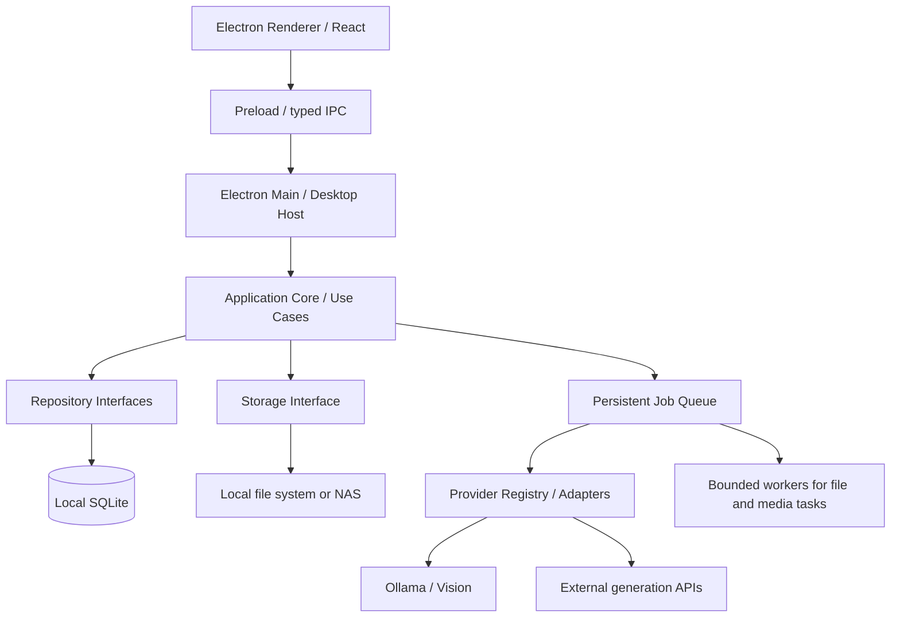

# AssetForge

**Local-first Digital Asset Management & AI Creation Studio**

> Working title · Technical target architecture and development baseline · Phases 1 to 4a implemented (§17)

AssetForge is a desktop application for organizing, creating and processing digital assets. It combines cross-project digital asset management with prompt management, AI-assisted image analysis, image generation and, prospectively, 3D generation.

The focus is on the asset as a domain object, not on a single file or a specific AI model. All related references, drafts, generated images, models, textures, prompts and work steps should be traceable in one place. External generators and analysis models are connected through interchangeable providers.

## 1. Goals and Architecture Principles

- **Local first:** Basic asset, project and prompt management works without the cloud, external AI services or a running database server.
- **Server ready:** Services and persistence are separated so that a central server with multiple clients can be added later.
- **Provider independence:** Image generation, image editing, analysis and 3D generation are not tied to a single vendor.
- **Cross-project assets:** An asset can be used in any number of projects without duplicating files.
- **Open file structure:** Files remain accessible in the file system and can be used with Blender, image editors and other tools.
- **Traceability:** Generations, changes, sources, versions and work states are documented.
- **Resource efficiency:** Large files are streamed, previews are loaded on demand and compute-intensive tasks run in the background with limits.
- **Docker-based server development:** All server components required for a development mode run locally via Docker Compose. The Electron UI runs natively on the host.

The first version is designed for single-user operation. Multi-user operation, central authentication and full synchronization are extensions, not prerequisites for the first runnable version.

## 2. Application Modules

| Module | Purpose |
| --- | --- |
| Workspace | Opening, creating, configuring and backing up a data set |
| Projects | Projects, project assignments, priorities and progress |
| Assets | Central management of typed assets and their relations |
| Library | File import, references, gallery, preview and search |
| Workflows | Configurable production steps and work history |
| Prompts | Reusable, versioned prompts and templates |
| Studio | Image generation, image editing and result management |
| AI Analysis | Automatic image description, classification and batch tagging |
| Providers | Configuration of interchangeable AI and generation services |
| Jobs | Background tasks, queues, progress and error handling |
| Settings | Storage, resource limits, providers, integrations and backups |

The renderer presents the implemented modules in one shell; section 3.3 describes it.

## 3. Projects and Assets

### 3.1 Projects

A project is an organizational unit, for example a game, a film production or a collection.

A project has, among other things, a name, a description, a status, a preview image and a list of assigned assets. The assignment is an n:m relation. Assets remain independent and also exist without any project assignment.

Example:

```text
Gilded Hour
├── Characters
│   ├── Gabriella
│   └── Linda Carver
├── Landscapes
│   └── San Aurelio Valley
└── Buildings
    ├── Gas station
    └── Motel
```

The structure shown is a logical view, not a physical project directory structure. Another project can reference the same gas station or the same vehicle.

Project-specific data such as priority, intended use, approval status or notes is stored on the project assignment. Global asset data is not overwritten by it. Removing an assignment deletes neither the asset nor its files.

### 3.2 Assets and Asset Types

An asset represents a domain object with a stable ID, independent of the files assigned to it.

Example asset types:

| Type | Possible contents |
| --- | --- |
| Character | People, character designs, views, rigs |
| Creature | Animals, creatures, anatomy and motion references |
| Landscape | Terrain, natural environments, vegetation |
| Building | Architecture, interiors, facades |
| Vehicle | Vehicles, vehicle parts, concepts |
| Prop | Objects, furniture, tools |
| Material | Materials, surfaces, shaders and texture sets |
| Other | Freely classifiable contents |

Asset types should be configurable. A type defines optional type-specific metadata fields, a default workflow, allowed or suggested file roles and its presentation in the UI. The type definition contains no hard-wired provider logic.

An asset has at least an ID, name, type, description, status, and creation and modification timestamps. Optionally it has a cover image, tags, custom metadata, relations to other assets and a workflow.

Relations between assets can be, for example, `uses`, `variant_of`, `part_of` or `derived_from`. A character can thus refer to a separate clothing or material asset.

### 3.3 Application Shell and Screens

The renderer is dark only. Its colours, radii and fonts are design tokens in the `@theme` block of `index.css` (`bg`, `surface`, `raised`, `line`, `text`, `muted`, `accent`, `danger`, ...); no component uses colour literals or light/dark variants, and a test scans the renderer sources for them. The window background equals the `bg` token (no white flash at start) and the window cannot be made smaller than 1024 x 680.

**Shell.** `AppShell` is the frame of an open workspace: a header with the workspace name, its path and the "Workspaces" button; a navigation (Assets, Projects, Inbox, Trash, Jobs, Settings); and the page slot. While an import runs, the navigation, the "Workspaces" button and every Settings button of the banner and the analysis dialogs are disabled with the tooltip "Import in progress". When the storage is unreachable, a warning banner with a Retry button appears above the page; Retry remounts the page, so it loads from scratch. When the analysis queue is paused (phase 4b, §15.2), a second warning banner shows the fixed message of the pause reason with a Resume button (tooltip "Continue the queued jobs", calls `jobs:resume`; a failed resume shows its error in the banner) and, for `provider_unauthorized` and `provider_not_configured`, a Settings button. The banner sits in the shell, so behind an open modal dialog it is inert (faintly visible through the backdrop of a form-size dialog, almost fully covered by the file detail dialog); the Jobs screen shows no pause of its own. `Ctrl+F` focuses the search field of the current page. The list state of the screens (filters, scroll offset, opened or selected item, asset tab) lives in `WorkspaceShell` and survives navigation within a workspace; it is dropped with the workspace.

**Detail column.** The Assets, Projects and Inbox screens show a right-hand detail column next to the list. On the gallery it is the "Selection" column of the selected asset (type, status, tags, cover image with its file tags, file count, projects, "Open asset", "Analyse"); on the project list it shows the selected project and, while a tag filter is set, the matching member assets; in the inbox it holds the batch actions for the selected files. The asset screen and the project screen use the full width.

**Tag attribution.** Asset tags and file tags are never shown in one undifferentiated row. File tags are preceded by one image icon per row, and rows are labelled "Asset tags" or "Image tags" wherever both appear. A chip carries its origin (`manual` or `ai`). An AI tag chip is drawn in its own colour (the token `--color-ai`, a violet clearly apart from the cyan accent, at least 4.5:1 on `bg` and `surface`; class constant `AI_CHIP`), has the tooltip "AI tag" and a remove button named "Remove AI tag <name>". Filter chips and the matched-tag chips of the gallery and project list carry no origin and keep their look. Tag filter chips show the normalised tag name.

**Search and filters.** The search field applies its text after 250 ms without typing; clearing it (Esc) applies at once. A newer request supersedes an older one: only the answer to the latest query is shown. The previous results stay visible until the first page of the new result arrives, so typing causes no "Loading..." flash.

**Selection model of file lists** (asset Files tab, inbox and trash). A click selects only the file, Ctrl+click toggles it, Shift+click selects the loaded files from the anchor to the clicked one, Space toggles the focused file, Ctrl+A selects the whole result (missing pages are loaded first), Esc clears. A selection holds at most 1000 files, the limit of the batch channels. Pending and failed files can be selected but are left out of tagging and assigning, and the button texts count only the eligible files.

**Batch channels.** Six channels act on 1 to 1000 distinct file ids:

| Channel | Semantics |
| --- | --- |
| `files:assignMany` | Per item. Each file is relocated on its own (a journaled move, no shared transaction) in request order; a failing file does not stop the others. The response lists, per file, the placed record or an error with the usual code and message. The whole batch holds the exclusive workspace queue. |
| `files:addTagMany` | All or nothing. One transaction: an unknown file fails the call with `not_found`, a file that is not complete with `validation_failed`, a file in the trash with `invalid_operation`, and nothing is written. A file that already has the tag manually is left alone; a file that carries it as an AI tag gets it as a manual one instead (§6); every affected asset is reindexed once. |
| `files:removeTagMany` | All or nothing like `files:addTagMany`. Removes the tag whatever its origin, manual or AI; a file without the tag is left alone. |
| `files:trashMany` | Per item like `files:assignMany`. Moves each complete file to the trash (§9.4) and removes each failed file outright (its item then carries neither file nor error); a pending file, a file already in the trash and an unreachable storage fail their item. |
| `files:restoreMany` | Per item. Moves each trashed file back to the asset and role it came from, or to the inbox when that asset is gone; a file not in the trash or whose binary is missing fails its item. |
| `files:purgeMany` | Per item. Removes each trashed file for good; a purged item carries neither file nor error, a file not in the trash fails its item. |

`trash:empty` purges every file in the trash in chunks and answers `{ purged, failed }`; `trash:summary` answers `{ count }` for the navigation. `files:list` has the scope `trash` (newest deletion first, with the search, tag and kind filters), and every `FileRecord` carries `deletedAt` and, for a trashed file, its origin `trashedAssetId`, `trashedAssetName` and `trashedRole`. A file in the trash is refused by tagging, assigning, detaching, choosing a cover, accepting a proposal, "Open externally" and "Show in folder" (`invalid_operation`, "The file is in the trash"); there is no `files:get` channel, so the trash reaches its files, their previews and image dimensions through the trash scope of `files:list`, `files:measure` and the media protocol. The three batch channels `files:trashMany`, `files:restoreMany` and `files:purgeMany` and `trash:empty` run in the exclusive workspace queue; `trash:summary` and `files:list` are reads and do not wait for it.

After a batch the inbox lists the failures of `files:assignMany` per file; the files that were placed leave the list.

**Delete and trash.** "Delete" is in the file menu, the file detail dialog and the selection bars of the asset Files tab and the inbox, next to Detach where that exists, and on the failed tiles of the inbox, where it removes the file outright. The `Delete` key acts only while a file item (tile or table row) has focus, never from an input or a control inside the item, and acts on the current selection of that file list: in the asset Files tab and the inbox it deletes the selection; on the Trash screen it asks for confirmation and then deletes the selection permanently; with an empty selection it does nothing. Delete itself asks for no confirmation: the trash is the safety net. The result strip reports the counts as for other batch actions. Deleting the file shown in the detail dialog moves on to the next file of the viewer list, or closes the dialog when it was the last. The **Trash** navigation entry, after Inbox, shows the number of files in the trash when it is above zero; it is refreshed after every delete, restore and purge. The Trash screen is a `FileBrowser` over the scope `trash` (grid and table, endless, multi-select, search and filters, viewer); its table shows the deletion date and the origin (asset name or Inbox). Tags are read-only there, and Analyse, Review tags, Image to prompt, Assign, Detach, cover and the tag editors are not offered. Its actions are "Restore" and "Delete permanently" in the file menu, the detail dialog and the selection bar, and "Empty trash" in the header. Delete permanently and Empty trash ask for confirmation in the shared renderer dialog (`ConfirmDialog`, not a native message box), naming the number of files; Restore does not. Nothing is emptied automatically.

**Analysis and jobs** (phases 4a and 4b). The file menu (tile, table row, "More" in the file detail dialog) offers, for complete images of a previewable MIME type, "Analyse" (opens the single-image result dialog), "Review tags" (only for a file with a waiting proposal; opens the same dialog) and "Image to prompt". The selection bars of the inbox and of the asset Files tab have "Analyse": exactly one selected file opens the result dialog, more open the start dialog with all selected files (it counts those that cannot be analysed); it is disabled, with a tooltip, when the selection holds no analysable image. For a selection of exactly one analysable image the bar adds "Image to prompt" and, with a proposal, "Review tags". "Analyse" in the gallery's Selection column and in the asset screen header analyses one asset, and "Analyse all" analyses the current file list (inbox, asset Files tab) or the current gallery filter; all of these open the start dialog. With a selection, the asset Files tab therefore shows two Analyse buttons (the asset's and the selection's, with different tooltips). The file lists have a "Proposals" toggle that shows only files with a waiting proposal (it is local to the list and does not survive navigation); "Analyse all" is disabled while it is on ("Turn off the proposal filter to analyse all"). A file with a proposal carries a marker (a sparkle icon in the AI colour, tooltip "Tag proposal waiting for review") on its tile, its table row and in the file detail dialog. When the settings are loaded and no base URL is configured, Analyse, Analyse all and Image to prompt are disabled with the tooltip "No analysis provider is configured"; Review tags stays available. A started batch appears in the existing result strip by counts only: "<n> queued" and each non-zero skip count (already analysed, already queued, not analysable, not found); the selection is kept. The dialogs are described in §6. While a workspace is open the shell polls `jobs:summary` every 2 s. The Jobs entry of the navigation shows the number of active jobs (queued, running and waiting) when there are any. When `changes` moved and the number of succeeded jobs rose since the last poll, the mounted inbox list, asset screen and asset Files tab reload (stale-while-loading) and an open file detail dialog shows the fresh record, so new AI tags appear without navigating; a failed poll keeps the last state and is not reported. The Jobs screen is an endless table, newest first, with the columns Job ("Analyse image"), File (plain text), Status, Attempt ("<n> / 3"), Created and Error (File shows "—" for a job without a file), a status filter ("All" or one of the seven statuses: Queued, Running, Retrying, Waiting, Done, Failed, Cancelled), row actions "Cancel job" (queued, running, waiting) and "Retry job" (failed, cancelled), and the page actions "Cancel all", "Retry failed" and "Clear finished", each disabled when the summary counts nothing to act on (no active, no failed or cancelled, no finished job). A job waiting for its next try shows "Retrying" with the time of the next try in its tooltip. A failed action shows its error above the table. The list reloads, keeping its scroll position and the focused row, after every action of the screen and whenever a poll sees `changes` move.

## 4. Files, References and Versions

Each asset can have any number of files. **Asset type, file type and file role are independent of each other.** A PNG can be an internet reference, a generated draft or a texture.

| File type | Examples |
| --- | --- |
| Image | PNG, JPG, WebP, TIFF |
| Model | BLEND, GLB, GLTF, FBX, OBJ |
| Texture | PNG, TIFF, EXR |
| Document | PDF, TXT, Markdown |
| Other | Any other files |

File roles include `reference`, `concept`, `generated`, `working`, `model`, `texture`, `final` and `other`. Roles are extensible; actual preview capability follows from the file format and the available decoders.

For each file, at least the ID, asset ID, relative storage path, original file name, MIME type, file size, checksum, role and import timestamp are recorded. Where applicable, dimensions, source, license information, tags, generation ID and a predecessor file are added. Image dimensions (width and height in pixels, after orientation) are measured in the worker pool at import and stored on the file row; for an existing file whose dimensions are still unknown, `files:measure` measures and stores them on demand, without a workspace scan. Unknown dimensions stay `null`.

### 4.1 Import

- Import of single files, multiple files and entire directories via drag & drop or file dialog.
- Import of internet references including optional URL, author/license information and notes. For URL imports, downloads are controlled and subject to size, time and type limits.
- By default, files are copied into the managed workspace. The original file outside the workspace remains unchanged.
- Identical contents can be detected via SHA-256. Multiple assignment must not cause a file that is used elsewhere to be lost when an asset is deleted. For the MVP, duplicate detection with a user decision is sufficient; physical global deduplication is optional.
- Import status, progress and errors are recorded per file. Failed imports leave no files marked as complete.

### 4.2 Editing and Versioning

Imported originals and finished generation results are not silently overwritten. New variants are separate file entries; their lineage and generation history are preserved.

Working files, for example a BLEND file, can be deliberately mutable. They can be opened directly in external applications. Changes are detected via file system events or a targeted re-check; checksums and previews are updated as needed. An explicit version snapshot can capture a work state.

AssetForge does not have to natively edit or visualize every file. For unsupported formats, metadata, a generic preview and "Open in external application" are available. For Blender files and referenced textures, relative paths and related working files are taken into account; external dependencies must be made visible on export or backup.

Implemented so far (phase 3a): previews (thumbnails and detail previews) exist for six raster MIME types: `image/png`, `image/jpeg`, `image/webp`, `image/tiff`, `image/gif` and `image/avif`. Every other format (for example EXR or BLEND) gets a format tile instead. "Open in external application" and "Show in folder" are offered in the file detail dialog. An asset has a cover file: by default its complete, previewable file with the earliest import (automatic cover), or a file chosen by the user ("Use as cover"; "Use automatic cover" returns to the default). Detaching the chosen file or moving it to another asset falls back to the automatic cover. The asset gallery scrolls endlessly, loads 60 assets per page and offers a grid view and a table view; the chosen view is remembered across restarts.

Implemented so far (phase 3b): every file has a kind (`image`, `model`, `document` or `other`), derived from its extension by one function in `core` and stored on the row; the extension lists are in `packages/core/src/media-types.ts`. "Open externally" is an allow-list: it is offered only for files of kind `image`, `model` or `document`, except SVG (which can carry script); everything else, including every script and every file without an extension, can only be shown in its folder. Programs, installers and shortcuts (for example `exe`, `msi`, `bat`, `cmd`, `ps1`, `lnk`, `url`, `dll`, `jar`, `dmg`, `iso`) are refused at import: that file fails with `validation_failed` and a message without a path, nothing is written for it, and the other files of the same import are unaffected. A name with an NTFS alternate data stream is refused when either the whole name or its part before the first `:` has such an extension (`a.exe::$DATA`, `a.exe:stream`, `a.txt:b.exe`). Scripts and markup that belong to asset pipelines (`py`, `js`, `sh`, `html`, `svg`) stay importable. Rows that were imported earlier are not touched.

## 5. Workflows and Production Progress

Workflows are templates configurable per asset type. The application distinguishes:

- **Asset status:** `draft`, `in_progress`, `in_review`, `completed`, `archived`.
- **Workflow steps:** Domain production milestones with an individual state, optional notes and assigned result files.
- **Job status:** Technical execution state of an AI or file operation, independent of production progress.

Example of a character workflow:

1. Asset created
2. References collected
3. References prepared / generated reference images created
4. Character views generated (front, back, side, 3/4)
5. 3D model created
6. Retopology completed
7. Textures / materials created
8. Rigging completed
9. Approved

Example for a landscape: references → concept images → terrain → materials → vegetation and details → approval.

Steps can be mandatory or optional, skipped, reopened or worked on in parallel. By default, progress is derived from completed mandatory steps. A successful generation job must not automatically mark a domain step as approved. A manual confirmation or an explicitly configured rule is required.

Workflow templates and their versions are kept separate from concrete workflow instances. A later change to a template must not silently alter running or completed workflows. Project-specific approvals remain independent of the global asset workflow; project-specific variants can be modeled as linked assets.

Implemented so far (phase 2b):

- **Step states:** `not_started`, `in_progress`, `done`, `skipped`. Only optional steps can be skipped. Any step can be reopened; steps have no enforced order, so they can be worked on in parallel. A step stores when it was completed; reopening clears that. Each step has free-text notes.
- **Progress** is the number of done mandatory steps out of all mandatory steps. It is shown on the asset and in the asset list. Asset status and step states never change each other.
- **Built-in templates** (Character, Landscape, Object, Material, Basic) are defined in code with a stable key and a version number. Opening a workspace adds missing templates and missing versions and sets the default template of asset types that have none; existing rows are never changed. A changed template therefore ships as a new version number in code.
- **Instances** refer to one template version and have step rows that reference that version's step definitions. Template versions and their step definitions are never changed after they are written, so later template versions do not touch running workflows. An asset has at most one workflow. A new asset starts the default workflow of its type; a workflow can also be started from any template and removed again (with confirmation), which deletes its step states and notes but nothing else.

Not built yet: a template editor and user-defined templates, moving a running workflow to a newer template version, result files assigned to steps, and rules that complete a step automatically.

## 6. AI-Assisted Analysis and Tagging

Image analysis is connected through an interchangeable vision provider. The first provider is **Ollama with a vision-capable model**. Ollama is reached through a base URL and an optional API key set in the app's provider settings (§9.3); the project ships no Ollama Compose service (§14.1) and no model: the owner runs their own instance and chooses the models (§8). Pure asset management does not require a running Ollama service.

### 6.1 Batch Processing

The user can queue single images, a selection, entire assets or all not-yet-analyzed images for analysis. A batch creates individual persistent jobs so that partial failures, resumption, cancellation and progress per image are possible.

The analysis uses a bounded preview suitable for the model instead of always transferring the full original. The original remains unchanged. Results are validated against a structured schema, normalized, and in the case of invalid responses treated as an error or as a reviewable suggestion.

Only tags are stored. There is no stored image description, no suggested asset type and no separate view or style field: view and style arrive as tags of their own. Example of an analysis answer (illustrative):

```json
{
  "tags": ["building", "service station", "roadside", "dusk", "exterior", "three-quarter view", "photorealistic"]
}
```

Image2Prompt derives a descriptive text from an image that can be used as a generation prompt; the text is shown for use and is not saved (phase 4b, below).

Tags are supported at both file and asset level. File tags can be aggregated as suggestions for tagging the asset. Manual and AI-generated tags remain distinguishable, and **an owner carries a tag at most once, manual wins**: an analysis never adds an AI assignment for a tag the owner carries manually; adding a tag by hand to an owner that carries it as AI turns it into a manual one (this is how a suggestion is adopted); removing a tag by hand removes it whatever its origin. A re-analysis replaces the earlier AI tags of the file and never touches manual ones. A tag the owner removed can come back when the same file is analysed again: nothing remembers a rejection. The provenance of an analysis (analysed content, provider, model, prompt version, time) is stored per file in `file_analysis`; a review status is not stored.

Implemented so far (phase 3b): tags on assets and on files. A tag has a normalised name (trimmed, inner whitespace collapsed, NFC, lower case, NFC again; 1 to 64 characters, otherwise `validation_failed`) and a display name, the spelling it was first entered with. An assignment records its origin (`manual` or `ai`); the key is still (owner, tag, origin), but since phase 4a the repositories keep at most one assignment per owner and tag (the rule above; no migration of the tag tables). Adding an existing assignment and removing a missing one are no-ops. Tag rows are never deleted and there is no rename or merge; suggestions (`tags:suggest`, limit 1 to 50) offer only tags that are in use, by name prefix, most used first. Search, filters and suggestions treat both origins alike. Asset detail and file records carry their tags. The IPC channels are `tags:suggest`, `assets:addTag`, `assets:removeTag`, `files:addTag` and `files:removeTag`; the tag rows and suggestions of the UI are described in §3.3.

Implemented so far (phase 4a, extended in phase 4b below): analysis of image files against a vision provider that speaks the Ollama HTTP API (in development the deterministic mock provider, §14). Every analysed file gets one persistent job of type `vision.analyze_file` (§15.2); enqueuing is not all or nothing: a file that is unknown, not complete, without a checksum or not of a previewable image MIME type, or that already has an active analysis job, is counted as skipped and the others are queued. One run of the job:

1. **Read.** The file must exist, be complete, have a previewable MIME type and a checksum; otherwise the job fails with `file_unavailable`. The media worker pool renders a JPEG for the model (longest edge at most 1024 px, quality 85, EXIF-oriented, alpha flattened onto white, the byte and pixel limits of previews, not cached). When no JPEG can be produced because the file was assigned or moved meanwhile, it is read once more from its new path; otherwise, and for an unreachable storage, the job fails with `file_unavailable`.
2. **Ask.** The provider receives the JPEG, the analysis prompt (`ANALYSIS_PROMPT_VERSION = 1`: 8 to 15 short English lower-case tags covering what is shown, materials, dominant colours, exactly one view tag and exactly one style tag) and a JSON schema. No database or storage access happens during the call, and the call never runs inside a transaction or the workspace's serial queue.
3. **Write.** The answer is parsed tolerantly: it must be an object with a `tags` array; entries that are not strings or not valid tags are dropped, the rest is cleaned like a manual tag, made distinct by normalised name and cut to 20. No tag left is `invalid_response`. One transaction then checks that the file still exists, is complete and has the checksum read in step 1 (otherwise `file_unavailable`, nothing written), replaces the file's AI tags by the new ones except those it carries manually, writes the `file_analysis` row (provider `ollama`, the model of the job) and reindexes the asset. A run that was cancelled before the transaction writes nothing.

Implemented in phase 4b:

- **Model per start.** The model is chosen at every start and travels in the job payload (version 2: `{ version: 2, model, mode }`), so a queued batch keeps its model when the settings change. No model is built in (§8). A version 1 row of phase 4a still runs, in mode `apply` with the tagging default model in force when it runs, and fails with `provider_not_configured` when there is none. The dedupe key stays `vision.analyze_file:<file id>`: one active analysis per file.
- **Targets.** `analysis:enqueue { target, model, mode, force }` takes one of four targets: `files` (1 to 1000 distinct ids), `fileFilter` (the filter part of `files:list`: scope, query, tags, role, kind), `asset` (the analysable files of one asset) and `assetFilter` (the filter part of `assets:list`: the analysable files of the matching assets; when the filter sets `fileRole` or `fileKind`, only the files that themselves have that role or kind; query and tags select assets and do not narrow the files). The main process resolves a target in keyset pages of 500 files (`ENQUEUE_CHUNK`) and inserts each page's jobs in one transaction, so a filter target never sends a set of ids over IPC. The answer carries counts only: `enqueued` and the skipped `notFound` (listed ids only), `notAnalysable`, `alreadyQueued` and `alreadyAnalysed`. `analysis:preview { target, model }` answers the disjoint counts `analysable`, `alreadyAnalysed`, `alreadyQueued` and `notAnalysable` for the start dialog.
- **Fingerprint.** A file counts as analysed with model M when its checksum, the provider id, M and `ANALYSIS_PROMPT_VERSION` equal its `file_analysis` row or its waiting proposal. In mode `apply` without `force` such a file is skipped as `alreadyAnalysed`; `force: true` is the deliberate re-analysis. Discarding removes only the proposal: the file counts as not analysed again unless its `file_analysis` row matches. A file that matches and also has an active job is counted only as `alreadyAnalysed` by the preview and by an enqueue without `force`; with `force` the enqueue answers it as `alreadyQueued`.
- **Proposals.** Mode `propose` is accepted only for a `files` target with exactly one id (`invalid_operation` otherwise) and implies `force`. Its job makes the same request and cleaning as `apply`, but instead of touching tags it stores the result in `file_analysis_proposal` (one per file, a new one replaces the older one; the same complete-and-checksum check, otherwise `file_unavailable`). The proposal waits for the owner, also across restarts. `analysis:acceptProposal { fileId, names }` applies exactly the chosen non-empty subset of the proposal's tags with the rules of `apply` (the file's AI tags are replaced, manual wins, the asset is reindexed), writes `file_analysis` from the proposal and deletes it; it answers `not_found` without a proposal, and `invalid_operation` for a name that is not in the proposal and for a stale proposal (the file is no longer complete or its checksum changed since), which is deleted. `analysis:discardProposal` deletes the proposal and is idempotent. `analysis:getProposal` answers the proposal (model, creation time, `stale`, at most 20 tags) and the file's active, otherwise latest, analysis job. A run in mode `apply` deletes a waiting proposal of the file in its own transaction: the newer result wins. `FileRecord.hasProposal` and the optional `files:list` filter `hasProposal` mark files with a waiting proposal; that filter is not part of a target.
- **Image2Prompt.** `analysis:describe { requestId, fileId, model }` sends the same 1024 px model JPEG with `IMAGE_PROMPT` (one English paragraph naming subject, shape, materials, colours, lighting, view and style; no preamble, title or list) and answers `{ ok: true, text }`, the answer trimmed and cut at 4000 characters (an empty answer is `invalid_response`), or `{ ok: false, code }` with a job error code, `cancelled` or `busy`. One request runs at a time: a second one while it runs answers `busy`. `analysis:cancelDescribe { requestId }` aborts it and frees the slot at once; the cancelled request answers `cancelled`, and the aborted run settles in the background. Closing the workspace and quitting cancel it as well; while a workspace lifecycle step runs (close, open, create, remove), a new request answers `cancelled`, and without an open workspace it fails with `no_workspace_open`. It is not a job and bypasses the scheduler, so it can overlap one running analysis (Ollama queues requests itself). The text is not stored, not logged and not part of any job.
- **Renderer.** The Settings screen and its navigation entry (§9.3) and a shared model select (the server's models, models without vision disabled, a refresh button, the function's default preselected). Three dialogs, at most one open per screen (`useAnalysisDialogs`), each choosing its model itself:
  - the start dialog for batches (model, the preview counts "To analyse", "Already analysed", "Already queued" and "Not analysable", "Analyse again" for `force`, Start; the counts of the start then appear in the result strip);
  - the result dialog for a single image in mode `propose` (Analyse, the running or failed state, the proposed tags as toggle chips in the AI colour with Accept, Discard and "Analyse again"; a stale proposal can only be discarded or redone; closing it changes nothing);
  - the prompt dialog "Image to prompt" (model, Generate, the text read-only, Copy; closing cancels the request).

  The entry points are listed in §3.3: the file menu, the selection bars, the gallery's Selection column, the asset screen header and "Analyse all". The single-image dialog opens only for exactly one file; any larger selection uses the start dialog. All three dialogs share one provider gate (`provider-gate.ts`) that decides whether they can start and whether they offer a Settings button: a failed settings load is its own state ("The provider settings could not be read"), not "not configured"; while the settings load nothing starts; then, in this order, not configured, no model with vision on the server, no model chosen, a chosen model the loaded list does not contain ("The provider does not offer this model") and a model without vision block the start. Settings is offered (once loading is over) for a failed settings load, not configured, no model with vision, a model list refused as unauthorized or not configured, and an unusable model list without a stored model. A Settings button closes the dialog (and a file detail dialog beneath it) and opens the Settings screen; while an import runs it is disabled with "Import in progress" and nothing closes. The pause banner and the result strip are described in §3.3.

Not built: multi-select in the asset gallery (several assets are analysed through the gallery filter), one AI tag set per model (a file has one), a history of proposals, a stored description or prompt, and control over loading or unloading Ollama models.

### 6.2 Search

The MVP supports full-text search over names, descriptions, prompts and tags, as well as filters for project, type, status, role and file format. SQLite FTS5 is intended for local full-text search. Semantic search via embeddings is a later, optional extension; a separate vector database service is not required to begin with.

Implemented so far (phase 3b, backend): one full-text index over the asset name, the asset description, the tags of the asset and the original names and tags of its complete files; prompts are not indexed yet. A query has at most 200 characters. It is normalised to NFC and split into words at every character that is not a letter, digit or combining mark (at most 16 words); a word starts with a letter or digit, so combining marks alone (for example the variation selector of an emoji) are no word. The indexed text is normalised to NFC as well; the stored values keep their spelling. Each word matches the beginning of a word in the index, all words are required, and case and diacritics are ignored. Results are ranked by BM25 with the name weighted highest, then by name; a query without words behaves like no query and orders by name. User input is never interpreted as FTS5 syntax. This changes the phase 2 behaviour: the name filter matched any substring, the search matches word beginnings ("swo" finds "Sword", "ord" does not). Filters combine with the search: project, asset type and status as before, tags (every selected tag, at most 10, must be on the asset itself or on at least one of its complete files; the filter does not distinguish where the tag sits, and an unknown tag yields no results), a file role and a file kind (each: the asset has at least one complete file with it). Results are paged like the list (60 per page) with a total. The search field, tag filter and role and kind selects of the UI redesign are described in §3.3.

## 7. Prompt Management and Generation Studio

### 7.1 Prompt Library

Prompts are independent objects that can be created and reused independently of assets and projects. They have a title, description, tags, content, optional negative prompts and parameters or variable definitions. Changes can be stored as immutable prompt versions.

Example of a template:

```text
Photorealistic full-body character reference of {{character}},
{{view}} view, neutral lighting, consistent pose and proportions.
```

A generation stores the prompt version used **and** the actually resolved prompt. This keeps older results traceable even after a template has changed.

### 7.2 Generation Studio

The studio allows selecting a provider and a model, assigning the generation to an asset, using reference images and configuring the parameters that are actually supported. Results can be adopted as a draft, a new variant or a final file. A result that is not yet assigned is managed in a workspace inbox until it is assigned to an asset or discarded.

A generation receives a permanent ID and documents:

- provider, model and, where available, model version;
- prompt version, resolved prompt and negative prompts;
- input files including version or checksum;
- effectively submitted parameters such as seed, resolution, steps and guidance, where supported;
- technical job ID, status, timestamps, output files and errors;
- cost or usage, provided the provider supplies reliable figures.

The goal is traceability, not a guarantee of pixel-identical reproduction with external, changing models. Credentials are never stored in the generation history.

## 8. Provider Architecture

Providers implement individual capabilities instead of one universal interface with many empty methods. The UI queries the capabilities and parameter metadata of a model and hides unsupported functions.

| Capability | Purpose |
| --- | --- |
| `vision` | Image description, tags and classification |
| `text_generation` | Prompt creation and optimization |
| `text_to_image` | Image generation from text |
| `image_edit` | Image editing with one or more reference images, without a mandatory mask |
| `inpainting` | Mask-based editing |
| `upscaling` | Resolution increase |
| `image_to_3d` | 3D generation from image references |
| `text_to_3d` | 3D generation from text |
| `embeddings` | Optional semantic search |

Illustrative adapter mapping: Ollama for vision/text, Seedream via a suitable API vendor for image editing, RunPod endpoints for custom models and Tripo3D for 3D generation. Concrete APIs, models, parameters and availability must be verified at implementation time.

Provider configuration comprises base URL, authentication reference, timeouts, concurrency limit, model configuration, capabilities and an optional cost limit. Differences between synchronous APIs and asynchronous job APIs are encapsulated in the adapter. External job IDs are stored persistently; polling uses backoff and avoids unnecessary requests.

A new provider must not require a change to the asset data model. Provider-specific parameters are stored as validated, versioned extra data. No provider has direct access to the database or to arbitrary workspace paths.

Implemented so far (phase 4b): one provider, the Ollama-compatible vision adapter (`createOllamaVision`, provider id `ollama`), behind the core port `VisionProvider` with three calls: `analyzeImage` and `describeImage` (both take the model as a required argument of every call, so no request without a chosen model is possible) and `listModels`. The adapter instance binds no model. The desktop host owns a vision gateway that builds the adapter from the settings in force (base URL, timeout, key, §9.3) and drops it after every save; it answers null when no base URL is configured, and handlers ask it at the moment they need a provider. There is no provider list, no capability other than `vision`, no cost limit and no per-provider concurrency setting; analysis stays in the `local_gpu` resource class with limit 1, also for a remote base URL.

- **Models.** No model name is built into the code. The owner sets a default model for tagging and one for Image2Prompt in the settings and can choose another one at every start. `listModels` calls `GET /api/tags` and then `POST /api/show` per model for its `capabilities` (at most 100 models, 4 at a time, 10 s each, answers capped at 1 MiB like every other one): `vision` is true or false when the server reports capabilities, and null when it does not or when `show` fails; a failing `show` never fails the list. Models with `vision: false` are listed but cannot be chosen; the renderer orders vision models first, then unknown ones, then by name. A model name is 1 to 200 characters, stored and sent verbatim; names in `/api/tags` that do not fit are left out of the list. The main process caches the list until the settings change or a refresh is asked for (`settings:listVisionModels { refresh }`, which answers `{ ok: true, models }` or `{ ok: false, code }` with a job error code).
- **Requests.** The chat body is that of phase 4a (§15.2) with the call's model and no `think` field; only `message.content` is read. Image2Prompt sends the same body without `format` and takes the content as text.

## 9. Persistence and Storage

### 9.1 Basic Decision

**Metadata in a relational database; physical assets in the file system; technical caches separate.** Large binary files are not stored as database BLOBs.

When creating a workspace, the user can select a local folder or a NAS/SMB share. The storage path is managed as a workspace setting. Database entries contain a storage ID and relative paths, not immutably baked-in absolute Windows paths.

### 9.2 Workspace Directory

```text
AssetForge-Workspace/
├── workspace.json                  # ID, format version, no credentials
├── assets/
│   └── <asset-uuid>/
│       ├── references/
│       │   └── <file-uuid>_reference.jpg
│       ├── generations/
│       │   ├── <file-uuid>_front.png
│       │   └── <file-uuid>_back.png
│       ├── models/
│       │   └── <file-uuid>_character.blend
│       ├── textures/
│       │   ├── <file-uuid>_albedo.png
│       │   └── <file-uuid>_normal.png
│       └── miscellaneous/
├── inbox/                          # Files not yet assigned
├── exports/
└── .assetforge/
    ├── staging/                    # Temporary, recoverable transfers
    └── trash/                      # Deleted files until restored or purged
```

Asset directories have stable IDs; renaming an asset or project does not change any paths. Every managed file is named `<file-uuid>_<sanitized original name>`, in the inbox as well as inside an asset directory, so two files with the same original name never collide. Related 3D working files keep a sensible internal directory structure. File name and role changes are handled as controlled operations, not through uncoordinated file moves.

The role of a file decides its directory inside the asset folder:

| File role | Directory |
| --- | --- |
| `reference`, `concept` | `references/` |
| `generated` | `generations/` |
| `model`, `working` | `models/` |
| `texture` | `textures/` |
| `final`, `other` | `miscellaneous/` |

A file without an asset lies in `inbox/` and has no role. Attaching a file to an asset, changing its role and detaching it back to the inbox each move the file to the path that follows from this table (§9.4). A deleted file lies in `.assetforge/trash/<file-uuid>_<sanitized original name>` in the same storage, with no asset and no role, until it is restored or purged.

A storage abstraction encapsulates resolving, reading/writing as streams, listing, moving, existence checks and deletion. File system adapters (local/SMB) are sufficient for the MVP. A future object storage adapter must support downloads into a local working directory; an object storage key is not a local Blender file path.

### 9.3 Local Application Data

```text
<electron-userData>/AssetForge/      # Schematic, actual path via Electron API
├── settings.json                   # Local settings and workspace registry
├── provider-settings.json          # Vision provider settings, never the key
├── credentials/                    # Only OS-protected encrypted values
│   └── vision-api-key              # The vision API key, encrypted by safeStorage
├── workspaces/
│   └── <workspace-uuid>/
│       └── assetforge.sqlite       # Local workspace database
├── cache/
│   ├── thumbnails/
│   └── previews/
└── logs/
```

The application determines OS-conformant paths instead of hard-coding `%APPDATA%` or other platform-specific paths. Local caches can reside on a suitable fast drive. `cache/thumbnails` and `cache/previews` exist (phase 3a); their entries are keyed by the content checksum of the file (§15.1), so they can be deleted at any time and are regenerated on demand. There is a separate database per workspace; this allows a workspace to be backed up independently.

**Provider settings and the API key** (phase 4b) are app-level, not part of any workspace: a workspace database is copied and backed up, and a secret does not belong there.

- `provider-settings.json` holds `{ version: 1, vision: { baseUrl, timeoutSeconds, taggingModel, promptModel } }` and never the key. It is its own file because `settings.json` belongs to the workspace registry, and it is written atomically (temporary file, then rename). A missing file reads as empty; a file that is not valid JSON or does not match the schema is renamed aside to `provider-settings.json.corrupt-<time>` and read as empty; any other read error is thrown. The base URL follows the rule of §14.2 (http or https, no user info, query or fragment, trailing slashes removed); private and loopback addresses are allowed on purpose. A blank base URL is saved as "not configured". The timeout is 10 to 600 s, default 120. Without a base URL the provider is not configured: analysis jobs fail with `provider_not_configured` and the model list answers that code.
- The key is stored only in `credentials/vision-api-key` as the bytes Electron's `safeStorage.encryptString` returns. When `safeStorage` cannot encrypt (on Linux also when its backend is `basic_text`, a hard-coded password), saving a key fails with `credential_store_unavailable` before anything is written, and nothing is written in plaintext; base URL, timeout and models can still be saved without a key. A key file that cannot be read or decrypted counts as no key. The key is decrypted in the main process for each request and never cached; no IPC response, job row, payload, `file_analysis` row, log line or error message carries it. The renderer only learns whether one is stored (`hasApiKey`) and whether one can be stored (`canStoreKey`).
- **The key is bound to the origin it was entered for.** A save that changes the origin (scheme, host, port) of the base URL and carries no new key deletes the stored key; a path-only change keeps it. An adapter built for an earlier base URL gets no key once the origin in force differs, so a request still in flight after a change never takes the new key to the old server. The key goes only as `Authorization: Bearer <key>` to the configured base URL; redirects are refused (§15.2). Without a key no header is sent.
- IPC, also without an open workspace: `settings:getVision` (`{ baseUrl, timeoutSeconds, taggingModel, promptModel, hasApiKey, fromEnvironment, canStoreKey }`), `settings:setVision` (the four settings and `apiKey`: absent keeps the stored key, `null` deletes it, a string of 1 to 500 characters replaces it; answers the same view; `invalid_operation` for an unusable base URL or in environment mode) and `settings:listVisionModels` (§8). The model list uses the stored settings, so the screen saves before it tests. Settings take effect for the next request without a restart, and every save resumes a paused analysis queue (§15.2).
- **Environment mode** for development and tests: when `ASSETFORGE_VISION_BASE_URL` is set in the environment of the main process at start, even to an empty value, the environment replaces the stored settings (§14.2) and the settings cannot be changed in the app. When the value is empty or not a usable http(s) URL, the main process logs one fixed warning per start, "ASSETFORGE_VISION_BASE_URL is not a usable http(s) URL; the vision provider is not configured", without the value; environment mode stays on. Without the variable and without stored settings nothing is configured; there are no default values.
- The **Settings** screen (a navigation entry of the open workspace) has the base URL, a write-only API key field (it shows only that a key is stored, with a button to remove it; disabled with a tooltip when `canStoreKey` is false), the timeout, a model select for tagging and one for Image2Prompt, Save, and "Test connection", which saves and then loads the model list and shows it or the error's fixed message. In environment mode it is read-only.

SQLite stays on a **local file system**, even when the assets reside on a NAS share. A shared SQLite database on SMB is not intended. One active writing local client per workspace applies. A second workstation with a separate local database must not write to the same workspace in an uncoordinated way. NAS files alone are not database synchronization.

For later multi-user operation, a central API server takes over write coordination and PostgreSQL handles persistence. Both modes use shared domain logic, but each with its own suitable database adapters and migrations. The Electron UI never accesses a remote PostgreSQL instance directly.

### 9.4 Consistency and Backup

File system and database do not form a joint atomic transaction. Import and generation operations therefore need a restartable flow: database entry in pending state, write to staging, checksum verification, transfer within the same storage volume, then commit of the final state. Incomplete transfers are detected at the next start and either resumed or deliberately cleaned up.

Moving a managed file (attach to an asset, role change, detach) follows the same idea with a move intent: a `file_move` row with the target path, asset and role is written first, then the file is moved within the storage, then the file row is updated and the intent deleted in one transaction. An existing target is never overwritten. When a workspace is opened, every remaining intent is repaired: if the target exists and the source (the file row's current path) is gone, the move happened and is committed; in every other case the intent is discarded and neither the file row nor either file is touched.

Deletion goes through a trash. Physical deletion checks all references and happens only after a successful metadata update, and only when the owner empties the trash or deletes a file from it permanently; nothing is purged automatically. Unreachable storage must be distinguished from files that are actually missing.

**File trash.** A file is in an asset, in the inbox or in the trash. Deleting a complete file first cancels its active jobs (a running one is only asked to stop; the write guard below is the guarantee), then relocates it with a `file_move` of kind `trash`: the binary moves to `.assetforge/trash/` (§9.2), and the commit transaction clears `asset_id` and `role`, records them in `trashed_asset_id` and `trashed_role`, sets `deleted_at`, clears a chosen cover that pointed at the file and reindexes the former asset. Tags, the analysis record and a waiting proposal stay on the row; `status` is not changed. A complete file whose binary is missing is still trashed, without a move, its path rewritten to the trash path; it can only be purged. A failed file is removed outright (row and any leftover binary in staging or the inbox); a pending file cannot be deleted. Restoring is a move of kind `restore` back to the recorded asset and role, or to the inbox when that asset is gone; the file never becomes the chosen cover again by itself, and a binary missing on a reachable storage refuses the restore. The repositories enforce the invariant that a trashed file has no asset and no role: a move commit or a placement on a trashed file is refused. Storage reachability is checked before each operation and checked again before a binary is treated as missing, so an unreachable share is never taken for a missing file and no row is purged while the storage cannot be reached. Analysis writes nothing to a trashed or purged file: applying tags and storing a proposal check `deleted_at` inside their transaction, enqueueing refuses a trashed file, `jobs:retry` refuses a job whose file is in the trash and `jobs:retryFailed` skips it. A job cancelled through the scheduler ends `cancelled`; one that hits the guard without having been cancelled ends `failed` with `file_unavailable` and is not retried. Outside the trash a trashed file appears nowhere: queries that go through an asset exclude it because it has no asset, and the inbox scope, the workspace-wide file list and its tag filters, tag suggestions, duplicate detection on import (a trashed file is no duplicate), the analysis targets and `analysis:preview` exclude it explicitly.

Restoring and purging first resolve an open `file_move` row of the file (left by an earlier commit that failed) with the same rule as the repair of move intents on open: a restore whose binary already moved back is completed, so a later restore succeeds and a purge answers that the file is not in the trash; any other open row is discarded. A row that cannot be resolved fails the item and stays for the next open. Purging (Delete permanently, Empty trash) applies only to files in the trash. It first cancels any still active job of the file, then deletes in one transaction the file's `file_tag`, `file_analysis`, `file_analysis_proposal` and `job` rows and the `file` row — the repository refuses the purge (`invalid_operation`, "The file is being moved") and deletes nothing while the file still has a `file_move` row, so a purge never drops a move journal — and only after that commit removes the binary from `.assetforge/trash/`. Purge and sweep never remove anything outside that directory. A crash between the two steps leaves a binary without a row: on every workspace open, after the move recovery (which completes or discards interrupted moves into and out of the trash by their kind), a sweep lists `.assetforge/trash/` — one bounded directory, not a workspace scan — and removes each `<file-uuid>_…` entry whose id has no row. The sweep is skipped when the workspace database was created in this open (a kept folder opened again, a lost `userData`): a database without rows cannot tell a purge leftover from a trashed file. A binary that cannot be removed is left for the next sweep; the purge still counts as done. Preview cache entries are keyed by content hash and are not touched by a purge.

Removing a workspace requires a confirmation in a native dialog owned by the main process. It deletes the registry entry and the local database of that workspace. The workspace folder stays untouched unless the user explicitly chooses to move it to the operating system trash; it is never deleted permanently by the application, and only a folder that still holds the manifest of exactly this workspace is moved. If moving to the trash fails, nothing is removed. A folder that was kept can be opened again later as an existing workspace; its catalog then starts empty until re-indexing exists.

Backup and restore must treat the database, workspace manifest and managed files as one consistent state. To this end, write jobs are coordinated, a consistent SQLite backup is created and the file manifest/checksums are backed up along with it. Mutable external working files must not be written to unnoticed during the snapshot. Caches, temporary files and credentials are not part of the regular workspace backup. For server mode, a correspondingly coordinated PostgreSQL backup is necessary.

A restore validates manifest, format version and checksums and must not overwrite existing workspaces without asking. Moving a workspace changes the storage configuration, not the domain IDs.

## 10. Relational Data Model

The following model is a starting point and not a finished SQL schema. IDs are modeled as stable UUIDs; referential integrity, suitable unique constraints, indexes and schema migrations are part of the implementation.

| Entity | Purpose / central relations |
| --- | --- |
| Workspace | Identity, format version, storage configuration |
| Project | Project metadata |
| AssetType | Type definition, metadata schema, default workflow |
| Asset | Domain asset, belongs to a type and a workspace |
| ProjectAsset | n:m link, project-specific priority and approval |
| AssetRelation | Typed relation between two assets |
| AssetFile | File, storage key, type, role, checksum, origin and metadata |
| FileVersion / FileRelation | File lineage and versions of mutable working files |
| Tag | Normalized tag with display name |
| AssetTag / FileTag | n:m assignment, manual or AI origin |
| AnalysisResult | Provenance of an analysis: analysed content, provider, model, prompt version, time (`file_analysis`); the results themselves are AI tags |
| WorkflowTemplate / WorkflowStepDefinition | Versioned production template and steps |
| AssetWorkflow / AssetWorkflowStep | Concrete production state and step status |
| Prompt / PromptVersion | Reusable prompt templates and versions |
| Provider / ProviderModel | Configuration and capability metadata, no plaintext secrets |
| Generation / GenerationInput / GenerationOutput | Generation, inputs used and result files |
| Job / JobAttempt | Persistent tasks, execution attempts and external job IDs (a job keeps an attempt counter and the error of its latest run; an attempt history table is added when a job type needs it, at the latest for paid jobs in phase 5) |
| ActivityEvent | Domain change history |

Implemented so far (phases 1 and 2), as tables: `workspace`, `storage` (the storage a file row refers to by ID), `asset_type` (built-in types with a default workflow template, no metadata schema yet), `asset`, `project`, `project_asset`, `asset_relation`, `file` (the AssetFile entity: storage ID, relative path, optional asset and role, checksum), `file_move` (move intents, §9.4), `workflow_template`, `workflow_template_version` and `workflow_step_definition` (the WorkflowTemplate / WorkflowStepDefinition entities), and `asset_workflow` and `asset_workflow_step` (one workflow per asset, each step row references a step definition of the template version the workflow refers to). Phase 3a adds `asset.cover_file_id` (the cover file chosen by the user, null for the automatic cover; cleared when the file is deleted, detached or moved to another asset). Phase 3b (migration `0004`) adds `tag` (normalised unique name, display name), `asset_tag` and `file_tag` (owner, tag and origin as key), `file.kind` (indexed with the asset, and `file (asset_id, status)` is indexed for the reindex and filter queries), `asset_search` (an FTS5 table over name, description, tags and file names, hand-written in the migration because Drizzle cannot express it), `asset_search_map` (the rowid of an asset's FTS row) and `workspace.derived_data_version`. The index is derived data: every repository method that changes something searchable rewrites the asset's row inside its own transaction, and a derived-data step on open (after migrations, built-in types and templates, also for a new workspace) recomputes all file kinds and rebuilds the index in batches of 500 assets, yielding to the event loop between batches, whenever the stored version differs from the constant in the adapter; the stamp is written last, so an interrupted run repeats on the next open. The image viewer (migration `0005`) adds `file.width` and `file.height` (stored image dimensions). Phase 4a (migration `0006`) adds `job` and `file_analysis`. `job` holds `type`, `resource_class` and `status` (both with check constraints over the values of §15.2), an optional `file_id` (the subject of the job), a JSON `payload` validated per type with a `version`, a `dedupe_key`, the `attempt` counter, `run_after`, the `error_code` and fixed `error_message` of the latest run, and the times `created_at`, `started_at` (latest run), `finished_at` and `updated_at`. It is indexed by (status, resource class, created at, id) for claiming, and a partial unique index on `dedupe_key` over the active statuses keeps one active analysis job per file (`vision.analyze_file:<file id>`). There is no `JobAttempt` table. `file_analysis` has one row per analysed file (primary key `file_id`): the `sha256` of the analysed content, `provider`, `model`, `prompt_version` and `analysed_at`; a new analysis replaces it, clearing finished jobs leaves it, and since phase 4b the fingerprint skip reads it (§6). Phase 4b (migration `0007`) adds `file_analysis_proposal`, one waiting tag proposal per file (primary key `file_id`, referencing `file`): the `sha256` of the analysed content, `provider`, `model`, `prompt_version`, the proposed `tags` as JSON (normalised name and display name, at most 20) and `created_at`; a new proposal replaces it, and accepting or discarding deletes it. It also adds the index `job (file_id, type, created_at, id)` for the latest job of a file. The file trash (migration `0008`, only `ADD COLUMN` and `CREATE INDEX`, `file` is not rebuilt) adds `file.deleted_at` (ISO time of the deletion, null outside the trash, indexed), `file.trashed_asset_id` (the asset the file was deleted from, foreign key with `set null`, so a restore after that asset is gone goes to the inbox) and `file.trashed_role`, and `file_move.kind` (`relocate` by default, `trash` or `restore`; §9.4). A trashed file has no asset and no role; the repositories enforce this, there is no CHECK. Deleting the chosen cover file clears `asset.cover_file_id`, and restoring does not set it again. Purging deletes the file's `file_tag`, `file_analysis`, `file_analysis_proposal` and `job` rows with it and is refused while the file has a `file_move` row. Provider settings and the API key are not in the workspace database (§9.3). Everything else in the table above does not exist yet.

Particularly important indexes: project assignments, asset type and status, file-to-asset assignment, tags, checksums, job status and job start time. Project-asset assignments and normalized tag assignments must not contain unintended duplicates. Type-dependent metadata can additionally be stored as validated JSON; regularly filtered core fields remain relational columns.

## 11. Application Architecture

A modular monolith with clearly separated domain services is sufficient for the first version. Microservices and additional infrastructure are introduced only when there is a concrete need.



Renderer and preload contain no domain persistence logic. The main process provides controlled IPC operations and delegates to the application core. Longer CPU-intensive or blocking tasks run in bounded worker threads or separate processes; they block neither the renderer nor the main event loop.

In the later server mode, the same core is hosted in an API process. The desktop host then uses an API client instead of the local use cases for the workspace in question. Only the server accesses PostgreSQL and managed storage. Editing remote files locally requires defined checkout/download and return operations; no silent write-back from arbitrary clients.

## 12. Proposed Technology Stack

| Area | Technology / approach |
| --- | --- |
| Desktop | Electron, TypeScript |
| Frontend | React, Vite, Tailwind CSS, shadcn/ui |
| Domain logic | Platform-neutral TypeScript core |
| Local persistence | SQLite, preferably better-sqlite3 with Drizzle ORM |
| Later server persistence | PostgreSQL with its own Drizzle adapter |
| API server (optional) | Node.js / Fastify |
| Validation | Zod, typed DTOs |
| File operations | Node.js Streams / File System API |
| Image previews | Sharp, with decoder and memory limits |
| 3D preview | Three.js, loaded on demand; initially GLB/glTF |
| Background tasks | Persistent DB-based queue and bounded workers |
| Search | SQLite FTS5; server-side search concept separate |
| Secret storage | Electron safeStorage or OS credential backend |
| Packaging | electron-builder or a comparable packager |
| Development | Monorepo, pnpm workspaces, Docker Compose |
| Tests | Vitest, integration and Electron E2E tests |

Exact versions are checked together for compatibility at project initialization and pinned via lockfile and reproducible container image tags. Native Electron modules (in particular SQLite and image processing) must be built and tested for the respective Electron ABI and target platform. No currently verified library compatibility is claimed.

## 13. Repository Structure

```text
assetforge/
├── apps/
│   ├── desktop/              # Electron main, preload and React renderer
│   └── api/                  # Optional server host (later / server profile)
├── packages/
│   ├── core/                 # Domain, use cases, port interfaces
│   ├── contracts/            # DTOs, Zod schemas, IPC/API contracts
│   ├── persistence/          # SQLite, later PostgreSQL, migrations
│   ├── storage/              # Local and NAS-capable storage adapter
│   ├── providers/            # Vision, image and 3D providers
│   ├── jobs/                 # Queue, scheduler, retry, worker contracts
│   ├── media/                # Metadata, thumbnails, preview
│   └── ui/                   # Shared UI components
├── docker/                   # Dockerfiles and service configuration
├── tests/                    # Integration and E2E tests, small fixtures
├── compose.yaml
├── .env.example
├── pnpm-workspace.yaml
└── README.md
```

Core and contracts must not depend on Electron, a concrete provider or a concrete database implementation. Dependencies are composed in the desktop or server host.

## 14. Local Docker Development Environment

Electron stays on the host in order to make sensible use of native windows, file dialogs, drag & drop, the file system and external desktop applications. **During development, server components run exclusively locally in Docker**, to the extent they are needed for the respective profile. External generation APIs are used only for deliberately triggered integration tests or real generations.

### 14.1 Compose Profiles

| Service / profile | Purpose | Activation |
| --- | --- | --- |
| `ollama` / `ai` | Local vision and text models | Not shipped: the owner's own Ollama instance is used, configured in the Settings screen (phase 4b, §9.3) |
| `mock-provider` / `mock` | Simulated provider API with deterministic results and failure cases | Implemented (phase 4a), on `127.0.0.1:11500`; for reproducible development and integration tests |
| `postgres` / `server` | Database for the later server mode | Only in the server profile |
| `api` / `server` | Optional central API host | Only in the server profile |

Standard development starts with Electron and SQLite. This requires no permanently running Docker service. An activated AI service or mock provider runs in Compose. Once the central server mode is implemented, API and PostgreSQL run together in the local Compose server profile. Redis, MinIO, Kubernetes and separate observability stacks are not required initially.

All server services get health checks, persistent data volumes where required, configurable resource limits and a clean shutdown strategy. Host ports are bound only to `127.0.0.1` where needed. Containers communicate within the Compose network via service names; Electron uses the published host ports. Database ports stay internal unless a local debug configuration explicitly needs them.

- Ollama models reside in a persistent Docker volume, not in the source code and not in short-lived container layers.
- In the server profile, PostgreSQL data resides in its own volume; no SQLite database file is mounted on SMB.
- The API container receives only the required workspace mounts with appropriate write permissions. Other containers, in particular model servers, do not get full workspace access.
- Production data and development data are kept separate. Tests use a temporary test workspace and small fixtures.
- GPU access is optional and requires a compatible host/Docker configuration, for example Windows with WSL2 and NVIDIA GPU support. CPU operation must be possible as a separate mode without requiring a GPU.

The mock provider (phase 4a) is `docker/mock-provider/server.mjs`, plain Node without dependencies, with a type declaration beside it so tests start it in-process. It speaks the Ollama HTTP API: `GET /api/tags` lists three models, `mock-vision` (capabilities `completion` and `vision`), `mock-text` (`completion` only) and `mock-legacy` (no capabilities reported); `POST /api/show` answers a model's capabilities, HTTP 404 for an unknown one; `POST /api/chat` answers in Ollama's shape, with `{"tags": [...]}` as content when the request carries a `format` — eight tags chosen deterministically from a fixed vocabulary by a hash of the first image (six subject, material or colour tags, one view tag, one style tag) — and with a deterministic plain-text description without `format` (Image2Prompt); a request without an image gets HTTP 400 and one for another model HTTP 404. With `MOCK_API_KEY` set, every request without exactly `Authorization: Bearer <that key>` gets HTTP 401; empty or unset means no check. It logs one line per request, `METHOD /path STATUS`, never a header or body. In-process, tests can script the next answers (an HTTP status, an invalid content or no answer at all). Run directly it reads `MOCK_PORT`, `MOCK_HOST`, `MOCK_DELAY_MS` and `MOCK_API_KEY`. The Compose service `mock-provider` runs it on `node:22-alpine` with the file mounted read-only, listens on `0.0.0.0` inside the container, is published as `127.0.0.1:11500:11500`, passes `MOCK_DELAY_MS` (default 0) and `MOCK_API_KEY` (default empty) through and has no named volumes (only the read-only bind mount of `server.mjs`).

### 14.2 Planned Development Commands

The following commands are target conventions. They only work once the Compose file, services and package scripts are implemented in the repository.

Already working (phase 1, no Docker needed): `pnpm install`, `pnpm dev`, `pnpm test`, `pnpm typecheck`, a single test via `pnpm --filter @assetforge/<package> test <file> -t "<name>"` (without a `--` separator, which pnpm would pass on literally and thereby disable the filter), and `pnpm --filter @assetforge/persistence db:generate`. The persistence and desktop tests run under Electron's Node because of the better-sqlite3 ABI. Since phase 4a `docker compose --profile mock up -d` and its `down` work as well; the `server` profile is still planned, and there is no `ai` profile (§14.1).

```bash
pnpm install

# Desktop / local-first: SQLite on the host
pnpm dev

# Optional: deterministic mock provider in local Docker (127.0.0.1:11500)
docker compose --profile mock up -d

# Later: central API host and PostgreSQL in local Docker
docker compose --profile server up -d

# Tests and cleanup
pnpm test
docker compose --profile mock --profile server down
```

`down` should preserve persistent volumes by default. Deleting model data or database volumes is a separate, explicitly destructive operation.

Configuration is done via `.env.example` and local, non-committed `.env` files. Implemented, documented in `.env.example`: `MOCK_DELAY_MS` and `MOCK_API_KEY` for the mock service (Compose reads them from `.env`), and the environment mode of the vision settings (phase 4b; §9.3). The provider is normally configured in the Settings screen and nothing has a default. `ASSETFORGE_VISION_BASE_URL` and `ASSETFORGE_VISION_MODEL` are read once from the environment of the desktop main process at start (the app does not load `.env`; they come from the shell that runs `pnpm dev`). When `ASSETFORGE_VISION_BASE_URL` is set, even to an empty value, environment mode is on: the stored settings are ignored and cannot be saved (`invalid_operation`), no API key is sent, and the timeout is 120 s. Its value must be `http:` or `https:` without user info, query or fragment (trailing slashes are removed); an empty or unusable value means "not configured" and logs one fixed warning at start that does not contain the value. `ASSETFORGE_VISION_MODEL` (trimmed, 1 to 200 characters) becomes the default model for tagging and for Image2Prompt; unset or invalid means no default. For the mock profile the values are `http://127.0.0.1:11500` and `mock-vision`; a mock started with `MOCK_API_KEY` answers 401 in environment mode, since no key is sent. Still intended for later: `ASSETFORGE_API_URL`, `ASSETFORGE_WORKSPACE_PATH` and, on the server side, `DATABASE_URL`. Real credentials do not belong in Git, example configurations or container images.

## 15. Resource Usage and Performance

Resource consumption is an architectural characteristic and not merely a later optimization task. The application should remain usable even with large libraries while Blender, other desktop applications or local AI models are used in parallel.

### 15.1 UI and File System

- Gallery and list views are virtualized and loaded page by page; never decode all original images of a library at once or transfer them to the renderer.
- Preview images are generated on request, cached persistently and keyed by the file's SHA-256, the preview size and a preview format version — never by file ID — so identical content shares a preview and a changed file never shows a stale one.
- By default, small gallery thumbnails (e.g. 256 px) and larger detail previews (e.g. 1024 px). Original images are loaded only for an explicit detail view (the image viewer, through the `original` address of the media protocol, or the lossless `full` rendition for TIFF and for images above 8192 px; §16) or for processing.
- Large imports, downloads, hash computations and exports use streams with backpressure. No unnecessary Base64 for large IPC transfers; encoding that a provider specifically requires stays confined to individual bounded jobs.
- Media is provided to the renderer through a controlled internal protocol or suitable bounded streams. No unrestricted `file://` access.
- The 3D viewer is initialized only when needed. Geometries, materials and textures that are no longer visible are released; unnecessary render loops are paused.
- No permanent full workspace scans. Changes are processed in a targeted, debounced way with a periodic or manual consistency check. Network file systems need a fallback for unreliable watchers.
- Lists keep their previous results on screen while a new query or filter loads, so changing a filter does not flash an empty or "Loading..." state; a superseded request is dropped.
- Search queries are debounced, paginated and index-backed. The renderer debounces (250 ms, with a newer request superseding an older one; section 3.3); the backend pages search results like the list and answers every query from the FTS index through indexed joins, never by scanning all assets. Database transactions stay short; long file or API operations take place outside DB transactions.

### 15.2 Jobs and Workers

All longer operations are executed as persistent tasks, for example import, thumbnail creation, batch tagging, generation, download and backup. The queue distinguishes `queued`, `running`, `waiting_remote`, `succeeded`, `failed`, `cancelled` and, where applicable, `retry_wait`.

The scheduler uses separate limits for CPU, I/O, local GPU and remote API tasks. Batches are not executed fully in parallel. User interactions take priority over non-urgent maintenance tasks. Network and provider errors are handled with bounded retries and exponential backoff; permanent errors are not retried endlessly.

On restart, active jobs are checked against stored information. Local operations are resumed idempotently or marked as failed; for remote generations, the stored provider job is queried first. Paid jobs that are not unambiguously finished are not automatically resubmitted unless the vendor guarantees reliable idempotency.

Cancelling terminates the actual operation where possible. Remote jobs that cannot be cancelled are shown as such and are not falsely reported as stopped at the vendor. A clean shutdown stops accepting new jobs, persists intermediate states and closes resources in a controlled manner.

Implemented so far (phase 4a): jobs live in the `job` table of the workspace database (§10); there is no cross-workspace queue. The scheduler (`createScheduler` in `packages/jobs`, no Electron, SQLite or HTTP) runs pluggable handlers, one per job type, each with a resource class and a policy for interrupted runs (`requeue`, or `fail` for paid work with an unclear outcome). It is event-driven — it looks for work on start, on a wake-up after enqueue, retry or cancel, when a job ends and when the timer for the earliest `run_after` fires — and never polls the table. Claiming is first in, first out by creation time per resource class up to that class's limit (`DEFAULT_LIMITS`: cpu 2, io 2, local GPU 1, remote API 2); a `retry_wait` job whose time has come competes by its creation time. A job runs at most 3 times (`MAX_ATTEMPTS`); the second run waits 5 s, the third 30 s (`RETRY_DELAYS_MS`). Retried are `provider_unreachable`, `provider_timeout`, `provider_unavailable` (HTTP 5xx or 429) and `invalid_response`; `provider_rejected` (any other 4xx), `file_unavailable` and `internal_error` fail at once. A stored error is exactly one `JobErrorCode` and its fixed English message, never a URL, response body, cause message or path; a handler that throws anything else ends the job as `internal_error`, and the cause is only logged in the main process. Cancelling a running job aborts its signal, and the job ends `cancelled` whatever the handler does, unless its run had already ended (with any outcome) before the cancel arrived. On start, jobs found `running` are put back to `queued` without consuming an attempt (`requeue`) or failed with `internal_error` (`fail`); a job whose type has no handler is never claimed. `stop` aborts running jobs, waits for them and puts them back to `queued`; after it resolved, the scheduler makes no repository call. The desktop host runs one scheduler per open workspace: it starts it after a workspace opened and stops it, outside the workspace's serial queue, before a workspace is opened, created, closed or removed, and on quit. The outcome of a job run (success, failure, cancellation) is data in the job row, not an IPC error; only the commands themselves can fail, for example `jobs:retry` with `invalid_operation`. The IPC channels are `analysis:enqueue` (§6), `jobs:list` (paged, newest first, optional status filter; a `JobView` carries the original file name), `jobs:summary` (counts of queued, running, waiting — `retry_wait` and `waiting_remote` together —, failed, cancelled and succeeded jobs, plus `changes`, an in-memory counter of the host that rises whenever the scheduler changes a job of the open workspace and whenever an IPC command enqueues, cancels, retries or clears jobs), `jobs:cancel` (a finished job is left alone), `jobs:cancelAll` (every queued, waiting and running job), `jobs:retry` (`invalid_operation` unless the job is failed or cancelled and its file has no active job; the attempt counter is reset), `jobs:retryFailed` (every failed or cancelled job whose file has no active job, at most one per file) and `jobs:clearFinished` (deletes succeeded, failed and cancelled rows). The status `waiting_remote` exists but nothing sets it yet; remote job IDs and polling come with phase 5. A job in `retry_wait` holds no slot: while one file waits 5 s or 30 s for its next try, the next queued file runs, so the runs of a batch interleave; "Cancel all" ends a batch at once, and asset management is unaffected.

Phase 4b adds `provider_unauthorized` (HTTP 401 or 403, or a key that cannot be sent) and `provider_not_configured` (no base URL, or no model for a version 1 job); neither is retried. It also adds a **pause gate** (`createPauseGate` in `packages/jobs`) so that a provider outage does not fail a whole batch:

- The gate counts the outcomes of `local_gpu` jobs. Three consecutive runs ending in `provider_unreachable`, `provider_timeout` or `provider_unavailable` (`DEFAULT_PAUSE_THRESHOLD = 3`) pause the class; one run ending in `provider_unauthorized` or `provider_not_configured` pauses it at once. Any other outcome (success, any other error code, cancellation) resets the count. While paused, the first reason is kept.
- A paused class claims nothing, neither `queued` nor due `retry_wait` jobs, and sets no timer for it; runs already started finish. The scheduler records an outcome before it stores the job's result, so the run that trips the pause still ends with its own status (failed or `retry_wait`), and the following jobs stay as they are.
- The desktop host holds one gate for the app session, shared by every workspace's scheduler: closing and opening a workspace does not resume, and the pause is not persisted, so a restart starts unpaused. `jobs:summary` carries `paused` (`{ reason }` with the job error code, or `null`), and `changes` rises on a pause and on every resume call, which includes every settings save, paused or not. `jobs:resume` (also without an open workspace) resumes the class and wakes the scheduler; every save of the provider settings resumes it as well.

The vision adapter (`createOllamaVision` in `packages/providers`) is built by the desktop host from the settings in force (§9.3) and rebuilt after every save. Its three calls are `POST <base URL>/api/chat` for tagging (the model, `stream: false`, the JSON schema as `format`, temperature 0, the image as Base64 in the message; `message.content` must parse as JSON, otherwise `invalid_response`) and for Image2Prompt (the same without `format`, the content as text), and `GET /api/tags` plus `POST /api/show` for the model list (at most 100 models, the capabilities asked four at a time with 10 s each; a failed `show` leaves the model's vision unknown). Every request reads the key in force and sends it as a bearer token when there is one, refuses redirects (`provider_rejected`), reads at most 1 MiB of an answer, honours the caller's abort signal and times out after the configured timeout (10 to 600 s, default 120; `provider_timeout`). HTTP 401 and 403 map to `provider_unauthorized`, 5xx and 429 to `provider_unavailable`, other non-2xx to `provider_rejected`. Fetch errors keep no cause, since they may quote the request. A failed call is logged in the main process as `Vision provider failed: <code>` with ` (HTTP <status>)` when there was one; neither the URL, the key nor a body is logged.

### 15.3 Conservative Starting Values

These values are configurable development defaults and not measured performance requirements. They must be profiled on the target hardware and with real models.

| Resource | Proposed default |
| --- | --- |
| CPU / thumbnail workers | 2 concurrent (implemented constant; a job times out after 30 s) |
| File imports / downloads | 2–4 concurrent, with a bounded buffer |
| Local vision / GPU jobs | 1 concurrent per configured GPU resource pool (implemented: one `local_gpu` limit of 1 per workspace scheduler) |
| Remote generations | 2 concurrent per provider, plus a global limit |
| Thumbnail cache | 2 GiB, LRU cleanup (implemented constant, not yet configurable) |
| Detail preview cache | 2 GiB, LRU cleanup (implemented constant, not yet configurable) |
| Full-size rendition cache (`cache/full`) | 2 GiB, LRU cleanup (implemented constant, not yet configurable) |
| Gallery page size | 60 entries (implemented constant) |
| API container in the server profile | Starting value 1 vCPU / 512 MiB RAM |
| PostgreSQL in the server profile | Starting value 1 vCPU / 512 MiB–1 GiB RAM |
| Mock provider | Starting value 0.5 vCPU / 256 MiB RAM |
| Ollama | Not shipped as a Compose profile (§14.1); the owner's own instance, connected in phase 4b; RAM, GPU offload and model size depend on the selected model |

The Docker CPU/RAM limits apply in addition to host-side worker limits and are configured via Compose. GPU VRAM is not limited by normal container RAM limits; local AI therefore needs its own scheduling and model configuration. API and PostgreSQL are not started permanently when local mode does not need them.

With Ollama, model switching, model load state, concurrency, context size and keep-alive should be controlled deliberately. A model does not have to remain permanently in VRAM when the application does not currently need it. With a GPU such as the RTX 4080 Super (16 GB VRAM), a single local inference job is recommended to begin with; Blender or AI workloads running in parallel must be taken into account. The actual model choice remains a setting and is tested against the available memory.

### 15.4 Measurability

To be measured: startup time, idle CPU and memory consumption, main process response time, gallery scrolling behavior, search latency, cache size, queue throughput and error rate. For server components, structured logs, health checks and, if needed, a metrics endpoint are provided. No separate monitoring stack for the MVP.

For reproducible load tests, a synthetic workspace with many files and metadata is used; tests must also work with large images, an unreachable NAS, interrupted downloads and provider rate limits. Concrete performance SLAs are defined only after baseline measurements.

Baseline measurements of phase 3b (development machine, not thresholds): on a synthetic workspace of 10 000 assets with tags and files, the search statements take 3 to 12 ms, and the full derived-data rebuild on open takes about 1.5 to 1.7 s. They are printed by `packages/persistence/test/search-scale.test.ts`; run `pnpm --filter @assetforge/persistence test search-scale` to see them.

## 16. Security and Privacy

- Renderer with `contextIsolation`, disabled Node integration and sandbox, as far as compatible with the application. Preload exposes only narrowly scoped, typed IPC operations; arguments and senders are validated.
- Paths, file names, archive imports, symlinks and junctions are checked. Storage operations must not break out of the intended workspace. External file contents and model responses are untrusted.
- The `assetforge-media://` protocol serves two kinds of addresses, both GET only and spelled exactly (no further segment, query, fragment, credentials or port). Cached previews: `assetforge-media://preview/<file id>?size=thumb|detail` (WebP) and `?size=full`, a lossless PNG of at most 8192 px on the longest edge, cached in its own directory `cache/full` with its own 2 GiB budget, streamed with `Cache-Control: no-store`. Unchanged originals: `assetforge-media://original/<file id>`, only for complete files with a checksum whose stored MIME type is PNG, JPEG, WebP, GIF or AVIF and whose stored dimensions are known and at most 8192 px on the longest edge; the file is streamed from the path the storage adapter resolves for the file row, with `Content-Type` from the stored MIME type, `X-Content-Type-Options: nosniff` and `Cache-Control: no-store`. Every other request, every refusal and every error is a bare 404. "Open externally" is offered only for files of kind image, model or document, except SVG, and program imports are refused (§4).
- Image decoders get size/pixel limits; large or corrupt files are rejected in a controlled manner. No automatic execution of imported scripts, HTML contents or programs.
- API keys are stored via the OS-backed secret backend and decrypted only in the responsible host/provider layer. If no suitable secret backend is available, no silent plaintext fallback is used. Server mode uses separate server-side secret configuration. Implemented (phase 4b) for the vision key: Electron `safeStorage` is the only secret backend (on Linux its `basic_text` backend counts as unavailable, and saving a key then fails with `credential_store_unavailable`); the key is decrypted in the main process per request, sent only as a bearer token to the stored base URL's origin, never along a redirect, and never appears in an IPC response, a log line, a job, the workspace database or an error message (§9.3).
- Private provider base URLs (e.g. local Ollama) are explicitly configurable. Arbitrary internet reference downloads, by contrast, must not unintentionally reach internal services. Redirects, addresses, protocols and limits are checked accordingly.
- Before reference images are sent to external providers, it is visible which vendor receives the data. By default, local tagging sends images only to the selected local Ollama instance.
- API keys, tokens, complete sensitive payloads and internal paths are not logged unnecessarily. There is no cloud telemetry by default. Paid provider operations must be triggered deliberately; retries and batch size are limited.
- A later central server needs authentication, authorization, access controls and TLS appropriate to its deployment scenario. Local development bindings are no substitute for production hardening.

## 17. Development Phases and Acceptance Criteria

| Phase | Content | Acceptance criterion |
| --- | --- | --- |
| 1 – Foundation | Electron, workspace, SQLite, storage, migrations | Create, close and reopen a workspace; file import and metadata are preserved. |
| 2 – Asset Management | Projects, types, roles, asset relations, workflows | Use one asset in several projects; remove assignments without losing files; trace status. |
| 3 – Library | Gallery, thumbnails, tags, search, filters, external files | Search a large library without loading all originals; open a BLEND file externally. |
| 4a – Jobs & Batch Tagging | Persistent jobs and scheduler, vision adapter, mock provider, batch tagging, Jobs screen | Start, interrupt and resume a batch against the mock provider; manual tags are preserved. |
| 4b – AI Analysis | The owner's Ollama with authentication and provider settings, result dialog for single images, fingerprint skip, Image2Prompt | Tag images with the real vision model; review a single result before accepting it; unchanged content is not analysed again. |
| 5 – Prompts & Studio | Prompt versioning, provider registry, mock API, first real image provider | Run a generation with reference images and permanently associate prompt, parameters and result. |
| 6 – Reliability & Export | Backup, restore, storage errors, versions, limits, tests | Consistent restore to a new local path; handle NAS outages and job restarts without silent data loss. |
| 7 – Extensions | 3D preview, 3D providers, additional models, embeddings | Integrate optional features without changing existing assets or other providers. |
| 8 – Server Mode | API, PostgreSQL, local Docker integration, multi-user concept | Several clients use the same central data set with controlled write access. |

Implemented so far: phase 1, phase 2 (2a asset management, 2b workflows), phase 3 (3a gallery, previews, cover, open externally; 3b tags, full-text search, filters, file kinds; the UI redesign with the search, filter and tag UI; the image viewer) and phase 4 (4a jobs and batch tagging against the mock provider; 4b provider settings with the API key, model choice per start, fingerprint skip, the pause gate, tag proposals with the single-image result dialog, and Image2Prompt). Phase 4 is split: 4a builds the persistent job queue every later long operation needs and proves it end to end without a GPU; 4b connects the real model.

Tests for storage consistency, migrations and job restart begin as early as phase 1. A rudimentary backup concept is required from the first persistent version onward; the full backup/restore workflow and failure-case tests are accepted in phase 6. Phases 7 and 8 are deliberately not part of the initial MVP.

## 18. Open Decisions

- Final product name and trademark availability; AssetForge is a working title.
- First concretely supported image generation models and their API contracts. Decided for vision (phase 4b): no model is built in; the owner chooses a default model per function (tagging, Image2Prompt) in the settings and can choose another at every start.
- Exact UI for configurable asset types, metadata fields and workflow templates.
- Whether physical deduplication across multiple assets is needed after the MVP.
- Handling of complex external working-file dependencies and optional checkouts in server mode.
- Concrete platform support beyond the initial desktop development target and the associated build pipeline.
- Selection and versioning of libraries, concrete container limits and performance targets after measurements.
- License of the application and any commercial use of the connected providers.

---

**Summary:** AssetForge combines an open, cross-project asset library with versioned prompts, configurable production workflows and interchangeable AI providers. Desktop operation stays local and resource-friendly. Server services needed for development are run reproducibly via local Docker Compose profiles; a central server can be added later without tying the core to external infrastructure.
