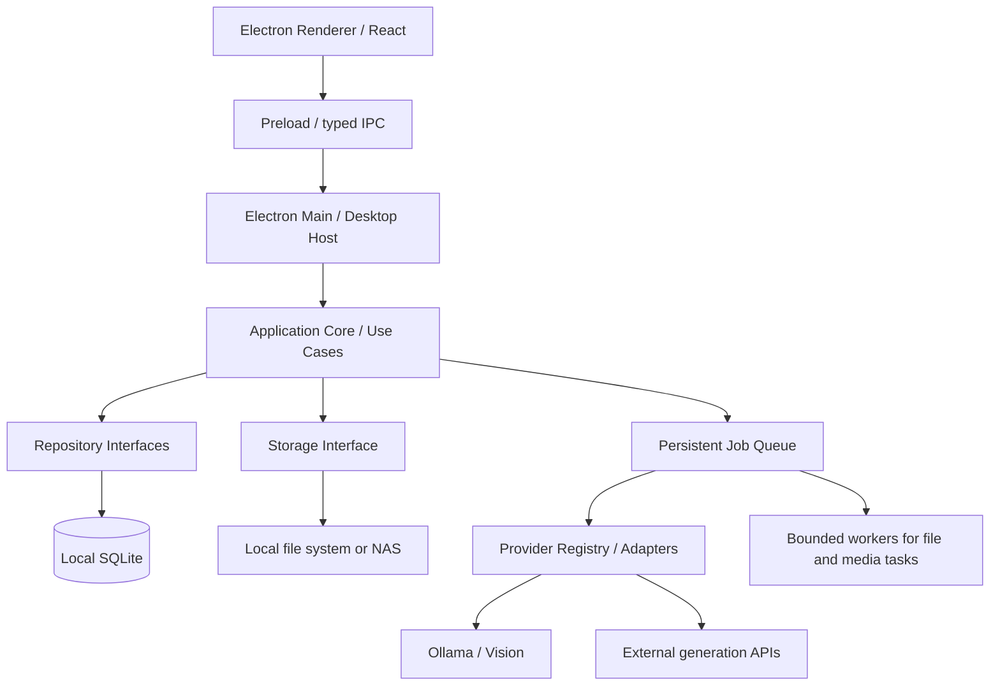

# AssetForge

**Local-first Digital Asset Management & AI Creation Studio**

> Working title · Technical target architecture and development baseline · No implemented application yet

AssetForge is a desktop application for organizing, creating and processing digital assets. It combines cross-project digital asset management with prompt management, AI-assisted image analysis, image generation and, prospectively, 3D generation.

The focus is on the asset as a domain object, not on a single file or a specific AI model. All related references, drafts, generated images, models, textures, prompts and work steps should be traceable in one place. External generators and analysis models are connected through interchangeable providers.

## 1. Goals and Architecture Principles

- **Local first:** Basic asset, project and prompt management works without the cloud, external AI services or a running database server.
- **Server ready:** Services and persistence are separated so that a central server with multiple clients can be added later.
- **Provider independence:** Image generation, image editing, analysis and 3D generation are not tied to a single vendor.
- **Cross-project assets:** An asset can be used in any number of projects without duplicating files.
- **Open file structure:** Files remain accessible in the file system and can be used with Blender, image editors and other tools.
- **Traceability:** Generations, changes, sources, versions and work states are documented.
- **Resource efficiency:** Large files are streamed, previews are loaded on demand and compute-intensive tasks run in the background with limits.
- **Docker-based server development:** All server components required for a development mode run locally via Docker Compose. The Electron UI runs natively on the host.

The first version is designed for single-user operation. Multi-user operation, central authentication and full synchronization are extensions, not prerequisites for the first runnable version.

## 2. Application Modules

| Module | Purpose |
| --- | --- |
| Workspace | Opening, creating, configuring and backing up a data set |
| Projects | Projects, project assignments, priorities and progress |
| Assets | Central management of typed assets and their relations |
| Library | File import, references, gallery, preview and search |
| Workflows | Configurable production steps and work history |
| Prompts | Reusable, versioned prompts and templates |
| Studio | Image generation, image editing and result management |
| AI Analysis | Automatic image description, classification and batch tagging |
| Providers | Configuration of interchangeable AI and generation services |
| Jobs | Background tasks, queues, progress and error handling |
| Settings | Storage, resource limits, providers, integrations and backups |

## 3. Projects and Assets

### 3.1 Projects

A project is an organizational unit, for example a game, a film production or a collection.

A project has, among other things, a name, a description, a status, a preview image and a list of assigned assets. The assignment is an n:m relation. Assets remain independent and also exist without any project assignment.

Example:

```text
Gilded Hour
├── Characters
│   ├── Gabriella
│   └── Linda Carver
├── Landscapes
│   └── San Aurelio Valley
└── Buildings
    ├── Gas station
    └── Motel
```

The structure shown is a logical view, not a physical project directory structure. Another project can reference the same gas station or the same vehicle.

Project-specific data such as priority, intended use, approval status or notes is stored on the project assignment. Global asset data is not overwritten by it. Removing an assignment deletes neither the asset nor its files.

### 3.2 Assets and Asset Types

An asset represents a domain object with a stable ID, independent of the files assigned to it.

Example asset types:

| Type | Possible contents |
| --- | --- |
| Character | People, character designs, views, rigs |
| Creature | Animals, creatures, anatomy and motion references |
| Landscape | Terrain, natural environments, vegetation |
| Building | Architecture, interiors, facades |
| Vehicle | Vehicles, vehicle parts, concepts |
| Prop | Objects, furniture, tools |
| Material | Materials, surfaces, shaders and texture sets |
| Other | Freely classifiable contents |

Asset types should be configurable. A type defines optional type-specific metadata fields, a default workflow, allowed or suggested file roles and its presentation in the UI. The type definition contains no hard-wired provider logic.

An asset has at least an ID, name, type, description, status, and creation and modification timestamps. Optionally it has a cover image, tags, custom metadata, relations to other assets and a workflow.

Relations between assets can be, for example, `uses`, `variant_of`, `part_of` or `derived_from`. A character can thus refer to a separate clothing or material asset.

## 4. Files, References and Versions

Each asset can have any number of files. **Asset type, file type and file role are independent of each other.** A PNG can be an internet reference, a generated draft or a texture.

| File type | Examples |
| --- | --- |
| Image | PNG, JPG, WebP, TIFF |
| Model | BLEND, GLB, GLTF, FBX, OBJ |
| Texture | PNG, TIFF, EXR |
| Document | PDF, TXT, Markdown |
| Other | Any other files |

File roles include `reference`, `concept`, `generated`, `working`, `model`, `texture`, `final` and `other`. Roles are extensible; actual preview capability follows from the file format and the available decoders.

For each file, at least the ID, asset ID, relative storage path, original file name, MIME type, file size, checksum, role and import timestamp are recorded. Where applicable, dimensions, source, license information, tags, generation ID and a predecessor file are added.

### 4.1 Import

- Import of single files, multiple files and entire directories via drag & drop or file dialog.
- Import of internet references including optional URL, author/license information and notes. For URL imports, downloads are controlled and subject to size, time and type limits.
- By default, files are copied into the managed workspace. The original file outside the workspace remains unchanged.
- Identical contents can be detected via SHA-256. Multiple assignment must not cause a file that is used elsewhere to be lost when an asset is deleted. For the MVP, duplicate detection with a user decision is sufficient; physical global deduplication is optional.
- Import status, progress and errors are recorded per file. Failed imports leave no files marked as complete.

### 4.2 Editing and Versioning

Imported originals and finished generation results are not silently overwritten. New variants are separate file entries; their lineage and generation history are preserved.

Working files, for example a BLEND file, can be deliberately mutable. They can be opened directly in external applications. Changes are detected via file system events or a targeted re-check; checksums and previews are updated as needed. An explicit version snapshot can capture a work state.

AssetForge does not have to natively edit or visualize every file. For unsupported formats, metadata, a generic preview and "Open in external application" are available. For Blender files and referenced textures, relative paths and related working files are taken into account; external dependencies must be made visible on export or backup.

Implemented so far (phase 3a): previews (thumbnails and detail previews) exist for six raster MIME types: `image/png`, `image/jpeg`, `image/webp`, `image/tiff`, `image/gif` and `image/avif`. Every other format (for example EXR or BLEND) gets a format tile instead. "Open in external application" and "Show in folder" are offered in the file detail dialog. "Open externally" is refused for files without an extension and for extensions on a block list of programs, scripts and shell-launched document types (for example `exe`, `bat`, `cmd`, `ps1`, `js`, `sh`, `html`, `svg`, `url`, `py`, `lnk`); such files can only be shown in their folder. An asset has a cover file: by default its complete, previewable file with the earliest import (automatic cover), or a file chosen by the user ("Use as cover"; "Use automatic cover" returns to the default). Detaching the chosen file or moving it to another asset falls back to the automatic cover. The asset gallery scrolls endlessly, loads 60 assets per page and offers a grid view and a table view; the chosen view is remembered across restarts.

## 5. Workflows and Production Progress

Workflows are templates configurable per asset type. The application distinguishes:

- **Asset status:** `draft`, `in_progress`, `in_review`, `completed`, `archived`.
- **Workflow steps:** Domain production milestones with an individual state, optional notes and assigned result files.
- **Job status:** Technical execution state of an AI or file operation, independent of production progress.

Example of a character workflow:

1. Asset created
2. References collected
3. References prepared / generated reference images created
4. Character views generated (front, back, side, 3/4)
5. 3D model created
6. Retopology completed
7. Textures / materials created
8. Rigging completed
9. Approved

Example for a landscape: references → concept images → terrain → materials → vegetation and details → approval.

Steps can be mandatory or optional, skipped, reopened or worked on in parallel. By default, progress is derived from completed mandatory steps. A successful generation job must not automatically mark a domain step as approved. A manual confirmation or an explicitly configured rule is required.

Workflow templates and their versions are kept separate from concrete workflow instances. A later change to a template must not silently alter running or completed workflows. Project-specific approvals remain independent of the global asset workflow; project-specific variants can be modeled as linked assets.

Implemented so far (phase 2b):

- **Step states:** `not_started`, `in_progress`, `done`, `skipped`. Only optional steps can be skipped. Any step can be reopened; steps have no enforced order, so they can be worked on in parallel. A step stores when it was completed; reopening clears that. Each step has free-text notes.
- **Progress** is the number of done mandatory steps out of all mandatory steps. It is shown on the asset and in the asset list. Asset status and step states never change each other.
- **Built-in templates** (Character, Landscape, Object, Material, Basic) are defined in code with a stable key and a version number. Opening a workspace adds missing templates and missing versions and sets the default template of asset types that have none; existing rows are never changed. A changed template therefore ships as a new version number in code.
- **Instances** refer to one template version and have step rows that reference that version's step definitions. Template versions and their step definitions are never changed after they are written, so later template versions do not touch running workflows. An asset has at most one workflow. A new asset starts the default workflow of its type; a workflow can also be started from any template and removed again (with confirmation), which deletes its step states and notes but nothing else.

Not built yet: a template editor and user-defined templates, moving a running workflow to a newer template version, result files assigned to steps, and rules that complete a step automatically.

## 6. AI-Assisted Analysis and Tagging

Image analysis is connected through an interchangeable vision provider. The first provider is intended to be **Ollama with a vision-capable model**. Ollama can be used both through a local Docker service and through a configurable external instance. Pure asset management does not require a running Ollama service.

### 6.1 Batch Processing

The user can queue single images, a selection, entire assets or all not-yet-analyzed images for analysis. A batch creates individual persistent jobs so that partial failures, resumption, cancellation and progress per image are possible.

The analysis uses a bounded preview suitable for the model instead of always transferring the full original. The original remains unchanged. Results are validated against a structured schema, normalized, and in the case of invalid responses treated as an error or as a reviewable suggestion.

Example of an analysis result (illustrative):

```json
{
  "description": "Exterior reference of a roadside service station at dusk.",
  "tags": ["building", "service station", "roadside", "dusk", "exterior"],
  "suggestedAssetType": "Building",
  "view": "three-quarter",
  "style": "photorealistic"
}
```

Tags are supported at both file and asset level. File tags can be aggregated as suggestions for tagging the asset. Manual and AI-generated tags remain distinguishable; repeated analyses do not overwrite manually maintained tags. Source, model, analysis timestamp and, where applicable, review status are stored.

A fingerprint of file content, provider/model identifier and analysis template version makes it possible to skip already analyzed contents when the configuration is unchanged. A re-analysis must be deliberately triggerable.

### 6.2 Search

The MVP supports full-text search over names, descriptions, prompts and tags, as well as filters for project, type, status, role and file format. SQLite FTS5 is intended for local full-text search. Semantic search via embeddings is a later, optional extension; a separate vector database service is not required to begin with.

## 7. Prompt Management and Generation Studio

### 7.1 Prompt Library

Prompts are independent objects that can be created and reused independently of assets and projects. They have a title, description, tags, content, optional negative prompts and parameters or variable definitions. Changes can be stored as immutable prompt versions.

Example of a template:

```text
Photorealistic full-body character reference of {{character}},
{{view}} view, neutral lighting, consistent pose and proportions.
```

A generation stores the prompt version used **and** the actually resolved prompt. This keeps older results traceable even after a template has changed.

### 7.2 Generation Studio

The studio allows selecting a provider and a model, assigning the generation to an asset, using reference images and configuring the parameters that are actually supported. Results can be adopted as a draft, a new variant or a final file. A result that is not yet assigned is managed in a workspace inbox until it is assigned to an asset or discarded.

A generation receives a permanent ID and documents:

- provider, model and, where available, model version;
- prompt version, resolved prompt and negative prompts;
- input files including version or checksum;
- effectively submitted parameters such as seed, resolution, steps and guidance, where supported;
- technical job ID, status, timestamps, output files and errors;
- cost or usage, provided the provider supplies reliable figures.

The goal is traceability, not a guarantee of pixel-identical reproduction with external, changing models. Credentials are never stored in the generation history.

## 8. Provider Architecture

Providers implement individual capabilities instead of one universal interface with many empty methods. The UI queries the capabilities and parameter metadata of a model and hides unsupported functions.

| Capability | Purpose |
| --- | --- |
| `vision` | Image description, tags and classification |
| `text_generation` | Prompt creation and optimization |
| `text_to_image` | Image generation from text |
| `image_edit` | Image editing with one or more reference images, without a mandatory mask |
| `inpainting` | Mask-based editing |
| `upscaling` | Resolution increase |
| `image_to_3d` | 3D generation from image references |
| `text_to_3d` | 3D generation from text |
| `embeddings` | Optional semantic search |

Illustrative adapter mapping: Ollama for vision/text, Seedream via a suitable API vendor for image editing, RunPod endpoints for custom models and Tripo3D for 3D generation. Concrete APIs, models, parameters and availability must be verified at implementation time.

Provider configuration comprises base URL, authentication reference, timeouts, concurrency limit, model configuration, capabilities and an optional cost limit. Differences between synchronous APIs and asynchronous job APIs are encapsulated in the adapter. External job IDs are stored persistently; polling uses backoff and avoids unnecessary requests.

A new provider must not require a change to the asset data model. Provider-specific parameters are stored as validated, versioned extra data. No provider has direct access to the database or to arbitrary workspace paths.

## 9. Persistence and Storage

### 9.1 Basic Decision

**Metadata in a relational database; physical assets in the file system; technical caches separate.** Large binary files are not stored as database BLOBs.

When creating a workspace, the user can select a local folder or a NAS/SMB share. The storage path is managed as a workspace setting. Database entries contain a storage ID and relative paths, not immutably baked-in absolute Windows paths.

### 9.2 Workspace Directory

```text
AssetForge-Workspace/
├── workspace.json                  # ID, format version, no credentials
├── assets/
│   └── <asset-uuid>/
│       ├── references/
│       │   └── <file-uuid>_reference.jpg
│       ├── generations/
│       │   ├── <file-uuid>_front.png
│       │   └── <file-uuid>_back.png
│       ├── models/
│       │   └── <file-uuid>_character.blend
│       ├── textures/
│       │   ├── <file-uuid>_albedo.png
│       │   └── <file-uuid>_normal.png
│       └── miscellaneous/
├── inbox/                          # Files not yet assigned
├── exports/
└── .assetforge/
    └── staging/                    # Temporary, recoverable transfers
```

Asset directories have stable IDs; renaming an asset or project does not change any paths. Every managed file is named `<file-uuid>_<sanitized original name>`, in the inbox as well as inside an asset directory, so two files with the same original name never collide. Related 3D working files keep a sensible internal directory structure. File name and role changes are handled as controlled operations, not through uncoordinated file moves.

The role of a file decides its directory inside the asset folder:

| File role | Directory |
| --- | --- |
| `reference`, `concept` | `references/` |
| `generated` | `generations/` |
| `model`, `working` | `models/` |
| `texture` | `textures/` |
| `final`, `other` | `miscellaneous/` |

A file without an asset lies in `inbox/` and has no role. Attaching a file to an asset, changing its role and detaching it back to the inbox each move the file to the path that follows from this table (§9.4).

A storage abstraction encapsulates resolving, reading/writing as streams, listing, moving, existence checks and deletion. File system adapters (local/SMB) are sufficient for the MVP. A future object storage adapter must support downloads into a local working directory; an object storage key is not a local Blender file path.

### 9.3 Local Application Data

```text
<electron-userData>/AssetForge/      # Schematic, actual path via Electron API
├── settings.json                   # Local settings and workspace registry
├── credentials/                    # Only OS-protected encrypted values
├── workspaces/
│   └── <workspace-uuid>/
│       └── assetforge.sqlite       # Local workspace database
├── cache/
│   ├── thumbnails/
│   └── previews/
└── logs/
```

The application determines OS-conformant paths instead of hard-coding `%APPDATA%` or other platform-specific paths. Local caches can reside on a suitable fast drive. `cache/thumbnails` and `cache/previews` exist (phase 3a); their entries are keyed by the content checksum of the file (§15.1), so they can be deleted at any time and are regenerated on demand. There is a separate database per workspace; this allows a workspace to be backed up independently.

SQLite stays on a **local file system**, even when the assets reside on a NAS share. A shared SQLite database on SMB is not intended. One active writing local client per workspace applies. A second workstation with a separate local database must not write to the same workspace in an uncoordinated way. NAS files alone are not database synchronization.

For later multi-user operation, a central API server takes over write coordination and PostgreSQL handles persistence. Both modes use shared domain logic, but each with its own suitable database adapters and migrations. The Electron UI never accesses a remote PostgreSQL instance directly.

### 9.4 Consistency and Backup

File system and database do not form a joint atomic transaction. Import and generation operations therefore need a restartable flow: database entry in pending state, write to staging, checksum verification, transfer within the same storage volume, then commit of the final state. Incomplete transfers are detected at the next start and either resumed or deliberately cleaned up.

Moving a managed file (attach to an asset, role change, detach) follows the same idea with a move intent: a `file_move` row with the target path, asset and role is written first, then the file is moved within the storage, then the file row is updated and the intent deleted in one transaction. An existing target is never overwritten. When a workspace is opened, every remaining intent is repaired: if the target exists and the source (the file row's current path) is gone, the move happened and is committed; in every other case the intent is discarded and neither the file row nor either file is touched.

Deletion is initially logical or goes through a trash. Physical deletion checks all references and happens only after a successful metadata update and a defined recovery period. Unreachable storage must be distinguished from files that are actually missing.

Removing a workspace requires a confirmation in a native dialog owned by the main process. It deletes the registry entry and the local database of that workspace. The workspace folder stays untouched unless the user explicitly chooses to move it to the operating system trash; it is never deleted permanently by the application, and only a folder that still holds the manifest of exactly this workspace is moved. If moving to the trash fails, nothing is removed. A folder that was kept can be opened again later as an existing workspace; its catalog then starts empty until re-indexing exists.

Backup and restore must treat the database, workspace manifest and managed files as one consistent state. To this end, write jobs are coordinated, a consistent SQLite backup is created and the file manifest/checksums are backed up along with it. Mutable external working files must not be written to unnoticed during the snapshot. Caches, temporary files and credentials are not part of the regular workspace backup. For server mode, a correspondingly coordinated PostgreSQL backup is necessary.

A restore validates manifest, format version and checksums and must not overwrite existing workspaces without asking. Moving a workspace changes the storage configuration, not the domain IDs.

## 10. Relational Data Model

The following model is a starting point and not a finished SQL schema. IDs are modeled as stable UUIDs; referential integrity, suitable unique constraints, indexes and schema migrations are part of the implementation.

| Entity | Purpose / central relations |
| --- | --- |
| Workspace | Identity, format version, storage configuration |
| Project | Project metadata |
| AssetType | Type definition, metadata schema, default workflow |
| Asset | Domain asset, belongs to a type and a workspace |
| ProjectAsset | n:m link, project-specific priority and approval |
| AssetRelation | Typed relation between two assets |
| AssetFile | File, storage key, type, role, checksum, origin and metadata |
| FileVersion / FileRelation | File lineage and versions of mutable working files |
| Tag | Normalized tag with display name |
| AssetTag / FileTag | n:m assignment, manual or AI origin |
| AnalysisResult | Model, analysis version, structured results |
| WorkflowTemplate / WorkflowStepDefinition | Versioned production template and steps |
| AssetWorkflow / AssetWorkflowStep | Concrete production state and step status |
| Prompt / PromptVersion | Reusable prompt templates and versions |
| Provider / ProviderModel | Configuration and capability metadata, no plaintext secrets |
| Generation / GenerationInput / GenerationOutput | Generation, inputs used and result files |
| Job / JobAttempt | Persistent tasks, execution attempts and external job IDs |
| ActivityEvent | Domain change history |

Implemented so far (phases 1 and 2), as tables: `workspace`, `storage` (the storage a file row refers to by ID), `asset_type` (built-in types with a default workflow template, no metadata schema yet), `asset`, `project`, `project_asset`, `asset_relation`, `file` (the AssetFile entity: storage ID, relative path, optional asset and role, checksum), `file_move` (move intents, §9.4), `workflow_template`, `workflow_template_version` and `workflow_step_definition` (the WorkflowTemplate / WorkflowStepDefinition entities), and `asset_workflow` and `asset_workflow_step` (one workflow per asset, each step row references a step definition of the template version the workflow refers to). Phase 3a adds `asset.cover_file_id` (the cover file chosen by the user, null for the automatic cover; cleared when the file is deleted, detached or moved to another asset). Everything else in the table above does not exist yet.

Particularly important indexes: project assignments, asset type and status, file-to-asset assignment, tags, checksums, job status and job start time. Project-asset assignments and normalized tag assignments must not contain unintended duplicates. Type-dependent metadata can additionally be stored as validated JSON; regularly filtered core fields remain relational columns.

## 11. Application Architecture

A modular monolith with clearly separated domain services is sufficient for the first version. Microservices and additional infrastructure are introduced only when there is a concrete need.



Renderer and preload contain no domain persistence logic. The main process provides controlled IPC operations and delegates to the application core. Longer CPU-intensive or blocking tasks run in bounded worker threads or separate processes; they block neither the renderer nor the main event loop.

In the later server mode, the same core is hosted in an API process. The desktop host then uses an API client instead of the local use cases for the workspace in question. Only the server accesses PostgreSQL and managed storage. Editing remote files locally requires defined checkout/download and return operations; no silent write-back from arbitrary clients.

## 12. Proposed Technology Stack

| Area | Technology / approach |
| --- | --- |
| Desktop | Electron, TypeScript |
| Frontend | React, Vite, Tailwind CSS, shadcn/ui |
| Domain logic | Platform-neutral TypeScript core |
| Local persistence | SQLite, preferably better-sqlite3 with Drizzle ORM |
| Later server persistence | PostgreSQL with its own Drizzle adapter |
| API server (optional) | Node.js / Fastify |
| Validation | Zod, typed DTOs |
| File operations | Node.js Streams / File System API |
| Image previews | Sharp, with decoder and memory limits |
| 3D preview | Three.js, loaded on demand; initially GLB/glTF |
| Background tasks | Persistent DB-based queue and bounded workers |
| Search | SQLite FTS5; server-side search concept separate |
| Secret storage | Electron safeStorage or OS credential backend |
| Packaging | electron-builder or a comparable packager |
| Development | Monorepo, pnpm workspaces, Docker Compose |
| Tests | Vitest, integration and Electron E2E tests |

Exact versions are checked together for compatibility at project initialization and pinned via lockfile and reproducible container image tags. Native Electron modules (in particular SQLite and image processing) must be built and tested for the respective Electron ABI and target platform. No currently verified library compatibility is claimed.

## 13. Repository Structure

```text
assetforge/
├── apps/
│   ├── desktop/              # Electron main, preload and React renderer
│   └── api/                  # Optional server host (later / server profile)
├── packages/
│   ├── core/                 # Domain, use cases, port interfaces
│   ├── contracts/            # DTOs, Zod schemas, IPC/API contracts
│   ├── persistence/          # SQLite, later PostgreSQL, migrations
│   ├── storage/              # Local and NAS-capable storage adapter
│   ├── providers/            # Vision, image and 3D providers
│   ├── jobs/                 # Queue, scheduler, retry, worker contracts
│   ├── media/                # Metadata, thumbnails, preview
│   └── ui/                   # Shared UI components
├── docker/                   # Dockerfiles and service configuration
├── tests/                    # Integration and E2E tests, small fixtures
├── compose.yaml
├── .env.example
├── pnpm-workspace.yaml
└── README.md
```

Core and contracts must not depend on Electron, a concrete provider or a concrete database implementation. Dependencies are composed in the desktop or server host.

## 14. Local Docker Development Environment

Electron stays on the host in order to make sensible use of native windows, file dialogs, drag & drop, the file system and external desktop applications. **During development, server components run exclusively locally in Docker**, to the extent they are needed for the respective profile. External generation APIs are used only for deliberately triggered integration tests or real generations.

### 14.1 Compose Profiles

| Service / profile | Purpose | Activation |
| --- | --- | --- |
| `ollama` / `ai` | Local vision and text models | Only for local AI development |
| `mock-provider` / `mock` | Simulated provider API with deterministic results and failure cases | For reproducible development and integration tests |
| `postgres` / `server` | Database for the later server mode | Only in the server profile |
| `api` / `server` | Optional central API host | Only in the server profile |

Standard development starts with Electron and SQLite. This requires no permanently running Docker service. An activated AI service or mock provider runs in Compose. Once the central server mode is implemented, API and PostgreSQL run together in the local Compose server profile. Redis, MinIO, Kubernetes and separate observability stacks are not required initially.

All server services get health checks, persistent data volumes where required, configurable resource limits and a clean shutdown strategy. Host ports are bound only to `127.0.0.1` where needed. Containers communicate within the Compose network via service names; Electron uses the published host ports. Database ports stay internal unless a local debug configuration explicitly needs them.

- Ollama models reside in a persistent Docker volume, not in the source code and not in short-lived container layers.
- In the server profile, PostgreSQL data resides in its own volume; no SQLite database file is mounted on SMB.
- The API container receives only the required workspace mounts with appropriate write permissions. Other containers, in particular model servers, do not get full workspace access.
- Production data and development data are kept separate. Tests use a temporary test workspace and small fixtures.
- GPU access is optional and requires a compatible host/Docker configuration, for example Windows with WSL2 and NVIDIA GPU support. CPU operation must be possible as a separate mode without requiring a GPU.

### 14.2 Planned Development Commands

The following commands are target conventions. They only work once the Compose file, services and package scripts are implemented in the repository.

Already working (phase 1, no Docker needed): `pnpm install`, `pnpm dev`, `pnpm test`, `pnpm typecheck`, a single test via `pnpm --filter @assetforge/<package> test <file> -t "<name>"` (without a `--` separator, which pnpm would pass on literally and thereby disable the filter), and `pnpm --filter @assetforge/persistence db:generate`. The persistence and desktop tests run under Electron's Node because of the better-sqlite3 ABI. Only the Docker Compose commands below are still planned.

```bash
pnpm install

# Desktop / local-first: SQLite on the host
pnpm dev

# Optional: deterministic mock provider in local Docker
docker compose --profile mock up -d

# Optional: Ollama in local Docker
docker compose --profile ai up -d

# Later: central API host and PostgreSQL in local Docker
docker compose --profile server up -d

# Tests and cleanup
pnpm test
docker compose --profile ai --profile mock --profile server down
```

`down` should preserve persistent volumes by default. Deleting model data or database volumes is a separate, explicitly destructive operation.

Configuration is done via `.env.example` and local, non-committed `.env` files. Intended variables are, for example, `OLLAMA_BASE_URL`, `MOCK_PROVIDER_BASE_URL`, `ASSETFORGE_API_URL`, `ASSETFORGE_WORKSPACE_PATH` and, on the server side, `DATABASE_URL`. Real credentials do not belong in Git, example configurations or container images.

## 15. Resource Usage and Performance

Resource consumption is an architectural characteristic and not merely a later optimization task. The application should remain usable even with large libraries while Blender, other desktop applications or local AI models are used in parallel.

### 15.1 UI and File System

- Gallery and list views are virtualized and loaded page by page; never decode all original images of a library at once or transfer them to the renderer.
- Preview images are generated on request, cached persistently and keyed by the file's SHA-256, the preview size and a preview format version — never by file ID — so identical content shares a preview and a changed file never shows a stale one.
- By default, small gallery thumbnails (e.g. 256 px) and larger detail previews (e.g. 1024 px). Original images are loaded only for an explicit detail view or for processing.
- Large imports, downloads, hash computations and exports use streams with backpressure. No unnecessary Base64 for large IPC transfers; encoding that a provider specifically requires stays confined to individual bounded jobs.
- Media is provided to the renderer through a controlled internal protocol or suitable bounded streams. No unrestricted `file://` access.
- The 3D viewer is initialized only when needed. Geometries, materials and textures that are no longer visible are released; unnecessary render loops are paused.
- No permanent full workspace scans. Changes are processed in a targeted, debounced way with a periodic or manual consistency check. Network file systems need a fallback for unreliable watchers.
- Search queries are debounced, paginated and index-backed. Database transactions stay short; long file or API operations take place outside DB transactions.

### 15.2 Jobs and Workers

All longer operations are executed as persistent tasks, for example import, thumbnail creation, batch tagging, generation, download and backup. The queue distinguishes `queued`, `running`, `waiting_remote`, `succeeded`, `failed`, `cancelled` and, where applicable, `retry_wait`.

The scheduler uses separate limits for CPU, I/O, local GPU and remote API tasks. Batches are not executed fully in parallel. User interactions take priority over non-urgent maintenance tasks. Network and provider errors are handled with bounded retries and exponential backoff; permanent errors are not retried endlessly.

On restart, active jobs are checked against stored information. Local operations are resumed idempotently or marked as failed; for remote generations, the stored provider job is queried first. Paid jobs that are not unambiguously finished are not automatically resubmitted unless the vendor guarantees reliable idempotency.

Cancelling terminates the actual operation where possible. Remote jobs that cannot be cancelled are shown as such and are not falsely reported as stopped at the vendor. A clean shutdown stops accepting new jobs, persists intermediate states and closes resources in a controlled manner.

### 15.3 Conservative Starting Values

These values are configurable development defaults and not measured performance requirements. They must be profiled on the target hardware and with real models.

| Resource | Proposed default |
| --- | --- |
| CPU / thumbnail workers | 2 concurrent (implemented constant; a job times out after 30 s) |
| File imports / downloads | 2–4 concurrent, with a bounded buffer |
| Local vision / GPU jobs | 1 concurrent per configured GPU resource pool |
| Remote generations | 2 concurrent per provider, plus a global limit |
| Thumbnail cache | 2 GiB, LRU cleanup (implemented constant, not yet configurable) |
| Detail preview cache | 2 GiB, LRU cleanup (implemented constant, not yet configurable) |
| Gallery page size | 60 entries (implemented constant) |
| API container in the server profile | Starting value 1 vCPU / 512 MiB RAM |
| PostgreSQL in the server profile | Starting value 1 vCPU / 512 MiB–1 GiB RAM |
| Mock provider | Starting value 0.5 vCPU / 256 MiB RAM |
| Ollama | Separate profile; RAM, GPU offload and model size depend on the selected model |

The Docker CPU/RAM limits apply in addition to host-side worker limits and are configured via Compose. GPU VRAM is not limited by normal container RAM limits; local AI therefore needs its own scheduling and model configuration. API and PostgreSQL are not started permanently when local mode does not need them.

With Ollama, model switching, model load state, concurrency, context size and keep-alive should be controlled deliberately. A model does not have to remain permanently in VRAM when the application does not currently need it. With a GPU such as the RTX 4080 Super (16 GB VRAM), a single local inference job is recommended to begin with; Blender or AI workloads running in parallel must be taken into account. The actual model choice remains a setting and is tested against the available memory.

### 15.4 Measurability

To be measured: startup time, idle CPU and memory consumption, main process response time, gallery scrolling behavior, search latency, cache size, queue throughput and error rate. For server components, structured logs, health checks and, if needed, a metrics endpoint are provided. No separate monitoring stack for the MVP.

For reproducible load tests, a synthetic workspace with many files and metadata is used; tests must also work with large images, an unreachable NAS, interrupted downloads and provider rate limits. Concrete performance SLAs are defined only after baseline measurements.

## 16. Security and Privacy

- Renderer with `contextIsolation`, disabled Node integration and sandbox, as far as compatible with the application. Preload exposes only narrowly scoped, typed IPC operations; arguments and senders are validated.
- Paths, file names, archive imports, symlinks and junctions are checked. Storage operations must not break out of the intended workspace. External file contents and model responses are untrusted.
- The `assetforge-media://` protocol serves only cached previews (`assetforge-media://preview/<file id>?size=thumb|detail`, WebP); every malformed or unknown request is a bare 404 and originals are never served through it. "Open externally" never opens files on the block list (§4).
- Image decoders get size/pixel limits; large or corrupt files are rejected in a controlled manner. No automatic execution of imported scripts, HTML contents or programs.
- API keys are stored via the OS-backed secret backend and decrypted only in the responsible host/provider layer. If no suitable secret backend is available, no silent plaintext fallback is used. Server mode uses separate server-side secret configuration.
- Private provider base URLs (e.g. local Ollama) are explicitly configurable. Arbitrary internet reference downloads, by contrast, must not unintentionally reach internal services. Redirects, addresses, protocols and limits are checked accordingly.
- Before reference images are sent to external providers, it is visible which vendor receives the data. By default, local tagging sends images only to the selected local Ollama instance.
- API keys, tokens, complete sensitive payloads and internal paths are not logged unnecessarily. There is no cloud telemetry by default. Paid provider operations must be triggered deliberately; retries and batch size are limited.
- A later central server needs authentication, authorization, access controls and TLS appropriate to its deployment scenario. Local development bindings are no substitute for production hardening.

## 17. Development Phases and Acceptance Criteria

| Phase | Content | Acceptance criterion |
| --- | --- | --- |
| 1 – Foundation | Electron, workspace, SQLite, storage, migrations | Create, close and reopen a workspace; file import and metadata are preserved. |
| 2 – Asset Management | Projects, types, roles, asset relations, workflows | Use one asset in several projects; remove assignments without losing files; trace status. |
| 3 – Library | Gallery, thumbnails, tags, search, filters, external files | Search a large library without loading all originals; open a BLEND file externally. |
| 4 – AI Analysis | Docker Ollama, vision adapter, persistent jobs, batch tagging | Start, interrupt and resume a batch; manual tags are preserved. |
| 5 – Prompts & Studio | Prompt versioning, provider registry, mock API, first real image provider | Run a generation with reference images and permanently associate prompt, parameters and result. |
| 6 – Reliability & Export | Backup, restore, storage errors, versions, limits, tests | Consistent restore to a new local path; handle NAS outages and job restarts without silent data loss. |
| 7 – Extensions | 3D preview, 3D providers, additional models, embeddings | Integrate optional features without changing existing assets or other providers. |
| 8 – Server Mode | API, PostgreSQL, local Docker integration, multi-user concept | Several clients use the same central data set with controlled write access. |

Tests for storage consistency, migrations and job restart begin as early as phase 1. A rudimentary backup concept is required from the first persistent version onward; the full backup/restore workflow and failure-case tests are accepted in phase 6. Phases 7 and 8 are deliberately not part of the initial MVP.

## 18. Open Decisions

- Final product name and trademark availability; AssetForge is a working title.
- First concretely supported vision and image generation models and their API contracts.
- Exact UI for configurable asset types, metadata fields and workflow templates.
- Whether physical deduplication across multiple assets is needed after the MVP.
- Handling of complex external working-file dependencies and optional checkouts in server mode.
- Concrete platform support beyond the initial desktop development target and the associated build pipeline.
- Selection and versioning of libraries, concrete container limits and performance targets after measurements.
- License of the application and any commercial use of the connected providers.

---

**Summary:** AssetForge combines an open, cross-project asset library with versioned prompts, configurable production workflows and interchangeable AI providers. Desktop operation stays local and resource-friendly. Server services needed for development are run reproducibly via local Docker Compose profiles; a central server can be added later without tying the core to external infrastructure.
